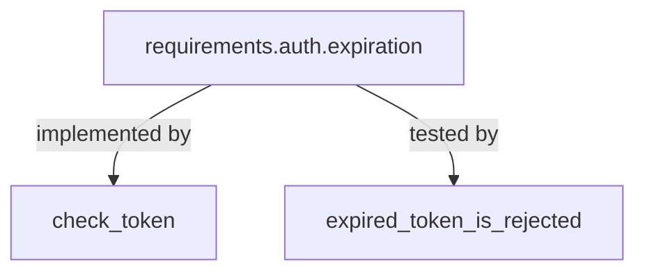

# Deconstructing Habeas

This chapter is for the implementer of a tool like Habeas. We start with the
Habeas you already know and ask how to express its verification work as a graph.
A node identifies a thing: a requirement, a function, a test, or a GitHub issue.
The application can ask several questions about the same node. Each validation
value identifies a criterion and supplies its execution procedure. The SDK
tracks and reuses each criterion's answer independently.

## Start with one requirement and its inputs

Suppose the application's specification contains this requirement in
`md/requirements/auth.md`:

```markdown
:::{req} expiration
The application MUST reject all expired tokens. A token is expired when the
current time is greater than or equal to its expiration time.
:::
```

With `md/` as the book's source directory, this declaration is named
`requirements.auth.expiration`. Here is a small implementation and test,
reduced to the expiration check:

```rust
// {impl}`requirements.auth.expiration`
fn check_token(expires_at: u64, now: u64) -> bool {
    now < expires_at
}

// {test}`requirements.auth.expiration`
#[test]
fn expired_token_is_rejected() {
    assert!(check_token(100, 99));
    assert!(!check_token(100, 100));
    assert!(!check_token(100, 101));
}
```

The `{impl}` comment identifies `check_token` as an implementation reference. The
`{test}` comment selects `expired_token_is_rejected` as a test input.

To assess this requirement, Habeas starts an agent with the requirement text
and the test function. The agent judges whether the tests adequately check the
requirement, and can request implementation source to answer a specific
question.

## SDK Perspective: obligations as a graph

The SDK represents things as nodes in a graph. A node has identity and contents;
the application chooses which criteria, if any, to verify for it. Each criterion
has its own inputs and saved evidence. The application defines how contents are
fetched and how each criterion is executed.

In our example, the requirement `requirements.auth.expiration` has a node, as does the Rust function `check_token` and the Rust test `expired_token_is_rejected`. The source for the requirement is the requirement text itself (*"The application MUST..."*). The source for the Rust nodes are their source content. These 3 nodes are connected by labeled edges, like so:



Edges make related nodes available to the validation process. The callback
receives a context identifying `requirements.auth.expiration`; it explicitly
chooses which contents to read or insert into each agent call. Habeas can insert
the requirement and `Tests` successors while leaving implementation source to
later requests. The SDK records those reads and the outgoing selections the
procedure observes. If a relevant part of a recorded input changes, the saved
validation becomes stale. CI reports the stale result; authoring can rerun the
validation. Fingerprints determine which changes count as relevant.

## Defining the application domain

The application defines its own domain by implementing `Domain`. This trait
combines three subtraits that capture different aspects of the domain.
Validation is implemented by the values submitted to a validator:

:::{req} domain
The SDK MUST expose a `Domain` trait with a blanket implementation and a number of subtraits that cover disjoint aspects of defining an application domain:

```rust,ignore
/// Every validation uses a domain with graph access, fingerprints, and storage.
///
/// Concurrent validations can share a domain by reference. Each validation
/// has its own dependency trace; operations within it share that trace safely.
/// Agent calls retain independent conversation and submission state.
/// Observations never leak between separate validations.
pub trait Domain: Graph + Fingerprinting + EvidenceStorage {}

impl<T: Graph + Fingerprinting + EvidenceStorage> Domain for T {}

pub trait Graph {
    // Defines the verification graph, including
    //
    // * Nodes: verifiable constructs
    // * Edges: inputs to verification
    // * NodeContent: the application-defined contents supplied by a node read
    /* ... members defined in the Graph chapter ... */
}

pub trait Fingerprinting: Graph {
    // Defines which changes to input contents matter for validation.
    /* ... members defined in the Fingerprinting chapter ... */
}

pub trait EvidenceStorage: Graph {
    // Defines how evidence is stored and loaded.
    /* ... members defined in the Evidence storage chapter ... */
}
```
:::

The domain traits and the separate validation interface have their own chapters:

| Trait | Purpose |
| --- | --- |
| [Graph](sdk/graph.md) | What nodes and edges represent, and how to obtain their contents and relationships. |
| [Validation](sdk/graph/validation.md) | A criterion's identity, result type, and execution procedure. |
| [Fingerprinting](sdk/graph/fingerprinting.md) | What parts of a node's contents are significant. |
| [EvidenceStorage](sdk/graph/evidence.md) | Where and how evidence is saved. |


## Building blocks

The SDK also provides building blocks that applications can reuse for common
functionality. The linked chapters describe each one:

| Chapter | What it provides |
| --- | --- |
| [Source providers](sdk/sources.md#the-application-supplies-a-source-provider) | Resource access, including a filesystem provider. |
| [Parsing and outlining](sdk/sources.md#register-the-languages-that-interpret-those-resources) | Language-aware source structure and selectors for individual items. |
| [Context tools](sdk/graph/context-tools.md) | Source discovery and tracked content reads. |
| [Structural fingerprints](sdk/graph/fingerprinting.md#fingerprint-the-structure-and-version-the-rules) | Change detection based on source structure. |
| [Agent calls](sdk/graph/agent-calls.md) | Prompt construction, tracked tools, and typed results. |
| [Evidence storage helpers](sdk/filesystem-storage.md) | Filesystem persistence for SDK evidence records. |


## Putting it all together

The [Habeas CLI definition](sdk/habeas.md) defines the `habeas` CLI workflow in
terms of the SDK, providing an example of how to use these traits and building
blocks together.
