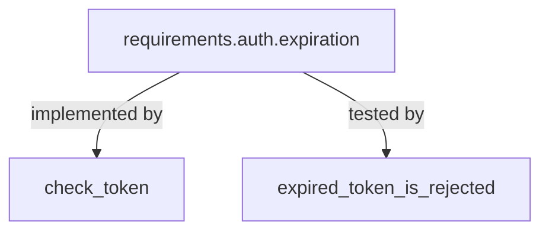

# Deconstructing Habeas

This chapter is for the implementer of a tool like Habeas. We start with the
Habeas you already know and ask how to express its verification work as a graph.
A node identifies a thing: a requirement, a function, a test, or a GitHub issue.
The application defines what it means for that thing to be valid and supplies
the procedure that checks it. The SDK is parametric over that definition of
validity.

## Start with one requirement and its inputs

Suppose the application's specification contains this requirement in
`md/requirements/auth.md`:

```markdown
:::{req} expiration
The application MUST reject all expired tokens. A token is expired when the
current time is greater than or equal to its expiration time.
:::
```

With `md/` as the book's source directory, this declaration is named
`requirements.auth.expiration`. Here is a small implementation and test,
reduced to the expiration check:

```rust
// {impl}`requirements.auth.expiration`
fn check_token(expires_at: u64, now: u64) -> bool {
    now < expires_at
}

// {test}`requirements.auth.expiration`
#[test]
fn expired_token_is_rejected() {
    assert!(check_token(100, 99));
    assert!(!check_token(100, 100));
    assert!(!check_token(100, 101));
}
```

The `{impl}` comment selects `check_token` as an implementation input. The
`{test}` comment selects `expired_token_is_rejected` as a test input.

To assess this requirement, Habeas starts an agent with the requirement text,
the implementation function, and the test function. The agent judges whether
the implementation and test satisfy the requirement.

## SDK Perspective: obligations as a graph

The SDK generalizes this concept by representing things as nodes in a graph. Each node plays a dual role. It represents some *noun* -- a thing, concept, whatever -- which both *has a source* and *must be validated*.  The SDK is not opinionated about how that source is fetched nor about how that validation takes place, that is defined by the application.

In our example, the requirement `requirements.auth.expiration` has a node, as does the Rust function `check_token` and the Rust test `expired_token_is_rejected`. The source for the requirement is the requirement text itself (*"The application MUST..."*). The source for the Rust nodes are their source content. These 3 nodes are connected by labeled edges, like so:



Edges indicate *(root) inputs* to the validation process. So the validation procedure for `requirements.auth.expiration` will be given the `check_token` and `expired_token_is_rejected` nodes as inputs. If a relevant part of an input changes, the saved validation becomes stale. CI reports the stale result; authoring can re-execute the validation. Fingerprints, introduced in the graph chapter, determine which changes count as relevant. Note that these are the *root* inputs: the validation procedure may fetch additional inputs in which case they too are added to the input set.

## Follow the abstraction into the SDK

The [graph chapter](sdk/graph.md) explains node identities, application-defined
validation, tracked inputs, and saved judgments. It treats each node's contents
as something the application can supply; parsing source code is not needed to
understand that model.

The [sources chapter](sdk/sources.md) then supplies a reusable implementation for
source inspection. An application provides resources and registers languages;
the SDK offers parsing, outlines, and searches. Each language has its own page.

Finally, [putting it together in Habeas](sdk/habeas.md) follows authoring and CI
through both the SDK machinery and Habeas's application policy.
