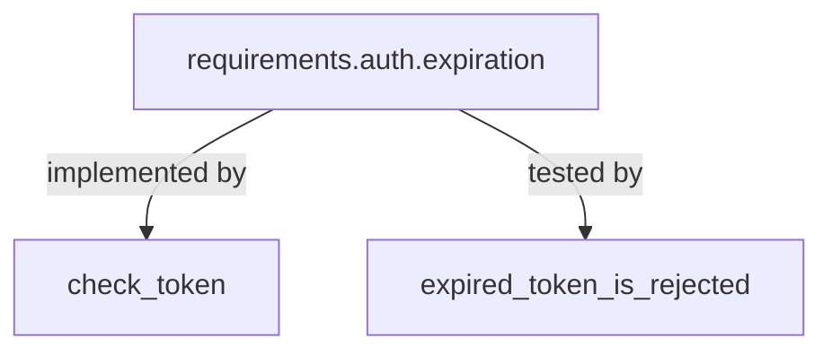

# The trust-but-verify SDK

The trust-but-verify SDK (TBV) supplies tracked criterion execution and
configured agents for an application-defined graph. Habeas Codicem (HC), the
mdBook and requirements tooling, is one application of it.
A node identifies a thing: a requirement, a function, a test, or a GitHub issue.
The application can ask several questions about the same node. Each
{term}`requirements.sdk.graph.validation.criterion`
value identifies a test to perform and supplies its execution procedure. The SDK
tracks each criterion's answer independently and supplies operations for loading,
checking, executing, and saving evidence. The application decides when to reuse
an answer and whether that answer satisfies its validation policy.

## Define application data and policy

The application interprets its node identities, obtains their contents, and
chooses which criteria to run. TBV runs agent conversations, supplies
inspection tools, and records dependencies.

| Application supplies | SDK supplies |
| --- | --- |
| Node identities, paths, and labeled relationships | Domain and tracked inspection interfaces |
| Node contents, formatting, and fingerprint rules | Recording and comparing supplied observations |
| Criteria, `Context` values, and the meaning of their answers | Criterion execution and typed ask builders |
| Serializable agent configuration loaded by the application | Supported agents, fixed tools, and backend integration |
| Resource access and source-item-to-node mapping | Source discovery and the outline module |
| Evidence location and command acceptance policy | Evidence comparison and storage helpers |

Resource access means choosing the repository root or other resource namespace,
which sources are available, and how to obtain their bytes. For a source node,
the application uses `trust_but_verify::outline` to resolve a selector against the file
snapshot it read, then returns the selected item as node contents.

## Start with one requirement and its inputs

Suppose the application's specification contains this requirement in
`md/requirements/auth.md`:

```markdown
:::{req} expiration
The application rejects all expired tokens. A token is expired when the
current time is greater than or equal to its expiration time.
:::
```

With `md/` as the book's source directory, this declaration is named
`requirements.auth.expiration`. Here is a small implementation and test,
reduced to the expiration check:

```rust
// {impl}`requirements.auth.expiration`
fn check_token(expires_at: u64, now: u64) -> bool {
    now < expires_at
}

// {test}`requirements.auth.expiration`
#[test]
fn expired_token_is_rejected() {
    assert!(check_token(100, 99));
    assert!(!check_token(100, 100));
    assert!(!check_token(100, 101));
}
```

The `{impl}` comment identifies `check_token` as an implementation reference. The
`{test}` comment selects `expired_token_is_rejected` as a test input.

To assess this requirement, HC asks the SDK agent with the requirement text
and the test function. The agent judges whether the tests adequately check the
requirement, and can request implementation source to answer a specific
question.

## SDK Perspective: obligations as a graph

The SDK represents things as nodes in a graph. A node has identity and contents;
the application chooses which criteria, if any, to verify for it. Each criterion
has its own inputs and saved evidence. The application defines how contents are
fetched and how each criterion is executed.

In our example, the requirement `requirements.auth.expiration` has a node, as does the Rust function `check_token` and the Rust test `expired_token_is_rejected`. The source for the requirement is the requirement text itself (*"The application rejects..."*). The source for the Rust nodes are their source content. These 3 nodes are connected by labeled edges, like so:



Edges make related nodes available to the validation process. The callback
receives a context identifying `requirements.auth.expiration`; it explicitly
chooses which contents to read or insert into each agent call. HC can insert
the requirement and `Tests` successors while leaving implementation source to
later requests. The SDK records those reads and the outgoing selections the
procedure observes. If a relevant part of a recorded input changes, the saved
validation becomes stale. Fingerprints determine which changes count as
relevant.

## Defining the application domain

::::{definition} application_domain
:phrase: application domain

:::{cite} requirements.sdk.domain
An *application domain* is the application's graph, node contents, and evidence
storage, made available together for criterion execution. In the SDK, it
implements [`Domain`](../rustdocs/trust_but_verify/domain/trait.Domain.html) to supply
its shared types, node and edge operations, and evidence persistence.
:::
::::

:::{req} domain
Every {term}`requirements.sdk.application_domain` implements
`trust_but_verify::domain::Domain`. A domain is cloneable and safe to share between
executions. The following chapters introduce its members one capability at a
time:

```rust,ignore
// Defined in trust_but_verify::domain.
/// Application data and operations used to evaluate criteria.
pub trait Domain: Clone + Send + Sync {
    // ... shared error type introduced below ...
    // ... node identities and contents in Graph nodes ...
    // ... labeled relationships in Graph edges ...
    // ... evidence persistence in Storage ...
}
```
:::

:::{req} errors
{cite}`requirements.sdk.domain`

The {term}`requirements.sdk.application_domain` defines its central `Error`
associated type on `Domain`. Node reads, edge queries, and evidence persistence
use it to report internal errors:

```rust,ignore
// Defined in trust_but_verify::domain.
pub trait Domain: Clone + Send + Sync {
    /// Application-defined errors from domain operations.
    type Error: Send;
}
```
:::

Domains with mutable state commonly store it behind `Arc`, so cloned domains
access the same graph and evidence storage.

## SDK chapters

The chapters introduce each interface and the tools used with it:

| Chapter | Purpose | Related traits and types |
| --- | --- | --- |
| [Graph nodes](sdk/graph.md) | Node identities, stable paths, contents, and fingerprints. | [`Domain`](../rustdocs/trust_but_verify/domain/trait.Domain.html), [`NodeContents`](../rustdocs/trust_but_verify/domain/trait.NodeContents.html) |
| [Graph edges](sdk/graph-edges.md) | Relationship labels and successor lookup. | [`Domain`](../rustdocs/trust_but_verify/domain/trait.Domain.html) |
| [Criteria](sdk/graph/validation.md) | Criterion types, completed answers, identity, review rules, and execution. | [`Criterion`](../rustdocs/trust_but_verify/graph/trait.Criterion.html) |
| [Validators](sdk/graph/validators.md) | Constructing a validator and running criterion values. | [`Domain`](../rustdocs/trust_but_verify/domain/trait.Domain.html), [`Validator`](../rustdocs/trust_but_verify/graph/struct.Validator.html) |
| [Agent calls](sdk/graph/agent-calls.md) | Prompt construction and typed answers. | [`Context`](../rustdocs/trust_but_verify/procedure/trait.Context.html), [`Ask`](../rustdocs/trust_but_verify/procedure/struct.Ask.html) |
| [Context tools](sdk/graph/context-tools.md) | Source discovery, tracked content reads, and edge selections. | [`InspectionContext`](../rustdocs/trust_but_verify/graph/struct.InspectionContext.html) |
| [Agent harness](sdk/graph/agent-harness.md) | Agent configuration, fixed inspection tools, and structured submissions. | [`AgentConfig`](sdk/graph/agent-harness.md#habeas-req-requirements.sdk.graph.agent-harness.agent_config) |
| [Storage](sdk/graph/evidence.md) | Where and how evidence is saved. | [`Domain`](../rustdocs/trust_but_verify/domain/trait.Domain.html) |
| [Filesystem evidence storage](sdk/filesystem-storage.md) | Filesystem persistence for SDK evidence records. | [`Domain`](../rustdocs/trust_but_verify/domain/trait.Domain.html), [`FileStorage`](sdk/filesystem-storage.md#habeas-req-requirements.sdk.filesystem-storage.interface) |
| [Sources and inspection](sdk/sources.md) | Resource access and source-item-to-node mapping. | [`SourceProvider`](../rustdocs/trust_but_verify/sources/trait.SourceProvider.html), [`SourceNodes`](sdk/sources.md#habeas-req-requirements.sdk.sources.source_nodes) |
| [Source outlines](sdk/outlines.md) | Default language selection and ready-to-use source contents. | [`OutlineId`](sdk/outlines.md#habeas-req-requirements.sdk.outlines.address_identity), [`OutlineLang`](sdk/outlines.md#habeas-req-requirements.sdk.outlines.language_provider), [`OutlineContent`](sdk/outlines.md#habeas-req-requirements.sdk.outlines.parser) |

## Putting it all together

The [Habeas Codicem integration](sdk/habeas.md) defines the `habeas` CLI workflow in
terms of the SDK, providing an example of how to use the domain interface and building
blocks together.
