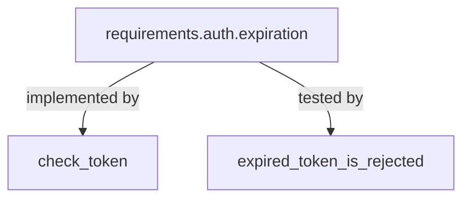

# Deconstructing Habeas

This chapter is for the implementer of a tool like Habeas. We start with the
Habeas you already know and ask how to express its verification work as a graph.
A node identifies a thing: a requirement, a function, a test, or a GitHub issue.
The application defines what it means for that thing to be valid and supplies
the procedure that checks it. The SDK is parametric over that definition of
validity.

## Start with one requirement and its inputs

Suppose the application's specification contains this requirement in
`md/requirements/auth.md`:

```markdown
:::{req} expiration
The application MUST reject all expired tokens. A token is expired when the
current time is greater than or equal to its expiration time.
:::
```

With `md/` as the book's source directory, this declaration is named
`requirements.auth.expiration`. Here is a small implementation and test,
reduced to the expiration check:

```rust
// {impl}`requirements.auth.expiration`
fn check_token(expires_at: u64, now: u64) -> bool {
    now < expires_at
}

// {test}`requirements.auth.expiration`
#[test]
fn expired_token_is_rejected() {
    assert!(check_token(100, 99));
    assert!(!check_token(100, 100));
    assert!(!check_token(100, 101));
}
```

The `{impl}` comment identifies `check_token` as an implementation reference. The
`{test}` comment selects `expired_token_is_rejected` as a test input.

To assess this requirement, Habeas starts an agent with the requirement text
and the test function. The agent judges whether the tests adequately check the
requirement, and can request implementation source to answer a specific
question.

## SDK Perspective: obligations as a graph

The SDK generalizes this concept by representing things as nodes in a graph. Each node plays a dual role. It represents some *noun* -- a thing, concept, whatever -- which both *has a source* and *must be validated*.  The SDK is not opinionated about how that source is fetched nor about how that validation takes place, that is defined by the application.

In our example, the requirement `requirements.auth.expiration` has a node, as does the Rust function `check_token` and the Rust test `expired_token_is_rejected`. The source for the requirement is the requirement text itself (*"The application MUST..."*). The source for the Rust nodes are their source content. These 3 nodes are connected by labeled edges, like so:



Edges make related nodes available to the validation process. The callback
receives a context identifying `requirements.auth.expiration`; it explicitly
chooses which contents to read or insert into each agent call. Habeas can insert
the requirement and `Tests` successors while leaving implementation source to
later requests. The SDK records those reads and the outgoing selections the
procedure observes. If a relevant part of a recorded input changes, the saved
validation becomes stale. CI reports the stale result; authoring can rerun the
validation. Fingerprints determine which changes count as relevant.

## Defining the application domain

The application defines its own domain by implementing `Domain`. This trait
combines four subtraits that capture different aspects of the domain:

:::{req} domain
The SDK MUST expose the following composite trait and blanket implementation:

```rust,ignore
pub trait Domain: Graph + Validation + Fingerprinting + EvidenceStorage {}

impl<T: Graph + Validation + Fingerprinting + EvidenceStorage> Domain for T {}
```

`Graph` MUST own its node, content, edge-label, and error types as specified by
{cite}`requirements.sdk.graph.domain_types`. `Fingerprinting` and
`EvidenceStorage` MUST extend `Graph` and use its associated types.
`Validation` MUST extend `Graph` and `Fingerprinting`; it supplies the
application callback, not the freshness-checking algorithm.
`Domain` MUST add no methods or associated types. The node validation runner
MUST require `Domain`; assessment callbacks MUST be usable without
`EvidenceStorage`.

The SDK MUST allow concurrent validations to share a domain by reference.
Asynchronous storage and assessment methods MUST return `Send` futures. Each
validation MUST retain its own dependency trace. Concurrent operations within
one validation MUST safely share that trace, while each agent invocation MUST
retain its own conversation and submission state. Observations MUST NOT leak
between separate node validations.
:::

Each subtrait is covered in its own chapter:

| Trait | Purpose |
| --- | --- |
| [Graph](sdk/graph.md) | What nodes and edges represent, and how to obtain their contents and relationships. |
| [Validation](sdk/graph/validation.md) | The decision procedure to validate a node. |
| [Fingerprinting](sdk/graph/fingerprinting.md) | What parts of a node's contents are significant. |
| [EvidenceStorage](sdk/graph/evidence.md) | Where and how evidence is saved. |


## Building blocks

The SDK also provides building blocks that applications can reuse for common
functionality. The linked chapters describe each one:

| Chapter | What it provides |
| --- | --- |
| [Source providers](sdk/sources.md#the-application-supplies-a-source-provider) | Resource access, including a filesystem provider. |
| [Parsing and outlining](sdk/sources.md#register-the-languages-that-interpret-those-resources) | Language-aware source structure and selectors for individual items. |
| [Context tools](sdk/graph/context-tools.md) | Source discovery and tracked content reads. |
| [Structural fingerprints](sdk/graph/fingerprinting.md#fingerprint-the-structure-and-version-the-rules) | Change detection based on source structure. |
| [Agent calls](sdk/graph/agent-calls.md) | Prompt construction, tracked tools, and typed results. |
| [Evidence storage helpers](sdk/filesystem-storage.md) | Filesystem persistence for SDK evidence records. |
| [Graph traversal](sdk/graph/traversal.md) | Validation scheduling across connected nodes, including cycles and parallel work. |


## Putting it all together

The [Habeas CLI definition](sdk/habeas.md) defines the `habeas` CLI workflow in
terms of the SDK, providing an example of how to use these traits and building
blocks together.
