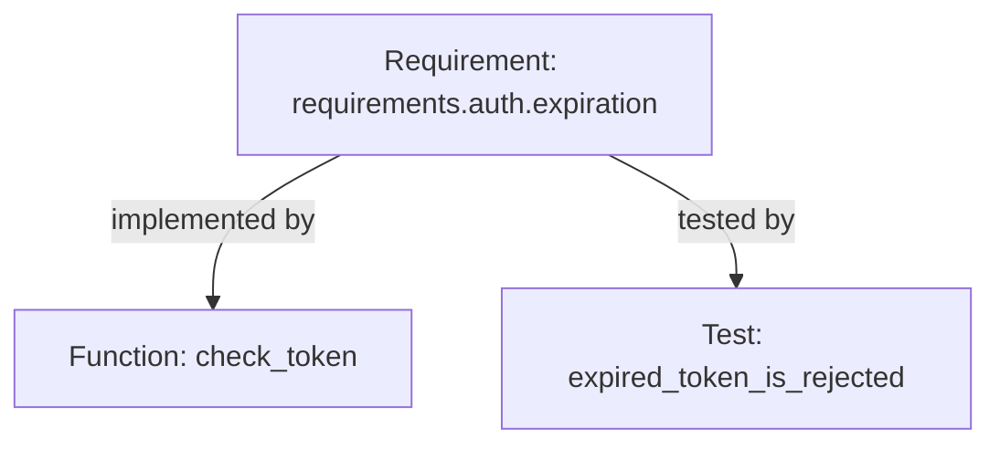
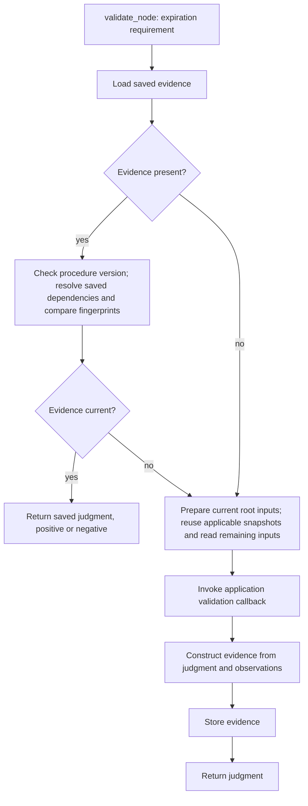
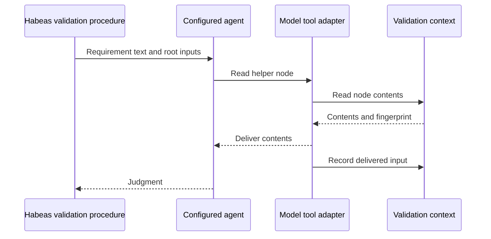
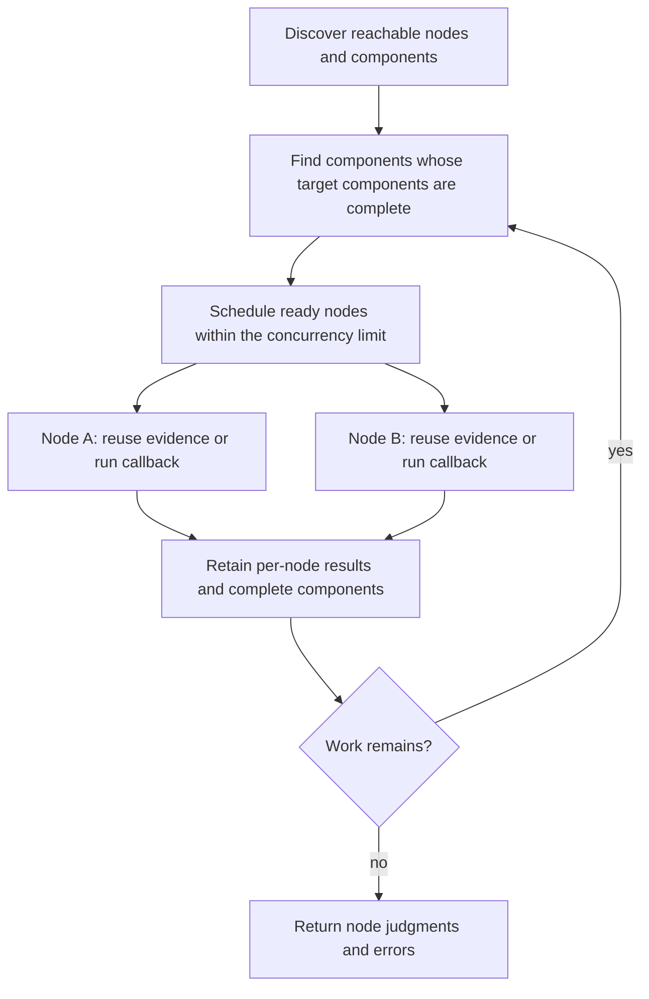
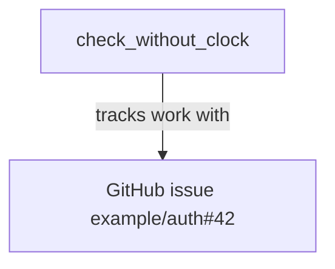

# Nodes, inputs, and validation

Consider the expiration requirement from the [introduction](../sdk.md).
Its text says expired tokens must be rejected. Its outgoing edges select
`check_token` and `expired_token_is_rejected` as the initial inputs to its review.
For this chapter, assume the application can supply the text of each of these
three nodes. How it finds a function inside a file comes later.



The graph generalizes this example to application-defined identities, contents,
and relationships. A node can supply input to another node's validation without
first being validated itself. Edges select inputs; the application supplies the
procedure that decides what constitutes a valid node.

## Represent the application as a graph

`Graph` gives the concepts from the introduction their Rust interface. For the
expiration example, `NodeId` identifies the requirement or one of its functions,
`NodeContent` holds its text, and `Edge` describes an implementation or test
reference. Calling `node_content` gets a node's current contents without validating it.

:::{req} domain_types
`habeas_sdk::graph` MUST expose the graph's associated types and content lookup operation:

```rust,ignore
pub trait Graph: Send + Sync {
    type NodeId: Clone + Eq + Send + Sync;
    type NodeContent: Send + Sync;
    type Edge: Clone + Send + Sync;
    type Error: Send;

    // endpoints and outgoing_edges are specified separately.
    fn node_content(&self, node: &Self::NodeId) -> Result<Self::NodeContent, Self::Error>;
}
```

The SDK MUST leave the domain meaning of node identities, edges, and contents
to the consumer.
:::

The application object is shared between concurrent validations through `&self`.
`Send + Sync` allows workers to share its read-only state and any synchronized
memoization. Input types are also `Sync` because operations can hold
references to them across an await; `Send` alone
would only permit transferring owned values. Errors need only be transferred,
so their bound is `Send`.

## Identify the thing being examined

An identity answers “which thing?”; reading it answers “what are its contents
now?” The same requirement or function can keep its identity as its text changes.
The SDK leaves the identity type to the application. For this example, we can
sketch it without specifying how functions are located:

```rust,ignore
enum ReviewNode {
    Requirement(RequirementId),
    Function(FunctionId),
}
```

## Connect nodes with typed edges

Our review needs to find the function associated with the requirement. Habeas
represents that relationship as an edge. Its edge variants carry their endpoints:

```rust,ignore
enum HabeasEdge {
    Implements(RequirementId, FunctionId),
    Tests(RequirementId, FunctionId),
    Acknowledges(RequirementId, FunctionId),
}
```

`Implements` cannot accidentally connect two source functions: its first argument
has to be a requirement identity. To find the endpoints, the SDK asks the graph:
`graph.endpoints(edge)`. Habeas can match the enum and project each typed endpoint
into its common node identity enum. Another application can use an edge handle
and resolve it through the graph's own state. The edge type itself need not
implement a trait.

:::{req} edges
`Graph` MUST provide the following method for consumer-defined edges:

```rust,ignore
pub trait Graph: Send + Sync {
    // ...
    fn endpoints(&self, edge: Self::Edge) -> (Self::NodeId, Self::NodeId);
}
```

`endpoints` MUST return the source and target node identities in that order.
The SDK MUST NOT require the edge type itself to implement an endpoint trait.
The consumer defines the edge representation and resolves its endpoints using
the graph. Here `NodeId` is the graph's node identity type.
:::

## Validate the expiration requirement

Suppose we ask the SDK to validate `requirements.auth.expiration`. It first
looks for saved evidence. To decide whether that evidence is current, it checks
the procedure version and resolves the recorded dependencies: the requirement
itself, its outgoing-edge selection, its implementation and test inputs, and any
additional node reads made by the previous review. Resolving these inputs
supplies their current fingerprints, computed from the contents being observed.
The freshness check therefore performs reads before it can reuse a judgment.

If all fingerprints still match, the SDK returns the saved judgment. This
includes a negative judgment: unchanged inputs do not justify rerunning a review
merely because it failed. A procedure-version or dependency mismatch can establish
staleness early, without checking the remaining saved dependencies.

When evidence is missing or stale, the SDK prepares the callback's initial
inputs: the requirement contents, current outgoing edges, and target contents.
Snapshots already obtained during this invocation can be reused when they still
represent the state being validated; any remaining root inputs must be read.
The callback examines those inputs, possibly invokes an agent, and returns a
judgment. The SDK records the new run's observations and stores its evidence.
Freshness checking uses a separate observation scope from the new assessment.
Reads performed only to check old evidence do not become dependencies of the
new judgment. If a checked snapshot is reused as a callback input, its identity
and fingerprint are recorded in the new assessment's trace.



A configured SDK validator provides this lifecycle. The validator uses the graph for node access and evidence storage,
together with the application's validation callbacks. In the method signature below, `NodeId` is its graph's node identity
type, `Judgment` is the application's result type, and `Error` covers graph,
callback, and storage failures. These are associated types of the configured
validator interface.

```rust,ignore
let judgment = validator.validate_node(&expiration).await?;
```

`validate_node` concerns this node's judgment. Reading the implementation as an
input does not recursively validate the implementation. Later in this chapter,
`validate_transitive` adds that traversal explicitly.

:::{req} validate_node
The configured SDK validator MUST expose the following method:

```rust,ignore
fn validate_node<'a>(
    &'a self,
    node: &'a Self::NodeId,
) -> impl Future<Output = Result<Self::Judgment, Self::Error>> + Send + 'a;
```

The operation MUST first look up evidence for the requested node and its
configured validation procedure. To establish that evidence is current, it MUST
check the procedure identity and resolve the recorded dependencies to compare
their current fingerprints with the saved fingerprints. If the evidence
is current under {cite}`requirements.sdk.graph.checking_records`, it MUST
return the stored judgment without invoking the validation callback, including
when that judgment is negative. If evidence is absent or stale, it MUST prepare
the node's contents and outgoing root inputs, invoke the application callback,
construct evidence from the returned judgment and captured dependencies, and
store that evidence before reporting successful completion.
:::

:::{req} validate_node.errors
Storage or input resolution errors MUST be reported as errors rather than
treated as absent or stale evidence. A callback error MUST NOT be stored as a
completed judgment.
:::

## Discover outgoing inputs without enumerating the graph

For the expiration requirement, an outgoing-edge lookup returns its
`Implements` and `Tests` edges. It need not discover unrelated requirements or
read every function in the repository. An application might answer this lookup
from a reference index or a database query.

The `Graph` trait also supplies outgoing-edge lookup. Together with
`Graph::endpoints`, this identifies the initial input nodes without enumerating
the whole graph. The procedure can read additional nodes through its context.
`Clone` lets the runner resolve an edge by value while retaining it in the
input bundle supplied to the callback.

:::{req} outgoing_edges
`habeas_sdk::graph` MUST expose the following interface:

```rust,ignore
pub trait Graph: Send + Sync {
    // ...

    fn outgoing_edges(
        &self,
        node: &Self::NodeId,
    ) -> Result<Snapshot<Vec<Self::Edge>>, Self::Error>;
}
```

The SDK MUST support node validation and reachable-node traversal using
caller-supplied starting nodes and per-node outgoing-edge lookup, without
requiring enumeration or materialization of all graph nodes or edges.
Every returned edge MUST have the requested node as its source endpoint.
The returned snapshot MUST fingerprint the complete outgoing-edge selection,
including an empty selection, resolved endpoint identities, and the labels and
metadata supplied to validation.
:::

An empty edge set matters too. Suppose the requirement initially has no test
reference, then gains one. Even if the implementation is unchanged, the next
review has another initial input. The outgoing selection therefore participates
in evidence freshness alongside the contents of the subject and its targets.

:::{req} root_inputs
When invoking a node's validation callback, the SDK MUST supply the subject
identity and contents, its outgoing edges, and the contents identified by their
targets. It MUST record the subject read, outgoing-edge selection, and target
reads as dependencies of that validation. A change to the outgoing selection,
including adding an edge to an empty selection, MUST make the prior evidence
stale. Edges supply content inputs; they MUST NOT implicitly supply or require
positive validation judgments for their targets.
:::

The `Dependency` definition below adds an `OutgoingEdges` observation alongside
node reads. This lets the runner recheck the selection using the subject
node identity.

## Read content together with its fingerprint

To read `check_token`, the SDK calls `Graph::node_content`. It then passes the returned
contents and node identity to `Fingerprinting::fingerprint`, then packages the
contents and fingerprint in a
`Snapshot`. The procedure receives the contents; the SDK retains the fingerprint
so it can check freshness later. Conceptually, the tracked context does this:

```rust,ignore
let content = graph.node_content(&check_token_id)?;
let fingerprint = graph.fingerprint(&check_token_id, &content);
let snapshot = Snapshot { content, fingerprint };
```

The fingerprint method receives the node identity and the contents already
read. It does not fetch the node again. This makes the relationship explicit: the fingerprint describes
the same observation that the procedure examines, even if the underlying
resource changes immediately afterward.

`Graph::outgoing_edges` returns a snapshot directly because its edge selection
has a different type and fingerprinting rules from `Self::NodeContent`. Its
implementation computes the selection fingerprint from the returned edges; `fingerprint` is specifically for node contents.

:::{req} snapshot
`habeas_sdk::graph` MUST define `Snapshot` as follows:

```rust,ignore
#[derive(Clone, Debug)]
pub struct Snapshot<T> {
    pub content: T,
    pub fingerprint: Fingerprint,
}
```

For node reads, the SDK MUST construct the snapshot by calling
`Fingerprinting::fingerprint` with the node identity and contents returned by `Graph::node_content`, without
reading the node again to compute its fingerprint. Graph operations returning
snapshots directly MUST supply fingerprints of the results from those same
observations. The SDK MUST NOT require `T` to carry a filesystem path or source
span.
:::

## Fingerprint the structure, and version the rules

Habeas uses structural fingerprints: it parses a node's source text and hashes
its structure rather than its raw bytes. The SDK supplies source-analysis
utilities for doing the same. This allows formatting edits to leave evidence
current. An application wanting finer-grained change detection can instead hash
the raw bytes, so that even whitespace changes make the observation different.

The fingerprint records both the digest and the version of the rules used to
compute it. Suppose a language extension changes how documentation comments
contribute to structural hashes. Existing applications need a way to recognize
that their saved fingerprints were computed under the earlier rules. In the
current API, `scheme` identifies those rules and their version, while `value`
holds the digest; for example, `rust-structural-v1` and `rust-structural-v2` are
illustrative scheme names.

This is versioning of the fingerprint calculation for a node's contents. It
does not require a node to have several sources or simultaneous digests. A
change of scheme makes a saved observation stale even if the digest strings
happen to match. A library update that preserves the calculation need not change
the scheme. The current SDK detects the mismatch; it does not migrate old
fingerprints or automatically rerun a review.

:::{req} fingerprint
`habeas_sdk::graph` MUST define `Fingerprint` as follows:

```rust,ignore
#[derive(Clone, Debug, PartialEq, Eq)]
pub struct Fingerprint {
    pub scheme: String,
    pub value: String,
}
```

Fingerprint equality MUST compare both `scheme` and `value`. The SDK’s graph
tracking and freshness comparison MUST treat these two fields as opaque values.
The graph supplies the fingerprinting rules; it may use the SDK’s source
tooling to compute fingerprints.
:::

For `check_token`, the graph's fingerprint method can use the Rust structural
hashing utilities on its contents. A graph serving several kinds of nodes can
use a content enum and dispatch on its variant. The node identity can also select the calculation: for example, requirement
text and a Rust function may use different rules. The method uses the supplied
identity and contents without fetching the node again.

The capability trait is named `Fingerprinting` to distinguish it from the
`Fingerprint` value it returns.

This method is infallible. Any parsing or preparation that can fail happens
during `Graph::node_content`; `NodeContent` can carry the prepared data needed to compute
the fingerprint successfully.

:::{req} fingerprint_content
`Fingerprinting` MUST provide the following method:

```rust,ignore
pub trait Fingerprinting: Graph {
    fn fingerprint(
        &self,
        node: &Self::NodeId,
        content: &Self::NodeContent,
    ) -> Fingerprint;
}
```

The method MUST compute the fingerprint of the supplied contents without
re-reading the node or querying mutable external state. For the same node identity and contents
under the same fingerprinting rules, it MUST return the same fingerprint.
Changes to the interpretation of those rules MUST be distinguished by the
fingerprint's `scheme`. The graph MUST make the information needed to apply
its fingerprinting rules available in `NodeId`, `NodeContent`, or its configured rules.
:::

A matching fingerprint establishes that the input is unchanged under those
rules. It does not establish that the node is valid: a current review can still
contain a negative judgment.

## The application supplies the validation procedure

A node's identity, contents, and validation have separate roles. In our example:

- **Node:** the requirement `requirements.auth.expiration`.
- **Node contents:** the text beginning “The application MUST reject all expired tokens.”
- **Validity criterion:** the requirement's obligations are implemented and tested.
- **Procedure:** the application-supplied code that establishes a judgment from
  the requirement and its inputs.
- **Evidence:** the result and the recorded inputs on which it depended.

The application associates a validation procedure and version with each node.
For this example it can dispatch by node kind: a requirement receives a review
of whether its obligations are implemented and tested; a function node might
receive a deterministic check that the function exists. Those meanings belong
to Habeas, not the graph scheduler.

Conceptually, the callback receives the following prepared input bundle plus a
tracked context. These are illustrative fields, not finalized Rust definitions:

```rust,ignore
NodeInputs {
    subject: expiration,
    contents: requirement_text,
    inputs: [
        (implements_edge, implementation_text),
        (tests_edge, test_text),
    ],
}
```

The context allows further node reads. Authoring callbacks additionally
receive an explicit agent capability; deterministic callbacks do not. Reading a
node remains distinct from invoking its callback.

`CheckProcedure` takes an application-defined `Request`. The node runner
prepares the bundle above for that request and selects the node's procedure.
The procedure interfaces require
node reads, fingerprinting, and relationships. Their callbacks do not
need persistence access; the runner handles evidence storage.

:::{req} check_procedure
`habeas_sdk::graph` MUST expose the following deterministic procedure interface:

```rust,ignore
pub trait CheckProcedure<D: Graph + Fingerprinting>: Send + Sync {
    type Request: Send + Sync;
    type Output: Send;

    fn run(
        &self,
        request: &Self::Request,
        ctx: &mut CheckContext<'_, D>,
    ) -> Result<Self::Output, D::Error>;
}
```
:::


:::{req} deterministic_procedures
The SDK MUST allow deterministic procedures to run without a configured model provider.
:::


## A procedure can invoke an agent

Deciding whether the implementation supports the requirement may call for a
model judgment. That is a separate capability, supplied by a `Judge`.
Its request can contain the review task, and its output can contain a
structured judgment and rationale. The judge receives the same tracked check
context so that reads performed by its tools become review dependencies.

:::{req} judge
`habeas_sdk::procedure` MUST expose the following judgment interface:

```rust,ignore
pub trait Judge<D: Graph + Fingerprinting>: Send {
    type Request: Send;
    type Output: Send;

    fn judge<'a, 'd>(
        &'a mut self,
        request: Self::Request,
        ctx: &'a mut CheckContext<'d, D>,
    ) -> impl Future<Output = Result<Self::Output, D::Error>> + Send + 'a
    where
        'd: 'a;
}
```
:::

An `AuthorContext` combines a graph's check context with an explicitly supplied
judge. Its `checks()` method lends the check context for deterministic work;
its `judge(request).await` method requests a judgment.

For a requirement review, an authoring procedure can first check that its inputs
are available, ask whether the implementation satisfies the requirement, then
use that answer to decide whether another judgment is needed. Ordinary Rust
code combines the results into the procedure's final output.

:::{req} author_procedure
`habeas_sdk::procedure` MUST expose the following authoring procedure interface:

```rust,ignore
pub trait AuthorProcedure<D: Graph + Fingerprinting, J: Judge<D>>: Send + Sync {
    type Request: Send + Sync;
    type Output: Send;

    fn run<'a, 'd>(
        &'a self,
        request: &'a Self::Request,
        ctx: &'a mut AuthorContext<'d, D, J>,
    ) -> impl Future<Output = Result<Self::Output, D::Error>> + Send + 'a
    where
        'd: 'a;
}
```
:::

:::{req} procedures
The SDK MUST support consumer-supplied assessment procedures that perform
deterministic computation and request zero or more model judgments. A procedure
MUST be able to use intermediate judgment results in subsequent computation and
judgment requests, and return a consumer-defined verdict.
:::

CI receives only the check context. A check context borrowed from an authoring
context still does not expose the judge. The distinction is in the Rust API,
not a runtime check for whether somebody configured a provider.

:::{req} model_capability
The SDK MUST provide deterministic procedures, including those used in CI, with
a context whose type exposes neither a model value nor an operation that invokes
a model-backed procedure. SDK operations that invoke a model-backed procedure
MUST require an explicit authoring capability that cannot be obtained from that
context alone. This restriction MUST apply to calls to other SDK procedures as
well as direct model calls.
:::

## Agent tools call the same context as deterministic code

In the requirement example, the procedure invokes an agent with the requirement
text and the implementation and test functions selected by the graph edges.
Suppose the implementation calls a helper. The agent can request that helper
through a tool; the tool calls back into the validation context to read the
helper's node contents. Once delivered, those contents are recorded as an
additional input to this judgment.



The context is also the API for deterministic code. Both callers can read additional nodes.
The sources chapter develops the additional inspection operations for code. A procedure can call these typed operations directly; the model tool
adapter translates its arguments and formats its results. Access controls,
redaction, and input recording belong beneath both callers.

The agent handle is an additional capability. A deterministic procedure has
access to inspection operations without receiving the capability to invoke an
agent.

## Remember what a procedure actually reads

Calling `Graph::node_content` directly only resolves a node. A review normally reads
through a `CheckContext`, which also remembers the dependency:

```rust,ignore
let mut ctx = CheckContext::new(&graph);
let requirement = ctx.read(&requirement_id)?;
let implementation = ctx.read(&implementation_id)?;
```

The procedure receives the content, while the context remembers the node
identity and its fingerprint, computed through `Fingerprinting::fingerprint`.
The runner also records the outgoing-edge snapshot used to prepare root inputs.
A failed read returns an error without inventing a successful observation.
Repeating an identical observation adds no information. Reading the same identity with two different
fingerprints preserves both observations: CI must not silently forget one.

:::{req} dependencies
`habeas_sdk::graph` MUST define captured dependencies as follows:

```rust,ignore
#[derive(Clone, Debug, PartialEq, Eq)]
pub enum Dependency<N> {
    Node(N, Fingerprint),
    OutgoingEdges(N, Fingerprint),
}
```
:::

:::{req} node_inputs
A record produced by finishing an SDK assessment context MUST include the
identity and fingerprint of every node successfully read through its assessment
context, whether requested by
deterministic code or a model tool. The recorded fingerprint MUST describe the
content supplied by that read.
:::

There is one important boundary in Habeas's model tools: preparing a page of
source text does not mean the model received it. Its delivery adapter records
only inputs on pages actually delivered. The SDK's `observe_read`
method lets such an adapter import the fingerprint of the
snapshot it supplied, without fetching that resource again. The adapter is
responsible for reporting that snapshot accurately. The SDK cannot intercept
arbitrary filesystem or network I/O performed by consumer Rust code.

## Save a result and check it tomorrow

When a procedure finishes, its context can produce a `Record`. This contains the
output and the dependencies supporting it. It also contains a procedure
identity: unchanged source inputs should not keep an old review current after
we change the question the procedure asks.

:::{req} record
`habeas_sdk::graph` MUST define the completed record as follows:

```rust,ignore
pub struct Record<N, V> {
    pub procedure: String,
    pub dependencies: Vec<Dependency<N>>,
    pub output: V,
}
```

The consumer chooses the procedure identity and output type, and selects
serialization and storage through the graph's evidence methods. The SDK MUST NOT infer a domain verdict from the
output.
:::

For example, the application can identify its recipe as `requirement-review-v1`:

```rust,ignore
let mut author = AuthorContext::new(&graph, judge);
let verdict = review.run(&request, &mut author).await?;
let record = author.finish("requirement-review-v1".into(), verdict);
```

Tomorrow, CI loads that record and checks it using a context with no judge:

```rust,ignore
let mut checks = CheckContext::new(&current_graph);
let current = checks.record_is_current("requirement-review-v1", &record)?;
```

The comparison resolves each saved node or outgoing-edge
dependency and compares its fingerprint with the saved one. A different procedure identity also makes the
record stale. An unresolvable dependency produces an error; it cannot establish
that the record is current. The current graph must observe the state that CI
intends to check; reusing yesterday's cached source snapshots would not do that.

:::{req} checking_records
Checking a stored assessment record’s freshness MUST NOT execute its assessment
procedure or invoke a model. The SDK MUST compare the requested procedure
identity and the record’s captured dependencies with their current state. A
procedure-identity mismatch or a fingerprint mismatch MUST make the record not
current; an error resolving a dependency MUST be returned as an error.
:::

A current record is not necessarily a favorable one. The model may have found
that an implementation fails to meet its requirement. If its dependencies still
match, that negative finding is still current. Habeas decides which judgments
make CI pass; the SDK only answers the freshness question.

## Load and store evidence through the graph

After reviewing the expiration requirement, Habeas can store its evidence in a
file. Another application might store the same kind of record in a database.
The SDK calls `graph.load_evidence(...)` and `graph.store_evidence(...)` in either
case. The graph implementation chooses where the data lives; the runner does
not need to enumerate every stored record.

The runner constructs a key from the node identity and the stable name of its
validation procedure. For example, it can use
`EvidenceKey::Validation { node: expiration, procedure: "requirement-review".into() }`.
The procedure version lives in the record's `procedure` field, so changing that
version can invalidate evidence stored under the same key.

The SDK defines this key's shape; the application decides how to encode it as a
filename or database key. Only the node identity is generic. There is currently
one kind of stored assessment, hence one enum variant. Storage also uses the
SDK's `Record` directly, with the application's `Judgment` as its output, so the
runner can construct and inspect the record without an application-specific
conversion.

:::{req} evidence_storage
`habeas_sdk::graph` MUST expose the following key and storage interface:

```rust,ignore
use std::future::Future;

#[derive(Clone, Debug, PartialEq, Eq)]
pub enum EvidenceKey<N> {
    Validation { node: N, procedure: String },
}

pub trait EvidenceStorage: Graph {
    type Judgment: Send + Sync;

    fn load_evidence<'a>(
        &'a self,
        key: &'a EvidenceKey<Self::NodeId>,
    ) -> impl Future<Output = Result<
        Option<Record<Self::NodeId, Self::Judgment>>,
        Self::Error,
    >> + Send + 'a;

    fn store_evidence<'a>(
        &'a self,
        key: &'a EvidenceKey<Self::NodeId>,
        record: &'a Record<Self::NodeId, Self::Judgment>,
    ) -> impl Future<Output = Result<(), Self::Error>> + Send + 'a;
}
```

The node runner MUST construct an `EvidenceKey::Validation` identifying the
requested node and stable validation procedure for lookup and persistence.
`load_evidence` MUST distinguish an absent record (`Ok(None)`) from a storage
error (`Err`). Storage MUST preserve the record's procedure version,
dependencies, and judgment. The application MUST be able to choose the
persistence mechanism without filesystem paths or a global evidence listing
being required by this interface.
:::

Habeas can implement `EvidenceStorage` on its application object and delegate
the methods to a filesystem helper. An application using a database implements
the same trait and delegates to its database client. Neither the key nor the
record has to implement storage methods.

:::{req} evidence_storage.filesystem
The SDK MUST supply a filesystem-backed evidence-storage helper to which an
`EvidenceStorage` implementation can delegate its `load_evidence` and
`store_evidence` methods under {cite}`requirements.sdk.graph.evidence_storage`.
:::

## Select the capabilities an operation needs

Habeas implements `Graph` to define its node types and graph operations. It then
implements `Fingerprinting` and `EvidenceStorage` on the same object. Both
capabilities extend `Graph`. Evidence storage adds its `Judgment` associated
type to the node, content, edge, and error types supplied by the graph.

`Domain` combines those capabilities. The validation runner can use `D: Domain`,
while a utility that only reads node contents can use `D: Graph`. Assessment
callbacks need inspection capabilities but do not need persistence access.

:::{req} domain
The SDK MUST expose the following composite trait and blanket implementation:

```rust,ignore
pub trait Domain: Graph + Fingerprinting + EvidenceStorage {}

impl<T: Graph + Fingerprinting + EvidenceStorage> Domain for T {}
```

`Graph` MUST own its node, content, edge, and error types as specified by
{cite}`requirements.sdk.graph.domain_types`. `Fingerprinting` and
`EvidenceStorage` MUST extend `Graph` and use its associated types.
`Domain` MUST add no methods or associated types. The node validation runner
MUST require `Domain`; assessment callbacks MUST be usable without
`EvidenceStorage`.

The SDK MUST allow concurrent validations to share a domain by reference.
Asynchronous storage and assessment methods MUST return `Send` futures. Each
validation MUST retain its own mutable observation context and agent state
rather than sharing those mutable values between concurrent validations.
:::

The signatures use `impl Future + Send` (with `Future` from `std::future`)
to make that scheduling guarantee explicit. A bare `async fn` in a trait does
not promise a `Send` future. The domain and procedures are shared through
`&self`; each invocation exclusively borrows its context and judge. This permits
memoization inside the domain without requiring a clone of it for every worker.

## Check evidence in CI without invoking validation

Suppose CI encounters stale evidence for the expiration requirement. It should
report that state, without starting an agent to repair it. The
`check_node` operation uses the same storage lookup and freshness comparison as
`validate_node`, but stops before invoking a callback or saving a replacement.

```rust,ignore
// No authoring capability is available on this checker.
let state = checker.check_node(&expiration).await?;
// state: current judgment, missing evidence, or stale evidence
```

:::{req} check_node
The SDK MUST provide a `check_node` operation that returns a current stored
judgment, a missing-evidence state, or a stale-evidence state. Storage and
input-resolution failures MUST be returned as errors. This operation MUST NOT
invoke validation callbacks, invoke a model, or write evidence, and MUST be
available without an authoring capability.
:::

A current negative judgment is a successful freshness check but may fail
Habeas's CI policy. Deterministic callbacks can also be executed through
`validate_node` without a model; only callbacks needing an agent require the
explicit authoring capability. Checking evidence and producing evidence remain
distinct operations.

## Validate the reachable graph

Now suppose the application wants to validate not only the requirement but
also its implementation and test nodes. It calls `validate_transitive` with
the requirement as its starting node. The SDK discovers further nodes by
following outgoing edges; the caller supplies neither a complete graph nor a
list of every reachable node.

```rust,ignore
let results = validator
    .validate_transitive(&expiration, options)
    .await?;
```

For an acyclic graph, the SDK completes input-node validations before the nodes
that use their contents. Each node still uses the `validate_node` lifecycle,
so current evidence is reused. Reusing the root's evidence does not skip
validation of other reachable nodes.

:::{req} validate_transitive
When discovery succeeds for the finite graph reachable from the supplied
starting node, `validate_transitive` MUST follow outgoing edges and apply the `validate_node`
lifecycle to every reachable node, including the starting node. It MUST
schedule each node at most once per invocation, including nodes reached by
multiple paths and self-references. Current evidence for a node MUST NOT cause
its reachable inputs to be omitted. The operation MUST expose each node's
judgment or error without interpreting an application-specific verdict as a
universal success or failure.
:::

Traversal is defined against the outgoing-edge snapshots collected for this
invocation. The runner retains each discovered selection and uses that same
snapshot when preparing the node's callback inputs and recording dependencies.
This avoids scheduling against one set of edges and validating against another.
It does not promise an atomic snapshot of all node contents; later changes can
make the resulting evidence stale.

If an outgoing lookup fails, the operation reports that node's discovery error
and an incomplete-traversal state. It cannot claim to have reached every node.
Discovered work whose inputs and scheduling dependencies are available can
finish; there is no implicit retry or promise to follow a continuously changing
graph. The concrete result type must preserve this distinction.

Cycles prevent a strict children-first ordering. For example, two prose nodes
might cite one another. Their validation callbacks can still read each other's
contents without assuming either explanation is valid. Grouping such nodes
into a strongly connected component lets the scheduler finish external input
components first, then validate the nodes within the cycle.

:::{req} validation_cycles
Transitive validation MUST account for cycles without recursively scheduling
a node again or waiting for a judgment from another node in the same cycle.
It MUST complete target components before source components in the reachable
graph's strongly connected component ordering. Within a component, validations
MAY run concurrently and MUST use target contents without assuming positive
target judgments. A negative judgment MUST NOT by itself prevent validation
of a node that reads those contents. For component scheduling, a node is
complete when its validation attempt has returned either a judgment or an
error. An error MUST NOT leave other components waiting indefinitely.
:::

This first model does not make another node's validated result an implicit
input. Such dependencies would need a separate design for stratification or
other cycle semantics. Following content edges imposes no recursive proof
assumptions.

## Run independent validations in parallel

The implementation and test in our example can be checked concurrently. If
several requirements share the same helper, that helper is scheduled once in
this invocation. Separate components whose inputs are already complete can
also run concurrently. Inside a cycle, the validations can proceed together
because their inputs are contents rather than one another's judgments.



:::{req} validation_parallelism
Transitive validation MUST provide bounded internal parallelism with a positive,
caller-configurable limit on active per-node validation operations. With a limit
greater than one, when more than one validation is ready and capacity remains,
the scheduler MUST allow ready validations to make progress concurrently,
including validations within a strongly connected component. Scheduling
MUST preserve {cite}`requirements.sdk.graph.validation_cycles` and the per-node
deduplication required by {cite}`requirements.sdk.graph.validate_transitive`.
Each validation MUST have its own dependency trace so concurrent observations
are not attributed to another node's evidence.
:::

This limit bounds active node operations, not the total size of the reachable
graph or every nested tool call. The scheduler may retain identities, edges,
and component state for the reachable subgraph. The application never needs to
materialize the entire graph, and disconnected nodes are not discovered.
The shared domain and `Send` futures support execution across workers.
Deduplication applies within one invocation, not across processes.

## Nodes can refer to external state

The nodes in the first example came from repository files. A node can also
identify something outside the repository, such as a GitHub issue. Its identity
might be `example/auth#42`; its contents are the issue data fetched from GitHub,
including its description and current state.

For example, an issue-only FIXME connects a source item to its tracking issue:

```rust,ignore
// :::{fixme}
// :github: example/auth#42
// Reject expired tokens when the clock is unavailable.
// :::
fn check_without_clock() { /* ... */ }
```



The source item is one node; the issue is another. Resolving the source node
reads code, while resolving the issue node fetches external data. Both supply
contents that a validation procedure can examine. Neither the node identity nor
the graph abstraction requires those contents to live in a source file.

The application defines the check that uses this relationship. If the check
requires the tracking issue to remain open, it can inspect the fetched state
deterministically. It does not need to ask an agent to determine whether the
state field says `open`.

External inputs also explain why evidence cannot be tied only to a repository
revision. The issue can close without any code changing. A judgment that relies
on the issue being open must account for that state when checking whether its
inputs are still current.

A named FIXME can contribute both relationships: from a requirement to the
source that acknowledges its gap, and from that source to a tracking issue.
The unnamed form above contributes only the issue relationship. The requirement
relationship selects code for review; the issue relationship brings external
state into the graph.

<a id="an-edge-carries-an-obligation"></a>

## From node contents to source inspection

So far the application has supplied contents through `Graph` and fingerprints through `Fingerprinting`.
The graph tracks those observations without interpreting their contents. The
[sources chapter](sources.md) explains how a reusable provider can obtain source
text, select individual items, and answer searches for the domain.
