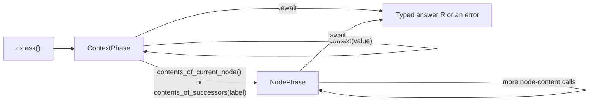
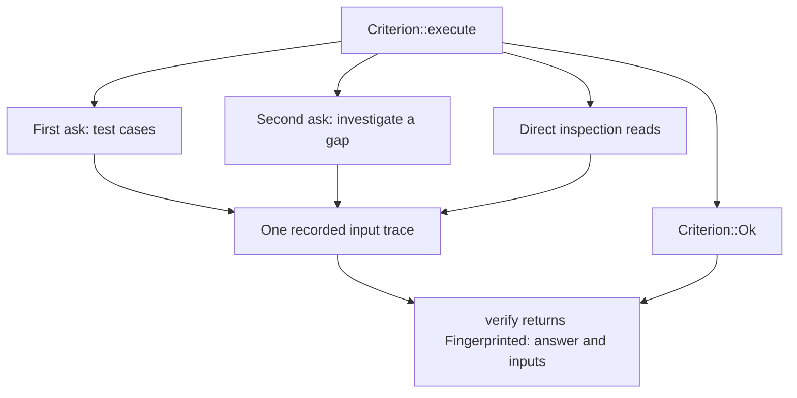

# Agent calls

An agent call combines reusable instructions with selected
{term}`requirements.sdk.graph.node_contents` and
returns an application-defined answer. A criterion starts the request with
`cx.ask::<R>()`, adds context and inputs, then awaits an `R`.

This chapter covers that caller-facing interface. [Agent harness](agent-harness.md)
covers the configuration of SDK-supplied agents, their fixed tools, and how a
structured submission becomes the answer.

## Compose reusable context

A `Context` value supplies text for the beginning of the prompt, including the
question and reusable instructions.

The application defines its instructions and review policies as
`Context`-implementing types, or uses the supplied string implementations.
Agent configuration selects the model; context supplies the question and
instructions. Node inputs are selected through the tracked operations below.

:::{req} agent_context
:test: crates/trust-but-verify/tests/public_api.rs#fn[public_exports_match_the_appendix]

Supplies reusable prompt text for an agent request. `contents` may borrow or own the string.

The SDK implements this trait for the following combinations:

| Value | Rendering |
| --- | --- |
| `String` | Use its text directly. |
| `str` | Use its text directly; `&str` works through the reference implementation. |
| `&C`, where `C: Context + ?Sized` | Forward to the referenced value. |
| `[C]` and `Vec<C>`, where `C: Context` | Render elements in order, separated by two newlines. An empty collection renders an empty string. |
| Heterogeneous tuples of 2 through 12 `Context` values | Render elements in order, separated by two newlines. |

Combinations can nest and preserve repeated elements. Each `.context(value)`
call obtains the text once and retains it for both the prefix and its hash,
without retaining a borrow of `value`. The value needs no `Hash`, `Serialize`,
`Send`, or `Sync` implementation. Repeated calls use the same two-newline
separator as combinations. No context calls give the empty prefix and the
same fingerprint as an explicitly empty rendered prefix.

The cache fingerprint hashes the exact UTF-8 prefix delivered to the agent,
using a versioned scheme. It preserves order and repetition and uses neither
object addresses nor type identities. It identifies this prefix, including the
question; node inputs, the result schema, and the rest of the request are outside
that fingerprint.

```rust,ignore
pub trait Context {
    fn contents(&self) -> Cow<'_, String>;
}
```

Trait implementations

```rust,ignore
impl Context for str;
impl Context for String;
impl<A: Context, B: Context> Context for (A, B);
impl<A: Context, B: Context, C: Context> Context for (A, B, C);
impl<A: Context, B: Context, C: Context, D: Context> Context for (A, B, C, D);
impl<A: Context, B: Context, C: Context, D: Context, E: Context> Context for (A, B, C, D, E);
impl<A: Context, B: Context, C: Context, D: Context, E: Context, F: Context> Context for (A, B, C, D, E, F);
impl<A: Context, B: Context, C: Context, D: Context, E: Context, F: Context, G: Context> Context for (A, B, C, D, E, F, G);
impl<A: Context, B: Context, C: Context, D: Context, E: Context, F: Context, G: Context, H: Context> Context for (A, B, C, D, E, F, G, H);
impl<A: Context, B: Context, C: Context, D: Context, E: Context, F: Context, G: Context, H: Context, I: Context> Context for (A, B, C, D, E, F, G, H, I);
impl<A: Context, B: Context, C: Context, D: Context, E: Context, F: Context, G: Context, H: Context, I: Context, J: Context> Context for (A, B, C, D, E, F, G, H, I, J);
impl<A: Context, B: Context, C: Context, D: Context, E: Context, F: Context, G: Context, H: Context, I: Context, J: Context, K: Context> Context for (A, B, C, D, E, F, G, H, I, J, K);
impl<A: Context, B: Context, C: Context, D: Context, E: Context, F: Context, G: Context, H: Context, I: Context, J: Context, K: Context, L: Context> Context for (A, B, C, D, E, F, G, H, I, J, K, L);
impl<C: Context + ?Sized> Context for &C;
impl<C: Context> Context for [C];
impl<C: Context> Context for Vec<C>;
```
:::

## Build a request

`ask` starts in `ContextPhase`, where `.context` appends instructions. The first
node-content call enters `NodePhase`, which accepts more node-content calls.
Either phase can be awaited to run the request:



:::{req} judge
`trust_but_verify` exposes `Ask` and its public `ContextPhase` and
`NodePhase` state types. The validation context starts a builder:

```rust,ignore
/// Create an independent request borrowing this context through a shared reference.
pub fn ask<R>(&self) -> Ask<'_, 'd, D, R, ContextPhase>
where
    R: serde::de::DeserializeOwned + schemars::JsonSchema + Send;
```

Both states implement `std::future::IntoFuture` with
`Output = Result<R, ValidationError<D::Error>>` and a `Send` future for
`R: serde::de::DeserializeOwned + schemars::JsonSchema + Send`.
Awaiting executes the assembled request, even with no contexts or node
insertions. Building it does not invoke an agent.
:::

:::{req} Ask
:test: crates/trust-but-verify/tests/public_api.rs#fn[public_exports_match_the_appendix]

Builds a typed agent request. `context` is available in the context phase. Adding graph contents enters the node phase. Awaiting a request returns the decoded answer or a validation error.

```rust,ignore
pub struct Ask<'a, 'd, D: Domain, R, P> { /* private fields */ }

impl<'a, 'd, D: Domain, R> Ask<'a, 'd, D, R, ContextPhase> {
    pub fn context(self, value: impl Context) -> Self;
}

impl<'a, 'd, D: Domain, R, P> Ask<'a, 'd, D, R, P> {
    pub fn contents_of_current_node(self) -> Ask<'a, 'd, D, R, NodePhase>;
    pub fn contents_of_successors(
        self,
        label: D::EdgeLabel,
    ) -> Ask<'a, 'd, D, R, NodePhase>
    where
        D::EdgeLabel: PartialEq;
}
```

Trait implementations

```rust,ignore
impl<'a, 'd, D: Domain, R> IntoFuture for Ask<'a, 'd, D, R, ContextPhase> where R: DeserializeOwned + JsonSchema + Send + 'a, D::Error: Display, D::EdgeLabel: DeserializeOwned + JsonSchema + PartialEq, 'd: 'a {
    type Output = Result<R, ValidationError<<D as Domain>::Error>>;
    type IntoFuture = Pin<Box<dyn Future<Output = <Ask<'a, 'd, D, R, ContextPhase> as IntoFuture>::Output> + Send + 'a>>;
}
impl<'a, 'd, D: Domain, R> IntoFuture for Ask<'a, 'd, D, R, NodePhase> where R: DeserializeOwned + JsonSchema + Send + 'a, D::Error: Display, D::EdgeLabel: DeserializeOwned + JsonSchema + PartialEq, 'd: 'a {
    type Output = Result<R, ValidationError<<D as Domain>::Error>>;
    type IntoFuture = Pin<Box<dyn Future<Output = <Ask<'a, 'd, D, R, NodePhase> as IntoFuture>::Output> + Send + 'a>>;
}
```
:::

:::{req} judge.phases
An ask builder begins in `ContextPhase`. Only that state exposes `context`,
composing the reusable prefix under
{cite}`requirements.sdk.graph.agent-calls.agent_context`. The first
`contents_of_current_node` or `contents_of_successors` call enters `NodePhase`, even
with an empty successor selection. This state allows further node insertions
and awaiting, with no `context` method or transition back. The builder's types
enforce the restriction.
:::

:::{req} ContextPhase
:test: crates/trust-but-verify/tests/public_api.rs#fn[public_exports_match_the_appendix]

Marks an agent request that can still accept reusable context before adding node contents.

```rust,ignore
pub struct ContextPhase;
```
:::

:::{req} NodePhase
:test: crates/trust-but-verify/tests/public_api.rs#fn[public_exports_match_the_appendix]

Marks an agent request that has begun collecting node contents. Further node inputs can be added before awaiting the answer.

```rust,ignore
pub struct NodePhase;
```
:::

## Example: review a requirement's tests

The `BehavioralAdequacy` criterion in [Criteria](criteria.md) asks whether a
requirement's tests cover its behavior and edge cases. This example shows its
agent request and the answer type it expects.

:::{example} test_review
{cite}`requirements.sdk.graph.agent-calls.agent_context`
{cite}`requirements.sdk.graph.agent-calls.judge`
{cite}`requirements.sdk.graph.agent-calls.judge.node_contents`
{cite}`requirements.sdk.graph.agent-calls.judge.submission`

The application can package reusable instructions in its own type:

```rust,ignore
struct Instructions {
    text: String,
}

impl Context for Instructions {
    fn contents(&self) -> std::borrow::Cow<'_, String> {
        std::borrow::Cow::Borrowed(&self.text)
    }
}
```

The criterion's `TestReview` answer, introduced in the criteria chapter, is:

```rust,ignore
/// Whether the tests cover the requirement's behavior and edge cases.
#[derive(serde::Serialize, serde::Deserialize, schemars::JsonSchema)]
struct TestReview {
    adequate: bool,
    rationale: String,
}
```

Here `review_policy` and `project_conventions` are `Instructions` values shared
across reviews, and `question` is a `&str` describing the test-adequacy question:

```rust,ignore
let answer: TestReview = cx.ask()
    .context((&review_policy, &project_conventions))
    .context(question)
    .contents_of_current_node()
    .contents_of_successors(HabeasEdgeLabel::Tests)
    .await?;
```

The tuple combines the first two instruction values. Calling
`.context(&review_policy)` and then `.context(&project_conventions)` produces the
same prefix. A slice or vector handles a variable number of contexts of one type;
tuples combine different types.

The request supplies the instructions first, followed by the requirement and its
tests. Awaiting returns the submitted `TestReview`. Its type can be inferred
from the receiving variable, as above, or chosen with `cx.ask::<TestReview>()`.
:::

## Deliver and record node inputs

The builder queues node selections; awaiting resolves them and supplies their
contents to the agent. Contents delivered in this call become dependencies of
the enclosing criterion.

:::{req} judge.node_contents
Node-insertion methods queue selections. They resolve no contents or edges,
render no inputs, and record no observations while building.

Awaiting with a configured agent resolves these selections in call order:

| Insertion | Contents delivered |
| --- | --- |
| `contents_of_current_node()` | The node identified by `ValidationContext::node_id`. |
| `contents_of_successors(label)` | Targets of edges whose labels equal `label`, in returned edge order, including duplicate targets. |

Each successful successor selection records its source, label, and target-set
fingerprint, even when nothing matches. Only selected targets have their contents
resolved. Each delivered node is recorded with its supplied snapshot's
fingerprint under {cite}`requirements.sdk.graph.agent-calls.author_procedure`.
Input-resolution failures return `ValidationError::Graph`.
:::

## Format node contents for the agent

:::{req} judge.rendering
The SDK presents node inputs using the returned value's `NodeContents::format`
under {cite}`requirements.sdk.graph.node_content.format`.
Its text and fingerprint describe the same retained observation.

```rust,ignore
let contents = domain.node_content(&node_id)?;
let text = contents.format();
```

Loading and fallible preparation occur in `Domain::node_content` under
{cite}`requirements.sdk.graph.node_content`. For inputs queued on an ask
builder, these failures return `ValidationError::Graph`. During a `read_node`
tool call, they are returned to the agent as a tool error, so it can continue
and recover.
:::

:::{req} judge.caching
The SDK's backend integration makes the rendered prefix available to its supported
prompt-caching mechanism. The prefix includes all context, including the
question, and precedes node contents. A cache hit is not guaranteed.
The prefix fingerprint follows
{cite}`requirements.sdk.graph.agent-calls.agent_context`.
:::

## Await a typed answer

The result type describes the answer the agent should submit. The supplied
harness exposes a structured submission tool with that schema, and awaiting
the builder decodes the accepted submission into `R`.

:::{req} judge.submission
Awaiting the builder returns the harness's accepted result deserialized into
`R`. The harness obtains the submitted value under
{cite}`requirements.sdk.graph.agent-harness.submission.acceptance`.
:::

:::{req} judge.submission.decoding
If the accepted result cannot be deserialized into `R`, awaiting the builder
returns `ValidationError::Agent`.
:::

[Agent harness](agent-harness.md#submit-a-structured-answer) defines the submission
tool, its schema, and its reminder and error behavior. The criterion can interpret
the typed answer and make another ask request; its application owns the assessment
policy.

## Combine inputs from several calls

One criterion can use direct computation, tracked reads, and several agent calls.
For example, one call can assess test cases and a second can investigate a
specific gap. Each has its own conversation. Both contribute inputs to the
criterion's final answer:



:::{req} author_procedure
A `Criterion::execute` invocation receives one `Send + Sync`
`ValidationContext<'d, D>` for `D: Domain`, with tracked `inspection(&self)`
and the `ask(&self)` builder under
{cite}`requirements.sdk.graph.agent-calls.judge`.

Each awaited ask builder runs its own conversation and returns its own submitted
answer. The context combines delivered node contents, tool reads, direct
inspection reads, and recorded edge selections into one dependency trace for
the criterion. It records the node identities and fingerprints of the supplied
contents. A later call that selects fewer nodes, or none, preserves earlier
inputs. An unawaited builder contributes no
agent-delivery dependencies.

Shared references support concurrent calls: builders, conversations, and
submission state remain independent, while updates to the trace are synchronized.
Calls can run concurrently without holding an exclusive context borrow across
an agent interaction or locking the whole context for the conversation.

The same context supports deterministic criteria under
{cite}`requirements.sdk.graph.criteria.deterministic_procedures`.
:::

:::{req} procedures
An application-supplied assessment procedure can perform ordinary computation
and request zero or more typed model answers. It can use intermediate answers
in later computation and requests, then return its `Criterion::Ok` value.
:::

Awaiting an ask builder without an agent returns `NoAgentConfigured`. A criterion
may propagate that error or handle it and compute its answer another way.

:::{req} model_capability
Without a configured agent, awaiting returns
`ValidationError::NoAgentConfigured`. It invokes no provider, resolves and
renders no queued node insertions, and fabricates no response. If the criterion
propagates the error, the runner reports it without storing a completed
judgment.
:::
