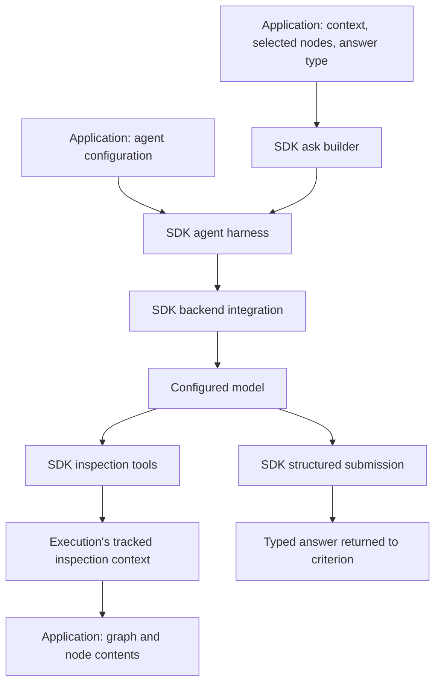

# Agent harness

A criterion describes the question, supplies its context and inputs, and awaits
an application-defined answer. TBV runs the agent that answers that
request. The application chooses a supported backend through configuration;
the SDK handles the model conversation and the inspection tools.

:::{definition} agent_harness
:phrase: agent harness

An *agent harness* runs an agent request: it sends instructions and inputs to
the configured model, executes requested tools, and obtains a structured answer.
TBV supplies the harness and its tools. The application supplies
[`Context` values](../../../rustdocs/trust_but_verify/request/trait.Context.html),
node contents, and
the answer type.
:::



## Configure the validator's agent

Choose the backend and model once when constructing the validator. All criteria
run through the same SDK interface, regardless of which supported backend is
selected.

:::{req} agent_config
:test: crates/trust-but-verify/tests/public_api.rs#fn[public_exports_match_the_appendix]

TBV exposes configuration for its supplied Bedrock, OpenAI, and Ollama
agents. The configuration selects a backend and carries its model, connection,
credential-selection, and model-option settings.

```rust,ignore
#[non_exhaustive]
pub enum AgentConfig {
    Bedrock(BedrockConfig),
    OpenAi(OpenAiConfig),
    Ollama(OllamaConfig),
}
```

Trait implementations

```rust,ignore
impl Clone for AgentConfig;
impl Debug for AgentConfig;
impl<'de> Deserialize<'de> for AgentConfig;
impl PartialEq for AgentConfig;
impl Serialize for AgentConfig;
```
:::

:::{req} agent_config.serialization
`AgentConfig` and its backend-specific configuration types implement Serde
serialization and deserialization. An application can embed them in its own
configuration types; serializing and deserializing a supported configuration
preserves its settings.
:::

:::{req} with_agent
The SDK configures a validator's supplied agent from an application-provided
[`AgentConfig`](#habeas-req-requirements.sdk.graph.agent-harness.agent_config).
It does not persist the agent configuration.

```rust,ignore
use trust_but_verify::agent::AgentConfig;
use trust_but_verify::domain::Domain;
use trust_but_verify::graph::validator::Validator;

impl<D: Domain> Validator<D> {
    // ...

    /// Configure the SDK agent used by this validator's ask requests.
    pub fn with_agent(self, config: AgentConfig) -> Self
    where
        D: 'static,
        D::EdgeLabel: serde::de::DeserializeOwned + schemars::JsonSchema + PartialEq,
        D::Error: std::fmt::Display;

    // ...
}
```

The label bounds let the fixed tools accept typed edge labels, and `Display`
lets them report domain errors to the agent.
Criteria obtain the configured agent through their `ValidationContext`.
Constructing a validator without this configuration still permits deterministic
criteria under {cite}`requirements.sdk.graph.criteria.deterministic_procedures`.
:::

:::{example} setup
{cite}`requirements.sdk.graph.agent-harness.agent_config`
{cite}`requirements.sdk.graph.agent-harness.with_agent`
{cite}`requirements.sdk.graph.validators.validator`

Here `domain` supplies the application's graph, contents, and storage. This
illustrative Bedrock configuration selects a model, AWS profile, and region:

```rust,ignore
use trust_but_verify::agent::AgentConfig;
use trust_but_verify::agent::BedrockConfig;

let config = AgentConfig::Bedrock(
    BedrockConfig::new("us.anthropic.claude-sonnet-5-5".into())
        .aws_profile("development".into())
        .region("us-east-1".into()),
);
let validator = Validator::new(domain).with_agent(config);
```
:::

## Backend settings and credentials

:::{req} agent_config.settings
Each `AgentConfig` variant carries the corresponding settings from
`trust_but_verify::agent`. Serde uses the `backend` field to select `bedrock`,
`openai`, or `ollama` and reads the settings from the same object.

Choose [`BedrockConfig`](#habeas-req-requirements.sdk.graph.agent-harness.BedrockConfig),
[`OpenAiConfig`](#habeas-req-requirements.sdk.graph.agent-harness.OpenAiConfig), or
[`OllamaConfig`](#habeas-req-requirements.sdk.graph.agent-harness.OllamaConfig) for the selected backend.
With settings omitted, OpenAI uses `gpt-6.1-sol`, `https://api.openai.com/v1`,
and `OPENAI_API_KEY`. Ollama defaults to `http://localhost:11434`.

All three backend constructors start with an empty `options` map. Calling
`option(key, value)` inserts one inference setting. Calling it again with the
same key replaces its value and preserves the other settings. An `OptionValue` is
a `String`, `Boolean`, `Integer(i64)`, `Float(f64)`, `Array`, or `Map`. Arrays hold
option values and maps associate strings with option values. These serialize as
the corresponding untagged values. Backend calls reject nonfinite floats,
including those nested in an array or map.

`BedrockCredentials` contains `access_key_id` and `secret_access_key`, both
`SecretString`, and an optional `session_token` of the same type. Construct a
`SecretString` from `String` or `&str`. `expose_secret()` borrows its value.
Serialization preserves the string, while `Debug` prints `<redacted>`.
:::

:::{req} BedrockConfig
:test: crates/trust-but-verify/tests/public_api.rs#fn[public_exports_match_the_appendix]

Select a Bedrock model or inference profile with `model`. The optional region, AWS profile, and explicit credentials configure its client. `options` carries inference settings.

```rust,ignore
#[non_exhaustive]
pub struct BedrockConfig {
    pub model: String,
    pub aws_profile: Option<String>,
    pub region: Option<String>,
    pub credentials: Option<BedrockCredentials>,
    pub options: BTreeMap<String, OptionValue>,
}

impl BedrockConfig {
    pub fn new(model: String) -> Self;
    pub fn aws_profile(self, aws_profile: String) -> Self;
    pub fn region(self, region: String) -> Self;
    pub fn credentials(self, credentials: BedrockCredentials) -> Self;
    pub fn option(self, key: String, value: OptionValue) -> Self;
}
```

Trait implementations

```rust,ignore
impl Clone for BedrockConfig;
impl Debug for BedrockConfig;
impl<'de> Deserialize<'de> for BedrockConfig;
impl PartialEq for BedrockConfig;
impl Serialize for BedrockConfig;
```
:::

:::{req} BedrockCredentials
:test: crates/trust-but-verify/tests/public_api.rs#fn[public_exports_match_the_appendix]

An explicit access key consists of its ID and secret. Supply `session_token` when using temporary credentials.

```rust,ignore
#[non_exhaustive]
pub struct BedrockCredentials {
    pub access_key_id: SecretString,
    pub secret_access_key: SecretString,
    pub session_token: Option<SecretString>,
}

impl BedrockCredentials {
    pub fn new(access_key_id: SecretString, secret_access_key: SecretString) -> Self;
    pub fn session_token(self, session_token: SecretString) -> Self;
}
```

Trait implementations

```rust,ignore
impl Clone for BedrockCredentials;
impl Debug for BedrockCredentials;
impl<'de> Deserialize<'de> for BedrockCredentials;
impl PartialEq for BedrockCredentials;
impl Serialize for BedrockCredentials;
impl Eq for BedrockCredentials;
```
:::

:::{req} OpenAiConfig
:test: crates/trust-but-verify/tests/public_api.rs#fn[public_exports_match_the_appendix]

Overrides the SDK’s OpenAI model, endpoint, credentials, or inference options. Omitted settings use the defaults in the agent configuration contract.

```rust,ignore
#[non_exhaustive]
pub struct OpenAiConfig {
    pub model: Option<String>,
    pub endpoint: Option<String>,
    pub api_key_env: Option<String>,
    pub api_key: Option<SecretString>,
    pub options: BTreeMap<String, OptionValue>,
}

impl OpenAiConfig {
    pub fn new() -> Self;
    pub fn model(self, model: String) -> Self;
    pub fn endpoint(self, endpoint: String) -> Self;
    pub fn api_key_env(self, api_key_env: String) -> Self;
    pub fn api_key(self, api_key: SecretString) -> Self;
    pub fn option(self, key: String, value: OptionValue) -> Self;
}
```

Trait implementations

```rust,ignore
impl Clone for OpenAiConfig;
impl Debug for OpenAiConfig;
impl Default for OpenAiConfig;
impl<'de> Deserialize<'de> for OpenAiConfig;
impl PartialEq for OpenAiConfig;
impl Serialize for OpenAiConfig;
```
:::

:::{req} OllamaConfig
:test: crates/trust-but-verify/tests/public_api.rs#fn[public_exports_match_the_appendix]

`model` names the model on the Ollama server. The endpoint, credentials, and inference options configure requests to that server.

```rust,ignore
#[non_exhaustive]
pub struct OllamaConfig {
    pub model: String,
    pub endpoint: Option<String>,
    pub api_key_env: Option<String>,
    pub api_key: Option<SecretString>,
    pub options: BTreeMap<String, OptionValue>,
}

impl OllamaConfig {
    pub fn new(model: String) -> Self;
    pub fn endpoint(self, endpoint: String) -> Self;
    pub fn api_key_env(self, api_key_env: String) -> Self;
    pub fn api_key(self, api_key: SecretString) -> Self;
    pub fn option(self, key: String, value: OptionValue) -> Self;
}
```

Trait implementations

```rust,ignore
impl Clone for OllamaConfig;
impl Debug for OllamaConfig;
impl<'de> Deserialize<'de> for OllamaConfig;
impl PartialEq for OllamaConfig;
impl Serialize for OllamaConfig;
```
:::

:::{req} SecretString
:test: crates/trust-but-verify/tests/public_api.rs#fn[public_exports_match_the_appendix]

Debug formatting redacts the credential. `expose_secret` borrows the original string, and serialization preserves it.

```rust,ignore
pub struct SecretString(/* private fields */);

impl SecretString {
    pub fn expose_secret(&self) -> &str;
}
```

Trait implementations

```rust,ignore
impl Clone for SecretString;
impl Debug for SecretString;
impl<'de> Deserialize<'de> for SecretString;
impl From<&str> for SecretString;
impl From<String> for SecretString;
impl PartialEq for SecretString;
impl Serialize for SecretString;
impl Eq for SecretString;
```
:::

:::{req} OptionValue
:test: crates/trust-but-verify/tests/public_api.rs#fn[public_exports_match_the_appendix]

An inference option may contain nested arrays and maps. Scalars retain their value types when serialized. Floating-point options must be finite when building a backend request.

Downstream callers matching on individual variants must include a fallback arm for future variants.

```rust,ignore
#[non_exhaustive]
pub enum OptionValue {
    String(String),
    Boolean(bool),
    Integer(i64),
    Float(f64),
    Array(Vec<OptionValue>),
    Map(BTreeMap<String, OptionValue>),
}
```

Trait implementations

```rust,ignore
impl Clone for OptionValue;
impl Debug for OptionValue;
impl<'de> Deserialize<'de> for OptionValue;
impl PartialEq for OptionValue;
impl Serialize for OptionValue;
```
:::

## Run the supplied harness

:::{req} tool_agent
TBV owns the model conversation, supported backend integrations, tool
dispatch, and structured submission used by its ask builder.
:::

:::{req} tool_agent.isolation
Each awaited ask builder has independent conversation, paging, and submission
state. Calls in the same criterion contribute their delivered
inputs to that criterion's shared trace under
{cite}`requirements.sdk.graph.agent-calls.author_procedure`.
:::

:::{req} tool_agent.provider_failure
A provider failure that ends the model conversation returns
`ValidationError::Agent` to the awaiting ask builder.
:::

:::{req} fixed_tools
The SDK supplies the inspection tools described in
[Validation context](validation-context.md). Graph tools invoke the application's graph
and contents interfaces; source tools invoke its source interfaces and
source-node mapping.

The SDK provides a fixed set of tools and their input-recording policy.
Application-specific node kinds use the SDK's ordinary node-read tool.
:::

Source tools use the application's
[source-node mapping](../sources.md#connect-source-items-to-graph-nodes).

## Submit a structured answer

:::{req} submission
The harness instructs the model to finish by calling
{cite}`requirements.sdk.graph.agent-harness.submission.mcp`.
:::

:::{req} submission.mcp
```text
submit_result({result: R})
```

The tool takes exactly one argument. The harness derives its `result` schema
from the ask builder's `R: JsonSchema` using `schemars`. An accepted call ends
the conversation under {cite}`requirements.sdk.graph.agent-harness.submission.acceptance`.
:::

:::{req} submission.mcp.description
> `Finish by submitting your structured result in result. Exactly one accepted
> submission ends this call.`
:::

:::{req} submission.acceptance
The harness checks the submission count in a complete model response before
checking submission arguments. An otherwise valid submission while any search
page is open returns a tool error listing every outstanding `search_id` and
instructing the agent to call `finish_search` before resubmitting. The request
stays open and retains its submission reminder. Once all delivered searches
are accounted for under {cite}`requirements.sdk.graph.search.finish_search.behavior`,
exactly one `submit_result` call whose arguments are an object containing only
the `result` field supplies that field's value as the accepted answer and ends
the conversation. Other tool calls in that response are skipped.
Assistant prose remains conversation text.
:::

:::{req} submission.reminder
A complete response requesting only inspection tools continues the conversation
through those tools.

If a complete response has no tool calls or contains multiple `submit_result` calls,
the harness accepts no answer and gives one reminder instructing the model to
invoke `submit_result` exactly once.

For multiple submissions, the harness returns tool errors for every call in
that response and executes none of them. The request has one submission reminder
in total. If either count violation occurs after that reminder, the request
ends with `ValidationError::Agent`.
:::

:::{req} submission.invalid
For a response with exactly one `submit_result` call, arguments other than an
object containing only the `result` field end the request with
`ValidationError::Agent`. Decoding the field's value into `R` follows
{cite}`requirements.sdk.graph.agent-calls.judge.submission.decoding`.
:::

For the `TestReview` example in
[Agent calls](agent-calls.md#example-review-a-requirements-tests), a submission
looks like this:

```json
{
  "result": {
    "adequate": true,
    "rationale": "The tests check earlier, equal, and later expiration times."
  }
}
```

The criterion can inspect that answer, perform more computation, or make
another ask request. The application interprets the completed answer under
{cite}`requirements.sdk.graph.criteria.output_policy`.
