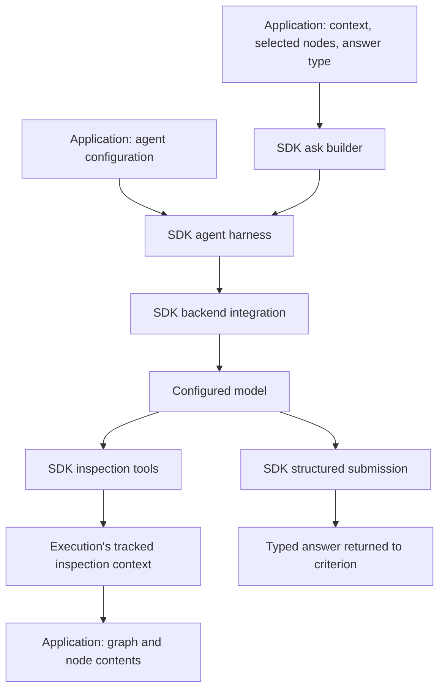

# Agent harness

A criterion describes the question, supplies its context and inputs, and awaits
an application-defined answer. Habeas SDK runs the agent that answers that
request. The application chooses a supported backend through configuration;
the SDK handles the model conversation and the inspection tools.

:::{definition} agent_harness
:phrase: agent harness

An *agent harness* runs an agent request: it sends instructions and inputs to
the configured model, executes requested tools, and obtains a structured answer.
Habeas SDK supplies the harness and its tools. The application supplies
[`Context` values](../../../rustdocs/habeas_sdk/procedure/trait.Context.html),
node contents, and
the answer type.
:::



## Configure the validator's agent

Choose the backend and model once when constructing the validator. All criteria
run through the same SDK interface, regardless of which supported backend is
selected.

:::{req} agent_config
Habeas SDK exposes configuration for its supplied Bedrock, OpenAI, and Ollama
agents. The configuration selects a backend and carries its model, connection,
credential-selection, and model-option settings.

The public type's shape is:

```rust,ignore
// Defined in habeas_sdk::agent.
#[derive(Clone, serde::Serialize, serde::Deserialize)]
#[non_exhaustive]
pub enum AgentConfig {
    Bedrock(BedrockConfig),
    OpenAi(OpenAiConfig),
    Ollama(OllamaConfig),
}

// The backend-specific configuration types contain their respective settings.
// Their individual fields are omitted here.
```
:::

:::{req} agent_config.serialization
`AgentConfig` and its backend-specific configuration types implement Serde
serialization and deserialization. An application can embed them in its own
configuration types; serializing and deserializing a supported configuration
preserves its settings.
:::

:::{req} with_agent
The SDK configures a validator's supplied agent from an application-provided
`AgentConfig`. It does not persist the agent configuration.

```rust,ignore
use habeas_sdk::agent::AgentConfig;

impl<D: Domain> Validator<D> {
    /// Configure the SDK agent used by this validator's ask requests.
    pub fn with_agent(self, config: AgentConfig) -> Self;
}
```

Criteria obtain the configured agent through their `ValidationContext`.
Constructing a validator without this configuration still permits deterministic
criteria under {cite}`requirements.sdk.graph.execution.deterministic_procedures`.
:::

:::{example} setup
{cite}`requirements.sdk.graph.agent-harness.agent_config`
{cite}`requirements.sdk.graph.agent-harness.with_agent`
{cite}`requirements.sdk.graph.validators.validator`

Here `domain` supplies the application's graph, contents, and storage. This
illustrative Bedrock configuration selects a model, AWS profile, and region:

```rust,ignore
use habeas_sdk::agent::{AgentConfig, BedrockConfig};

let config = AgentConfig::Bedrock(BedrockConfig {
    model: "us.anthropic.claude-sonnet-5-5".into(),
    aws_profile: Some("development".into()),
    region: Some("us-east-1".into()),
    credentials: None,
    options: Default::default(),
});
let validator = Validator::new(domain).with_agent(config);
```
:::

## Run the supplied harness

:::{req} tool_agent
Habeas SDK owns the model conversation, supported backend integrations, tool
dispatch, and structured submission used by its ask builder.
:::

:::{req} tool_agent.isolation
Each awaited ask builder has independent conversation, paging, and submission
state. Calls in the same criterion contribute their delivered
inputs to that criterion's shared trace under
{cite}`requirements.sdk.graph.agent-calls.author_procedure`.
:::

:::{req} fixed_tools
The SDK supplies the inspection tools described in
[Context tools](context-tools.md). Graph tools invoke the application's graph
and contents interfaces; source tools invoke its source interfaces and
source-node mapping.

The SDK provides a fixed set of tools and their input-recording policy.
Application-specific node kinds use the SDK's ordinary node-read tool.
:::

Source tools use the application's
[source-node mapping](../sources.md#connect-source-items-to-graph-nodes).

## Submit a structured answer

The SDK submission tool is `submit_result`. The builder's `R: JsonSchema`
defines the schema of its `result` argument. For the `TestReview` example in
[Agent calls](agent-calls.md#example-review-a-requirements-tests), a submission
looks like this:

```json
{
  "result": {
    "adequate": true,
    "rationale": "The tests check earlier, equal, and later expiration times."
  }
}
```

The SDK accepts exactly one structured submission and decodes it into `R`,
under {cite}`requirements.sdk.graph.agent-calls.judge.submission`.
Assistant prose is conversation text; the submitted value is the answer.

The criterion can inspect that answer, perform more computation, or make
another ask request. The application interprets the completed answer under
{cite}`requirements.sdk.graph.execution.output_policy`.
