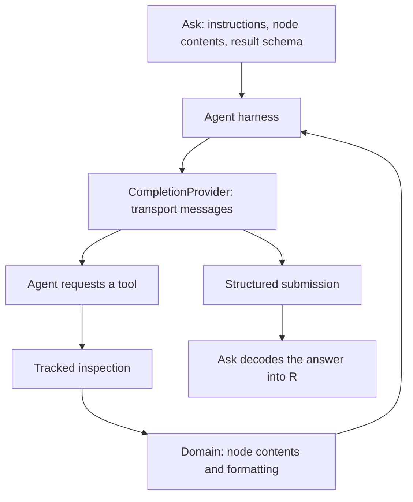

# Agent harness

The ask builder defines what the agent receives and the answer type it should
return. An agent harness turns that request into provider messages, handles tool
calls, and returns an accepted submission. Configure it once on the validator;
criteria then use the same `ask` interface.



## Configure the supplied harness

The SDK supplies `ToolAgent` for applications that want a provider conversation
with graph-inspection tools. A `CompletionProvider` transports requests to the
chosen backend; `ToolAgent` handles the conversation and tool dispatch.

:::{req} tool_agent
```rust,ignore
// Defined in habeas_sdk::agent.
/// Provider conversations with graph tools and optional application tools.
pub struct ToolAgent<P, T = NoTools> { /* fields omitted */ }

impl<P> ToolAgent<P> {
    /// Use the provider with graph tools and no additional application tools.
    pub fn new(provider: P) -> Self;
}

impl<P, T> ToolAgent<P, T> {
    /// Use this factory for additional application tools, with fresh state per call.
    pub fn with_tools<U>(self, tools: U) -> ToolAgent<P, U>;
}
```

`ToolAgent<P, T>` implements `Agent<D>` when `D: Domain`,
`P: CompletionProvider`, and `T: ToolFactory<D>`. Its graph-tool adapter requires `D::EdgeLabel` to implement
`DeserializeOwned`, `JsonSchema`, and `PartialEq`, and `D::Error` to implement
`Display`. These bounds describe and decode tool arguments and errors; they do
not constrain ordinary graph operations.

Each call creates a fresh conversation and tool session. Graph-node reads use
the domain's formatter under
{cite}`requirements.sdk.graph.agent-calls.judge.rendering` and record delivered
inputs under {cite}`requirements.sdk.graph.agent-calls.author_procedure`.
:::

:::{example} setup
{cite}`requirements.sdk.graph.agent-harness.tool_agent`
{cite}`requirements.sdk.graph.validation.validator`

Here `provider` implements `CompletionProvider`, and `domain` is the
application's domain with the adapter's label and error bounds described above.
The provider lives for the lifetime required by the shared `Arc<dyn Agent<D>>`.
The validator shares the agent across criterion executions:

```rust,ignore
use habeas_sdk::{agent::ToolAgent, graph::Validator};
use std::sync::Arc;

let agent = Arc::new(ToolAgent::new(provider));
let validator = Validator::new(domain).with_agent(agent);
```

The application implements `Contents::format_node_content` to present its node
contents; the harness obtains that formatter through the execution's domain.
:::

## Expose inspection tools

The supplied harness exposes these graph tools:

| Tool | Purpose |
| --- | --- |
| `outgoing_edges` | Select a known node's outgoing targets by label and make those targets available to read. |
| `read_node` | Read and format a known node's contents; return the first page and any continuation page IDs. |
| `get_node_page` | Deliver a further page from a prepared node read. |

A `ToolFactory<D>` adds application tools through `with_tools`. For each call,
its `session` method creates a `ToolSession<D>`. The session supplies the tool
definitions and dispatches calls, returning a `ToolDelivery` containing the
response text and the exact dependencies delivered with it.

`SourceTools` is one such factory. It exposes source listing, text and structural
search, outlines, reads, and paging through a `SourceAnalysis`. Its observation
callback maps a delivered parsed-source snapshot into a domain dependency.
[Context tools](context-tools.md) explains which operations record inputs and
which are discovery only.

## Submit a structured answer

The default submission tool is `submit_result`. The builder's `R: JsonSchema`
defines the schema of its `result` argument. For the `TestReview` example in
[Agent calls](agent-calls.md#example-review-a-requirements-tests), a submission
looks like this:

```json
{
  "result": {
    "adequate": true,
    "rationale": "The tests check earlier, equal, and later expiration times."
  }
}
```

The harness accepts exactly one structured submission and the builder decodes it
into `R`, under {cite}`requirements.sdk.graph.agent-calls.judge.submission`.
Assistant prose is conversation text; the submitted value is the answer.

## Adapt an existing conversation

An application with its own tool names or acceptance policy can implement
`Agent<D>` instead of using `ToolAgent`. That implementation receives the
prepared request and tracked inspection interface. It can reuse the SDK's
`converse` loop by implementing `Conversation`:

```rust,ignore
// Selected members of habeas_sdk::agent::Conversation.
pub trait Conversation: Send {
    type Output: Send;

    /// Describe the tools made available in this conversation.
    fn tools(&self) -> std::io::Result<Vec<ToolDefinition>>;

    /// Accept an answer, or ask the agent to revise its submission.
    fn submit(
        &mut self,
        name: &str,
        arguments: &serde_json::Value,
    ) -> std::io::Result<Submission<Self::Output>>;

    /// Dispatch an inspection or application-tool call.
    fn dispatch(
        &mut self,
        name: &str,
        arguments: &serde_json::Value,
    ) -> impl std::future::Future<Output = std::io::Result<String>> + Send;

    // ... delivery, usage, and retry callbacks ...
}
```

The `submit` argument to `converse` names the terminal tool, while
`Conversation::submit` defines its acceptance checks. `Submission::Accepted`
finishes the call; `Submission::Retry` sends a correction to the agent and
continues the conversation.

This is the adapter used by Habeas to retain `submit_judgment`,
`submit_verification`, rationale checks, and the `finish_search` gate. The
application's adapter supplies those policies; they are not hidden configuration
on the ask builder. [Putting it together in Habeas](../habeas.md) follows that
integration.
