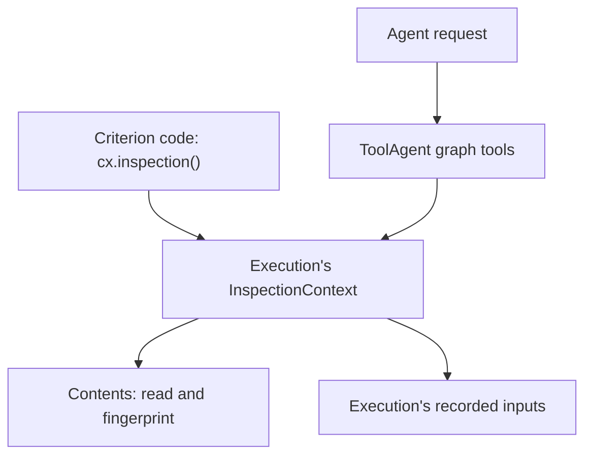

# Context tools and tracked inspection

An `execute` method can read additional graph nodes through
`cx.inspection()`. An agent can request additional reads through tools. Those
reads contribute inputs to the criterion's answer, alongside the contents
supplied by the ask builder.

## Find a node, then read its contents

Suppose a test calls a helper whose code the agent needs to examine. A search
finds the file containing the helper. The file's outline lists its functions
and gives each one an identifier. The agent can then read the helper's complete
contents using that identifier.

Searches and outlines help choose what to read. The read records the chosen
contents and their fingerprint, so a later change can make the answer stale.

## Agent tools call the same context as ordinary code

The SDK's graph tools are adapters around the inspection API available to the
criterion. They translate tool arguments and format results; the shared context
prepares reads and records observations.

:::{req} shared_context
`ValidationContext::inspection()` exposes the execution's `InspectionContext`.
The ask builder passes that context to `Agent::run`. The supplied `ToolAgent`
implements graph-node reads, outgoing-edge queries, and delivery recording by
delegating to that same context's operations.
:::



For source exploration, `SourceTools` adapts the
provider and parser operations described in [Sources and inspection](../sources.md).
That chapter explains how applications configure sources and languages.

## Reading the contents of a graph node

Use a node's identity to obtain its application-defined
[contents](fingerprinting.md).

:::{req} read_node
```rust,ignore
// Method on InspectionContext<'_, D>, where D: Contents.
/// Read this node and record the fingerprint of the returned contents.
pub fn read(&self, node: &D::NodeId) -> Result<D::NodeContent, D::Error>;
```

The read follows {cite}`requirements.sdk.graph.evidence.node_inputs`.
`ToolAgent` exposes `read_node`, accepting a known node's `NodePath`. It
prepares that node's contents and fingerprint, formats the supplied contents
under {cite}`requirements.sdk.graph.agent-calls.judge.rendering`, and records
the observation when those contents are delivered.
:::

## Selecting a node's outgoing edges

Select relationships by their label. A criterion can use the returned node
identities to choose additional reads.

:::{req} outgoing_edges
```rust,ignore
// Method on InspectionContext<'_, D>, where D: Contents.
/// Obtain this source's targets for the label and record their set fingerprint.
pub fn outgoing_edges(
    &self,
    source: &D::NodeId,
    label: D::EdgeLabel,
) -> Result<Snapshot<Vec<D::NodeId>>, D::Error>
where
    D::EdgeLabel: PartialEq;
```

The snapshot pairs the returned target identities with their target-set
fingerprint under {cite}`requirements.sdk.graph.fingerprinting.snapshot`.
The selection becomes an observation under
{cite}`requirements.sdk.graph.evidence.inputs`; reading a target's contents
is a separate operation.

`ToolAgent` exposes this selection as `outgoing_edges`, with a known source
`NodePath` and a typed label argument. It returns the target paths and records
the selection when delivered. The adapter's label bounds follow
{cite}`requirements.sdk.graph.agent-harness.tool_agent`.
:::

## Reading a source item

A source item is identified by a resource and an outline selector, such as a
function within a file. Source identities are defined in
[Sources and inspection](../sources.md#identify-something-before-reading-it).

:::{req} read_source
The supplied `SourceTools` adapter exposes `read_source` with a resource
identity and an optional outline selector. An omitted or empty selector selects
the whole resource. The result supplies the selected item's contents.

The adapter's observation callback receives the selected identity and the
parsed source snapshot. `ToolAgent` records any dependency it returns when
those contents are delivered, under
{cite}`requirements.sdk.sources.provider_observations`.
:::

## Listing source resources

List resources when choosing a file or other source to inspect.

:::{req} list_sources
The supplied `SourceTools` adapter exposes `list_sources` with an optional
scope prefix.
It returns the identities supplied by `SourceProvider::list` under
{cite}`requirements.sdk.sources.provider`. The listing is discovery and
contributes no graph-node input observations.
:::

## Inspecting a source outline

An outline identifies the items within a source, so a caller can select one
for a content read.

:::{req} outline_source
The supplied `SourceTools` adapter exposes `outline_source` with a resource
identity. It parses that resource through `SourceAnalysis` and returns its
items' selectors and kinds. Inspecting the outline is discovery and contributes
no graph-node input observations.
:::

## Searching source text

Use a regular expression to locate relevant source text.

:::{req} search_text
The supplied `SourceTools` adapter exposes `search_text` with a regular
expression and optional scope prefix, context-window size, and match limit.
It uses `SourceProvider::search_text` and returns matches with their locations,
excerpts, and completeness under
{cite}`requirements.sdk.sources.provider_results.search_completeness`.
Search results and their pages are discovery and contribute no graph-node
input observations.
:::

## Searching source structure

Use a language and a structural query to locate syntax, such as calls to a
particular function.

:::{req} search_structure
The supplied `SourceTools` adapter exposes `search_structure` with a language
and an ast-grep rule, plus an optional scope prefix and match limit. It uses
`SourceAnalysis::search_structure` and returns matching source-item identities,
excerpts, and completeness under
{cite}`requirements.sdk.sources.provider_results.search_completeness`.
Search results and their pages are discovery and contribute no graph-node
input observations.
:::

The SDK's discovery policy is fixed for now. Habeas also offers `finish_search`
to record the enclosing source nodes of excerpts that an assessment relied on;
see [Authoring evidence](../../authoring.md#account-for-search-snippets).

## Continuing a paged result

Long results arrive in pages. Fetch another page to continue reading the same
prepared result.

:::{req} pages
`ToolAgent` exposes `get_node_page`, and `SourceTools` exposes
`get_source_page`, accepting page IDs returned by their prepared results.

A continuation returns the stored text and dependency metadata from the
prepared result without fetching replacement contents. When `ToolAgent`
delivers a read page, it records the dependencies retained by that page under
{cite}`requirements.sdk.graph.evidence.node_inputs`. Discovery pages retain
the discovery operation's dependency policy.
:::

## Habeas's application tools

Habeas supplies its own names and selectors for these operations.
`habeas` reads source items, requirements, examples, or terminology definitions;
`list_files`, `outline`, `ripgrep`, and `ast_grep` provide source discovery.
`references` finds connections to declarations, optionally filtered by reference
role. [Authoring evidence](../../authoring.md) specifies these argument forms.

### Inspecting external issue state

Habeas's supplementary `github` tool retrieves issue data without recording
evidence inputs. An application can represent issue state as a graph node and
use a tracked node read when the answer depends on it; see
[Habeas external nodes](../habeas.md#nodes-can-refer-to-external-state).

Structured submissions are explained separately in
[Agent harness](agent-harness.md#submit-a-structured-answer).

## Stay inside the tracked interface

Application code or an agent with its own shell could run ripgrep, read a file,
or fetch a URL independently. The SDK cannot observe those reads. A judgment
that relies on them would have an incomplete dependency record, so later
changes could escape the freshness check.

:::{req} tracked_inspection
Criteria and their agents should use the SDK's context inspection
operations for information on which a judgment depends.
The context records successful node-content observations in the enclosing
validation's trace. The SDK makes no recording claim for arbitrary filesystem,
process, or network I/O outside that interface. Discovery-only results do not
count as full reads of the nodes they locate.
:::

An application integrating its own tool must explicitly connect its delivered
observations to the SDK's tracking interface. Merely making the tool available
to the agent does not do this. Prefer a context operation when one exists;
otherwise the adapter must report the identity and fingerprint of the exact
contents delivered, without refetching them. See
[Remember what a procedure actually reads](evidence.md#remember-what-a-procedure-actually-reads).
