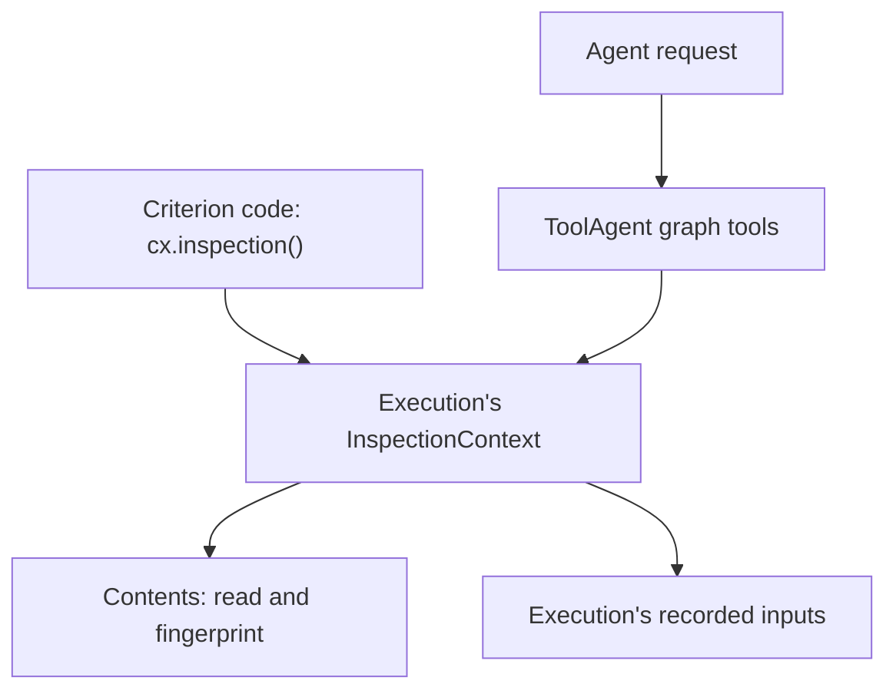

# Context tools and tracked inspection

An `execute` method can read additional graph nodes through
`cx.inspection()`. An agent can request additional reads through tools. Those
reads contribute to the execution's
{term}`requirements.sdk.graph.evidence.dependency_trace`, alongside the contents
supplied by the ask builder.

## Find a node, then read its contents

Suppose a test calls a helper whose code the agent needs to examine. A search
finds the file containing the helper. The file's outline lists its functions
and gives each one an identifier. The agent can then read the helper's complete
contents using that identifier.

Searches and outlines help choose what to read. The read records the chosen
contents and their fingerprint, so a later change can make the answer stale.

## Agent tools call the same context as ordinary code

The SDK's graph tools are adapters around the inspection API available to the
criterion. They translate tool arguments and format results; the shared context
prepares reads and records observations.

:::{req} shared_context
```rust,ignore
impl<'d, D: Domain> ValidationContext<'d, D> {
    /// Borrow the inspection context shared by this criterion's operations.
    pub fn inspection(&self) -> &InspectionContext<'d, D>;
}
```

`ValidationContext::inspection()` exposes the execution's `InspectionContext`.
The ask builder passes that context to `Agent::run`. The supplied `ToolAgent`
implements graph-node reads, outgoing-edge queries, and delivery recording by
delegating to that same context's operations.

Borrowing the context does not record an input. The reads and edge selections
performed through it contribute the observations described below.
:::



For source exploration, `SourceTools` adapts the
provider and parser operations described in [Sources and inspection](../sources.md).
That chapter explains how applications configure sources and languages.
The source-tool names, such as `read_source`, are commands exposed to the agent.
The signatures below show the Rust methods those commands use.

## Reading the contents of a graph node

Use a node's identity to obtain its application-defined
[contents](fingerprinting.md).

:::{req} read_node
```rust,ignore
impl<'d, D: Contents> InspectionContext<'d, D> {
    /// Read this node and record the fingerprint of the returned contents.
    pub fn read(&self, node: &D::NodeId) -> Result<D::NodeContent, D::Error>;
}
```

The result is the node's application-defined `D::NodeContent`. A successful
read records the node's identity and the fingerprint of those contents, under
{cite}`requirements.sdk.graph.evidence.node_inputs`. A failed read records no
successful observation. The evidence becomes stale when a later read of that
node has a different fingerprint; a failure to resolve it is reported by
{cite}`requirements.sdk.graph.evidence.checking_records`.

`ToolAgent` exposes `read_node`, accepting a known node's `NodePath`. It
prepares that node's contents and fingerprint, formats the supplied contents
under {cite}`requirements.sdk.graph.agent-calls.judge.rendering`, and records
the observation when those contents are delivered.
:::

## Selecting a node's outgoing edges

Select relationships by their label. A criterion can use the returned node
identities to choose additional reads.

:::{req} outgoing_edges
```rust,ignore
impl<'d, D: Contents> InspectionContext<'d, D> {
    /// Obtain this source's targets for the label and record their set fingerprint.
    pub fn outgoing_edges(
        &self,
        source: &D::NodeId,
        label: D::EdgeLabel,
    ) -> Result<Snapshot<Vec<D::NodeId>>, D::Error>
    where
        D::EdgeLabel: PartialEq;
}
```

The snapshot returns the target node identities and a fingerprint of their
set of stable `NodePath`s, under
{cite}`requirements.sdk.graph.fingerprinting.snapshot`. The returned vector
preserves the graph's ordering and duplicates.

The recorded dependency contains the source identity, the requested label,
and that set fingerprint. Adding or removing an identity from that set changes
it, including adding the first identity to an empty set. Reordering targets or
repeating a target does not change it. Changes to a target's contents do not affect this
dependency: reading those contents records a separate node dependency.
These observations follow {cite}`requirements.sdk.graph.evidence.inputs`
and {cite}`requirements.sdk.graph.evidence.checking_records`.

`ToolAgent` exposes this selection as `outgoing_edges`, with a known source
`NodePath` and a typed label argument. It returns the target paths and records
the selection when delivered. The adapter's label bounds follow
{cite}`requirements.sdk.graph.agent-harness.tool_agent`.
:::

## Reading a source item

A source item is identified by a resource and an outline selector, such as a
function within a file. Source identities are defined in
[Sources and inspection](../sources.md#identify-something-before-reading-it).

:::{req} read_source
```rust,ignore
impl<P: SourceProvider> SourceAnalysis<P> {
    /// Read and parse one resource, retaining the bytes used for its outline.
    pub async fn parse(&self, id: &ResourceId) -> Result<ParsedSource, P::Error>;
}
```

The supplied `SourceTools` adapter exposes `read_source` with a resource
identity and an optional outline selector. It calls `SourceAnalysis::parse`
and selects the requested item from the returned snapshot's outline.
An omitted or empty selector selects the whole resource.
The tool result contains the selected `OutlineId` and its text.

The adapter's observation callback receives the selected identity and the
parsed source snapshot. `ToolAgent` records any dependency it returns when
those contents are delivered, under
{cite}`requirements.sdk.sources.provider_observations`.
The callback maps the source item into the application's graph: a node
dependency records its identity and the fingerprint of the supplied contents.
That dependency becomes stale when the node's fingerprint changes. A callback
returning `None` supplies no dependency; calling `SourceAnalysis::parse`
directly also records none. Dependency comparison follows
{cite}`requirements.sdk.graph.evidence.checking_records`.
:::

## Listing source resources

List resources when choosing a file or other source to inspect.

:::{req} list_sources
```rust,ignore
pub trait SourceProvider: Send + Sync {
    type Error: From<SourceError> + Send;

    /// List resource identities within this scope.
    fn list(
        &self,
        scope: &SourceScope,
    ) -> impl Future<Output = Result<Vec<ResourceId>, Self::Error>> + Send;

    // Other provider methods omitted.
}
```

The supplied `SourceTools` adapter exposes `list_sources` with an optional
scope prefix, represented in Rust by `SourceScope::prefix`.
It returns the resource identities supplied by `SourceProvider::list` under
{cite}`requirements.sdk.sources.provider`. The listing is discovery and
records neither the returned identity set nor the resources' contents as
evidence inputs. Adding or removing a listed resource therefore does not by
itself invalidate the evidence. Subsequent tracked reads record their own
dependencies.
:::

## Inspecting a source outline

An outline identifies the items within a source, so a caller can select one
for a content read.

:::{req} outline_source
```rust,ignore
impl<P: SourceProvider> SourceAnalysis<P> {
    /// Read and parse one resource, returning its source snapshot and outline.
    pub async fn parse(&self, id: &ResourceId) -> Result<ParsedSource, P::Error>;
}
```

The supplied `SourceTools` adapter exposes `outline_source` with a resource
identity. It parses that resource through `SourceAnalysis` and returns its
items' selectors and kinds. The Rust result is a `ParsedSource` containing
the resource identity, source bytes, and `Outline`; the tool presents the
outline's selectors and kinds.

Inspecting the outline is discovery and records no evidence inputs. Changes to
that outline alone do not invalidate the evidence. A subsequent tracked read
of a selected item records that item's contents and fingerprint.
:::

## Searching source text

Use a regular expression to locate relevant source text.

:::{req} search_text
```rust,ignore
pub trait SourceProvider: Send + Sync {
    type Error: From<SourceError> + Send;

    /// Return regular-expression matches and whether the result is complete.
    fn search_text(
        &self,
        query: &TextQuery,
    ) -> impl Future<Output = Result<TextMatches, Self::Error>> + Send {
        defaults::search_text(self, query)
    }

    // Other provider methods omitted.
}
```

The supplied `SourceTools` adapter exposes `search_text` with a regular
expression and optional scope prefix, context-window size, and match limit.
These correspond to `TextQuery`'s `pattern`, `scope`, `context_lines`, and
`limit`. It uses `SourceProvider::search_text` and returns each match's
resource identity, line number, and excerpt, together with whether the search
is complete, under
{cite}`requirements.sdk.sources.provider_results.search_completeness`.

Search results and their pages are discovery. They record neither the matching
identity set nor the excerpts as evidence inputs, including when no matches
are returned. Changes to those results do not by themselves invalidate the
evidence. Read a matched item through a tracked operation to record a
dependency on its contents.
:::

## Searching source structure

Use a language and a structural query to locate syntax, such as calls to a
particular function.

:::{req} search_structure
```rust,ignore
impl<P: SourceProvider> SourceAnalysis<P> {
    /// Return structural matches and whether the result is complete.
    pub async fn search_structure(
        &self,
        query: &StructuralQuery,
    ) -> Result<StructuralMatches, P::Error>;
}
```

The supplied `SourceTools` adapter exposes `search_structure` with a language
and an ast-grep rule, plus an optional scope prefix and match limit. It uses
`SourceAnalysis::search_structure`; `StructuralQuery` holds the `language`,
`rule`, `scope`, and `limit`. Each match contains an `OutlineId` and an
excerpt; the result also states whether the search is complete, under
{cite}`requirements.sdk.sources.provider_results.search_completeness`.

Search results and their pages are discovery and record no evidence inputs,
including an empty result. Changes to matches or excerpts do not by themselves
invalidate the evidence. A subsequent tracked read records the selected
item's contents and fingerprint.
:::

The SDK's discovery policy is fixed for now. Habeas also offers `finish_search`
to record the enclosing source nodes of excerpts that an assessment relied on;
see [Authoring evidence](../../authoring.md#account-for-search-snippets).

## Continuing a paged result

Long results arrive in pages. Fetch another page to continue reading the same
prepared result.

:::{req} pages
```rust,ignore
// Graph-tool calls go through the harness's Conversation.
pub trait Conversation: Send {
    type Output: Send;

    fn dispatch(
        &mut self,
        name: &str,
        arguments: &serde_json::Value,
    ) -> impl Future<Output = std::io::Result<String>> + Send;

    // Other conversation methods omitted.
}

// Source-tool calls go through the factory's per-conversation ToolSession.
pub trait ToolSession<D: Graph>: Send {
    fn dispatch<'a>(
        &'a mut self,
        name: &'a str,
        arguments: &'a serde_json::Value,
    ) -> BoxFuture<'a, std::io::Result<ToolDelivery<D::NodeId, D::EdgeLabel>>>;

    // Other session methods omitted.
}
```

`ToolAgent` exposes `get_node_page`, and `SourceTools` exposes
`get_source_page`, accepting page IDs returned by their prepared results.
They are dispatched with the tool name and a `{"page": page_id}` argument.
The graph dispatcher returns response text; a source session returns
`ToolDelivery`, containing response text and any dependencies awaiting delivery.

A continuation returns the stored text and dependency metadata from the
prepared result without fetching replacement contents. When `ToolAgent`
delivers a read page, it records the dependencies retained by that page under
{cite}`requirements.sdk.graph.evidence.node_inputs`. Each page of a graph-node
read carries the original node identity and content fingerprint; reading a
later page does not observe a newer version. A change to that node's
fingerprint can invalidate the evidence even if it happens between pages.
Source-read pages retain whatever dependency the observation callback supplied.
Discovery pages record no evidence inputs, just like the original discovery
result.
:::

## Habeas's application tools

Habeas supplies its own names and selectors for these operations.
`habeas` reads source items, requirements, examples, or terminology definitions;
`list_files`, `outline`, `ripgrep`, and `ast_grep` provide source discovery.
`references` finds connections to declarations, optionally filtered by reference
role. [Authoring evidence](../../authoring.md) specifies these argument forms.

### Inspecting external issue state

Habeas's supplementary `github` tool retrieves issue data without recording
evidence inputs. An application can represent issue state as a graph node and
use a tracked node read when the answer depends on it; see
[Habeas external nodes](../habeas.md#nodes-can-refer-to-external-state).

Structured submissions are explained separately in
[Agent harness](agent-harness.md#submit-a-structured-answer).

## Stay inside the tracked interface

Application code or an agent with its own shell could run ripgrep, read a file,
or fetch a URL independently. The SDK cannot observe those reads. A judgment
that relies on them would have an incomplete dependency record, so later
changes could escape the freshness check.

:::{req} tracked_inspection
Criteria and their agents should use the SDK's context inspection
operations for information on which a judgment depends.
The context records successful node-content observations in the enclosing
validation's trace. The SDK makes no recording claim for arbitrary filesystem,
process, or network I/O outside that interface. Discovery-only results do not
count as full reads of the nodes they locate.
:::

An application integrating its own tool must explicitly connect its delivered
observations to the SDK's tracking interface. Merely making the tool available
to the agent does not do this. Prefer a context operation when one exists;
otherwise the adapter must report the identity and fingerprint of the exact
contents delivered, without refetching them. See
[Remember what a procedure actually reads](evidence.md#remember-what-a-procedure-actually-reads).
