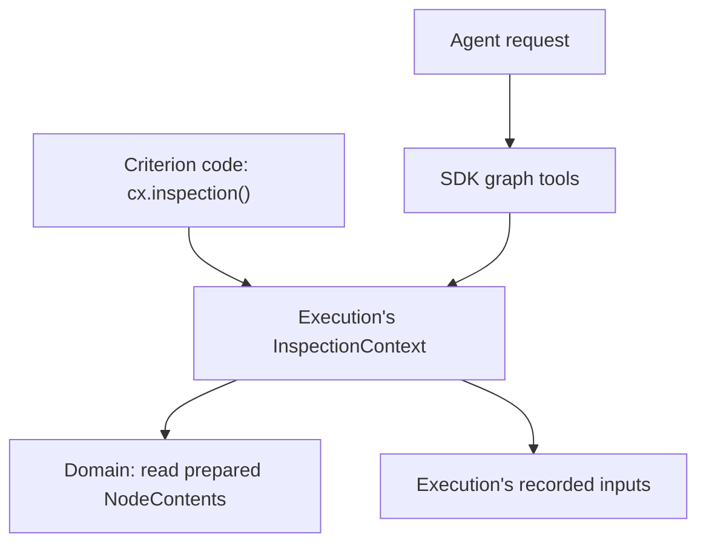

# Context tools and tracked inspection

An `execute` method can read additional graph nodes through
`cx.inspection()`. An agent can request additional reads through tools. Those
reads contribute to the execution's
{term}`requirements.sdk.graph.evidence.dependency_trace`, alongside the contents
supplied by the ask builder.

## Find a node, then read its contents

Suppose a test calls a helper whose code the agent needs to examine. A search
finds the file containing the helper. The file's outline lists its functions
and gives each one an identifier. The agent can then read the helper's complete
contents using that identifier.

Searches and outlines help choose what to read. The read records the chosen
contents and their fingerprint, so a later change can make the answer stale.

## Access the criterion's source and inputs

Before reading additional inputs, criterion code can identify its source
and select related nodes through its validation context.

:::{req} root_inputs
```rust,ignore
// Defined in habeas_sdk::graph.
/// Input selection and tracked observations for one criterion execution.
pub struct ValidationContext<'cx, D: Domain> { /* private fields */ }

impl<'cx, D: Domain> ValidationContext<'cx, D> {
    /// The source node this criterion examines.
    pub fn node_id(&self) -> &D::NodeId;

    /// Tracked graph reads and edge selections for this execution.
    pub fn inspection(&self) -> &InspectionContext<'cx, D>;

    /// Select outgoing edges by label, preserving their order and duplicates.
    /// Record this label's target-set fingerprint even when nothing matches.
    /// Target contents enter the trace when explicitly read or inserted.
    pub fn successors(
        &self,
        label: &D::EdgeLabel,
    ) -> Result<Vec<D::NodeId>, D::Error>
    where
        D::EdgeLabel: PartialEq;
}
```

Labels match by equality. A change to the recorded target set makes prior
evidence stale, including adding an edge to an empty selection. Target contents
become dependencies through tracked reads or agent insertions. An edge selects a
related source; assessments of that target remain separate.
:::

## Agent tools call the same context as ordinary code

The SDK's graph tools call the same inspection operations as criterion code.
The shared context prepares reads and records observations.

:::{req} shared_context
```rust,ignore
impl<'d, D: Domain> ValidationContext<'d, D> {
    /// Borrow the inspection context shared by this criterion's operations.
    pub fn inspection(&self) -> &InspectionContext<'d, D>;
}
```

`ValidationContext::inspection()` exposes the execution's `InspectionContext`.
The SDK's supplied agent uses that same context for graph-node reads,
outgoing-edge queries, and delivery recording. The application supplies data
through its domain; the SDK supplies and dispatches the tools.

Borrowing the context does not record an input. The reads and edge selections
performed through it contribute the observations described below.
:::



Source discovery uses the resource access and independent outline library
described in [Sources and inspection](../sources.md). The application maps
source addresses into its graph and resolves their contents. The SDK's
`read_source` tool uses that mapping, then performs the same tracked node read
as criterion code. The signatures below describe the Rust operations behind
the fixed tools.

## Reading the contents of a graph node

Use a node's identity to obtain its application-defined
[contents](../graph.md#read-node-contents).

:::{req} read_node.fn
The SDK offers this `InspectionContext` method and exposes it to the agent
as the `read_node` command.

```rust,ignore
impl<'d, D: Domain> InspectionContext<'d, D> {
    /// Read the contents of this graph node.
    pub fn read(&self, node: &D::NodeId) -> Result<D::NodeContent, D::Error>;
}
```
:::

:::{req} read_node.behavior
`InspectionContext::read` returns the node's application-defined
`D::NodeContent`, or the domain's read error.

The SDK's `read_node` tool accepts a known node's `NodePath` and returns its
contents formatted under
{cite}`requirements.sdk.graph.agent-calls.judge.rendering`.
:::

:::{req} read_node.inputs
A successful `InspectionContext::read` records the node's identity and the
fingerprint of the returned contents, under
{cite}`requirements.sdk.graph.evidence.node_inputs`. A failed read records no
successful observation. The evidence becomes stale when a later read of that
node has a different fingerprint; a failure to resolve it is reported by
{cite}`requirements.sdk.graph.evidence.checking_records`.

The SDK prepares the contents and their fingerprint together and records
the observation when those contents are delivered. The dependency describes
the supplied contents, rather than a replacement read.
:::

## Selecting a node's outgoing edges

Select relationships by their label. A criterion can use the returned node
identities to choose additional reads.

:::{req} outgoing_edges.fn
The SDK offers this `InspectionContext` method and exposes it to the agent
as the `outgoing_edges` command.

```rust,ignore
impl<'d, D: Domain> InspectionContext<'d, D> {
    /// Obtain this source's targets for the label.
    pub fn outgoing_edges(
        &self,
        source: &D::NodeId,
        label: D::EdgeLabel,
    ) -> Result<Snapshot<Vec<D::NodeId>>, D::Error>
    where
        D::EdgeLabel: PartialEq;
}
```
:::

:::{req} outgoing_edges.behavior
`InspectionContext::outgoing_edges` returns the target node identities and a
fingerprint of their set of stable `NodePath`s, under
{cite}`requirements.sdk.graph-edges.snapshot`. The returned vector
preserves the graph's ordering and duplicates.

The SDK's `outgoing_edges` tool accepts a known source `NodePath` and a typed
label argument and returns the target paths. The SDK obtains those identities through the
application's graph.
:::

:::{req} outgoing_edges.inputs
A successful edge selection records the source identity, the requested label,
and the fingerprint of the returned target identity set. Adding or removing an
identity from that set changes it, including adding the first identity to an
empty set. Reordering targets or repeating a target does not change it.
Changes to a target's contents do not affect this dependency: reading those
contents records a separate node dependency. These observations follow
{cite}`requirements.sdk.graph.evidence.inputs` and
{cite}`requirements.sdk.graph.evidence.checking_records`.

`InspectionContext::outgoing_edges` records the selection when returning it.
The SDK agent records the prepared selection when delivered. A failed selection
records no successful observation.
:::

## Reading a source item

A source item is identified by a resource and an outline selector, such as a
function within a file. Source identities are defined in
[Sources and inspection](../sources.md#identify-something-before-reading-it).

:::{req} read_source.fn
The SDK exposes a tracked source read for domains supplying the source-node
mapping under {cite}`requirements.sdk.sources.source_nodes`. It is available
as the agent's `read_source` command.

The Rust interface has this shape; `SourceNodes` names the capability sketched
in the source chapter:

```rust,ignore
impl<'d, D: Domain + SourceNodes> InspectionContext<'d, D> {
    /// Map this source address into the graph and read its node contents.
    pub fn read_source(&self, item: &OutlineId) -> Result<D::NodeContent, D::Error>;
}
```
:::

:::{req} read_source.behavior
`read_source` accepts a resource identity and an optional outline selector.
An omitted or empty selector identifies the whole resource. The operation maps
that `OutlineId` into the application's graph, then obtains its node contents
through `Domain::node_content`. Mapping and read failures return errors.

The Rust caller receives `D::NodeContent`; the agent receives those same
contents presented by `NodeContents::format` under
{cite}`requirements.sdk.graph.node_content.format`.
:::

:::{req} read_source.inputs
A successful source read records the mapped node's identity and the fingerprint
of the supplied contents under
{cite}`requirements.sdk.sources.provider_observations`. Direct tracked reads
record when returning the contents; agent reads record when delivering them.
Failures record no successful observation.

The dependency becomes stale when that node's fingerprint changes. The source
mapping cannot return an untracked successful read. Calling the standalone
outline parser directly records no graph dependency; a tracked node read must
enclose its use when its contents contribute to an assessment.
:::

## Listing source resources

List resources when choosing a file or other source to inspect.

:::{req} list_sources.fn
The SDK offers this `SourceProvider` method. Its source tools expose the
`list_sources` command using the application's source provider.

```rust,ignore
pub trait SourceProvider: Send + Sync {
    type Error: From<SourceError> + Send;

    /// List resource identities within this scope.
    fn list(
        &self,
        scope: &SourceScope,
    ) -> impl Future<Output = Result<Vec<ResourceId>, Self::Error>> + Send;

    // Other provider methods omitted.
}
```
:::

:::{req} list_sources.behavior
The SDK's source tools expose `list_sources` with an optional
scope prefix, represented in Rust by `SourceScope::prefix`.
It returns the resource identities supplied by `SourceProvider::list` under
{cite}`requirements.sdk.sources.provider`.
:::

:::{req} list_sources.inputs
The SDK's `list_sources` result is discovery and
records neither the returned identity set nor the resources' contents as
evidence inputs. Adding or removing a listed resource therefore does not by
itself invalidate the evidence. Subsequent tracked reads record their own
dependencies.
:::

## Inspecting a source outline

An outline identifies the items within a source, so a caller can select one
for a content read.

:::{req} outline_source.fn
The SDK offers this `SourceAnalysis` method and exposes the `outline_source`
command through its source tools.

```rust,ignore
impl<P: SourceProvider> SourceAnalysis<P> {
    /// Parse a source resource.
    pub async fn parse(&self, id: &ResourceId) -> Result<ParsedSource, P::Error>;
}
```
:::

:::{req} outline_source.behavior
The SDK's `outline_source` tool accepts a resource identity and delegates to
`SourceAnalysis::parse`, including the source provider's parsing override.
The default obtains one resource snapshot through the provider and parses
that snapshot with the outline library.

The tool returns the parsed outline's selectors and kinds. The Rust parse
result retains the resource identity and the parsed source snapshot under
{cite}`requirements.sdk.sources.provider_results.parse_snapshot`.
:::

:::{req} outline_source.inputs
The SDK's `outline_source` result is discovery and records no evidence inputs. Changes to
that outline alone do not invalidate the evidence. A subsequent tracked read
of a selected item records that item's contents and fingerprint.
:::

## Searching source text

Use a regular expression to locate relevant source text.

:::{req} search_text.fn
The SDK offers this `SourceProvider` method and its shown default
delegation. Its source tools expose the `search_text` command.

```rust,ignore
pub trait SourceProvider: Send + Sync {
    type Error: From<SourceError> + Send;

    /// Search source text.
    fn search_text(
        &self,
        query: &TextQuery,
    ) -> impl Future<Output = Result<TextMatches, Self::Error>> + Send {
        defaults::search_text(self, query)
    }

    // Other provider methods omitted.
}
```
:::

:::{req} search_text.behavior
The SDK's source tools expose `search_text` with a regular
expression and optional scope prefix, context-window size, and match limit.
These correspond to `TextQuery`'s `pattern`, `scope`, `context_lines`, and
`limit`. It uses `SourceProvider::search_text` and returns each match's
resource identity, line number, and excerpt, together with whether the search
is complete, under
{cite}`requirements.sdk.sources.provider_results.search_completeness`.
:::

:::{req} search_text.inputs
The SDK's `search_text` results and their pages are discovery. They record neither the matching
identity set nor the excerpts as evidence inputs, including when no matches
are returned. Changes to those results do not by themselves invalidate the
evidence. Read a matched item through a tracked operation to record a
dependency on its contents.
:::

## Searching source structure

Use a language and a structural query to locate syntax, such as calls to a
particular function.

:::{req} search_structure.fn
The SDK offers this `SourceAnalysis` method and exposes the `search_structure`
command through its source tools.

```rust,ignore
impl<P: SourceProvider> SourceAnalysis<P> {
    /// Search source structure.
    pub async fn search_structure(
        &self,
        query: &StructuralQuery,
    ) -> Result<StructuralMatches, P::Error>;
}
```
:::

:::{req} search_structure.behavior
The SDK's source tools expose `search_structure` with a language
and an ast-grep rule, plus an optional scope prefix and match limit. It uses
`SourceAnalysis::search_structure`; `StructuralQuery` holds the `language`,
`rule`, `scope`, and `limit`. Each match contains an `OutlineId` and an
excerpt; the result also states whether the search is complete, under
{cite}`requirements.sdk.sources.provider_results.search_completeness`.
:::

:::{req} search_structure.inputs
The SDK's `search_structure` results and their pages are discovery and record no evidence inputs,
including an empty result. Changes to matches or excerpts do not by themselves
invalidate the evidence. A subsequent tracked read records the selected
item's contents and fingerprint.
:::

## Continuing a paged result

Long results arrive in pages. Fetch another page to continue reading the same
prepared result. The SDK retains the prepared text and its dependencies.

:::{req} pages.fn
The SDK exposes continuation operations for prepared node and source results
through its fixed `get_node_page` and `get_source_page` tools. Criterion code
can use the same page-continuation facility through inspection.

The public Rust interface has this shape:

```rust,ignore
impl<'d, D: Domain> InspectionContext<'d, D> {
    /// Return a continuation from the same prepared result snapshot.
    pub fn read_page(
        &self,
        page: &PageId,
    ) -> Result<String, PageError>;
}
```

The caller receives response text; the SDK privately retains each page's
dependency metadata. `PageError` reports continuation failures such as an
unknown page ID. The page-ID and error representations are illustrative here.
:::

:::{req} pages.behavior
The SDK's `get_node_page` and `get_source_page` accept page IDs issued by the
originating execution or conversation's prepared results. A page ID cannot
retrieve another execution's result. A continuation returns stored text
without fetching replacement contents. Unknown or unavailable page IDs return
errors.
:::

:::{req} pages.inputs
A delivered read page records the dependencies retained by that page under
{cite}`requirements.sdk.graph.evidence.node_inputs`. Each continuation of a
node or mapped source read retains the original node identity and content
fingerprint; reading a later page does not observe a newer version. A change
to that node's fingerprint can invalidate the evidence even if it happens
between pages. Direct inspection records on return; agent tools record on
delivery. Discovery pages record no evidence inputs, just like their initial
result. Preparing an undelivered page records no read.
:::

## Stay inside the tracked interface

:::{req} tracked_inspection
Criteria and their agents should use the SDK's context inspection
operations for information on which a judgment depends.
The context records successful node-content observations in the enclosing
validation's trace. The SDK makes no recording claim for arbitrary filesystem,
process, or network I/O outside that interface. Discovery-only results do not
count as full reads of the nodes they locate.
:::

Application code performs source parsing or network access inside its domain's
node-content implementation. A tracked inspection read then records the node
value returned by that implementation.
[Remember what a procedure actually reads](evidence.md#remember-what-a-procedure-actually-reads)
describes the resulting dependency trace.
