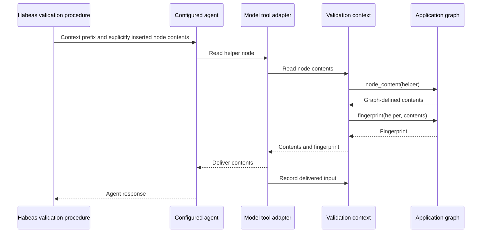

# Context tools and tracked inspection

The validation context is the application's route to additional inputs. Its
inspection operations are also exposed as tools to the agent. Both routes use
the same dependency trace, access policy, and redaction rules. The source
provider and language machinery behind these operations are described in
[Sources and inspection](../sources.md).

## Find a node, then read its contents

A review of `check_token` may need to inspect a helper. Text search or structural
search locates the helper; an outline identifies its selector; a node-content
read obtains the contents used in the judgment. Finding a node does not mean
that its contents have been examined.

## Agent tools call the same context as ordinary code

In the requirement example, the procedure explicitly inserts the requirement
text and test functions into its ask builder. Implementation references remain
available for discovery. Suppose a test calls a helper. The agent can request that helper
through a tool; the tool calls back into the validation context to read the
helper's node contents. Once delivered, those contents are recorded as an
additional input to this judgment.

The context is also the API for ordinary code. Both callers can read additional nodes.
The sources chapter develops the additional inspection operations for code. A procedure can call these typed operations directly; the model tool
adapter translates its arguments and formats its results. Access controls,
redaction, and input recording belong beneath both callers.

Every validation receives this context. Its inspection operations work whether
or not an agent provider is configured.

## Inspection operations and their agent presentation

Applications choose domain-specific tool names. The table uses Habeas's names
where they make the operation concrete; `habeas` and `references` expose Habeas
policy rather than requiring every SDK graph to contain requirements.

| Operation | Arguments and result | Dependency meaning |
| --- | --- | --- |
| Read a graph node | `inspection().read(&node_id)` returns graph-defined contents. | Records the node identity and the fingerprint of the returned contents. |
| Find and read source-node contents (`habeas`) | Select a resource and outline item, or locate items using a line range. Returns identified node contents. Habeas also offers requirement/example selections and terminology-definition reads. | Records the source nodes actually delivered, using selectors rather than line numbers as identity. |
| List resources (`list_files`) | A directory or provider scope; returns child resource identities and kinds. | Discovery. A listing does not establish that any resource's contents were read. |
| Inspect an outline (`outline`) | A resource identity; returns selectable items, kinds, names, and ancestry. | Discovery. Read a selected item to make its contents an input. |
| Text search (`ripgrep`) | A regex, search scope, and context-window options; returns matching nodes and excerpts. | Locates candidate nodes. Excerpts do not count as a full read of a matching node. |
| Structural search (`ast_grep`) | A structural pattern or configured query and resource/language scope; returns matching nodes and excerpts. | Locates syntax-related candidates. Read the nodes on which the conclusion relies. |
| Discover relationships (`references`) | In Habeas, a definition selection and reference roles; returns matching references and source selectors. Generic graph relationships come from `outgoing_edges`. | Discovery results do not read target contents. Explicit context successor selections record the outgoing-edge snapshot. |
| Inspect an external issue (`github`) | Habeas accepts a GitHub issue identity and returns issue data. | This supplementary Habeas tool does not record evidence inputs. When an issue state supports a judgment, expose it as a graph node and read it through the tracked context; see [Habeas external nodes](../habeas.md#nodes-can-refer-to-external-state). |
| Continue a paged result (`next_page`) | An opaque continuation token; returns another page of the original operation. | Keeps the underlying operation's semantics. Only delivered content pages contribute node reads. |

Habeas can constrain searches by the definitions and reference roles they relate
to. Those filters are application policy; they do not change the distinction
between finding a node and reading it. The exact Habeas argument forms are
specified in [Authoring evidence](../../authoring.md).

A structured submission tool is also supplied to each agent call, but is not an
inspection tool. Its SDK default name is `submit_result`; Habeas retains the
submission names and acceptance checks of its existing harness. It ends the
call with the typed result described in [Agent calls](agent-calls.md).
Awaiting an ask builder starts an agent interaction. Its
`current_node_contents()` and `successors_content(label)` calls explicitly
insert tracked contents after the reusable context prefix.

## Search tools use a fixed dependency policy

Text search and structural search call shared SDK operations through the
source-exploration interface to find resources and parse their contents.
The tools treat search result sets as discovery, without recording them as
assessment dependencies. A hook to customize that policy is deferred.
Habeas separately records the enclosing source nodes of excerpts selected
through `finish_search`; it does not track changes to the search result set.
Search results still report completeness: a truncated result cannot establish
the absence of other matches.

## Stay inside the tracked interface

Application code or an agent with its own shell could run ripgrep, read a file,
or fetch a URL independently. The SDK cannot observe those reads. A judgment
that relies on them would have an incomplete dependency record, so later
changes could escape the freshness check.

:::{req} tracked_inspection
Validation callbacks and their agents should use the SDK's context inspection
operations for information on which a judgment depends.
The context records successful node-content observations in the enclosing
validation's trace. The SDK makes no recording claim for arbitrary filesystem,
process, or network I/O outside that interface. Discovery-only results do not
count as full reads of the nodes they locate.
:::

An application integrating its own tool must explicitly connect its delivered
observations to the SDK's tracking interface. Merely making the tool available
to the agent does not do this. Prefer a context operation when one exists;
otherwise the adapter must report the identity and fingerprint of the exact
contents delivered, without refetching them. See
[Remember what a procedure actually reads](evidence.md#remember-what-a-procedure-actually-reads).
