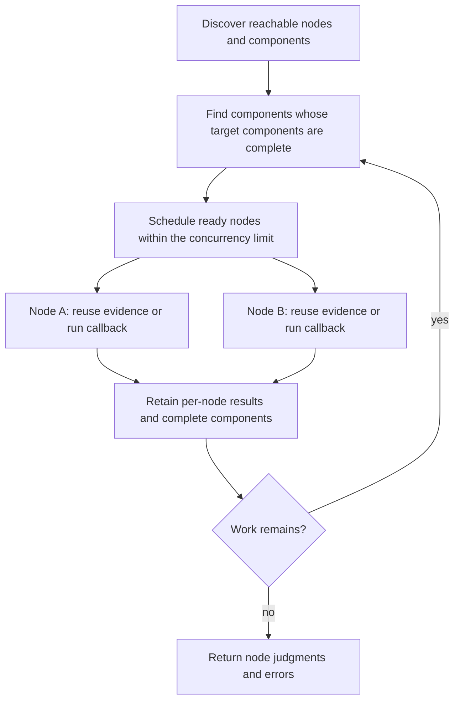

# Graph traversal

## Validate the reachable graph

Now suppose the application wants to validate not only the requirement but
also its implementation and test nodes. It calls `validate_transitive` with
the requirement as its starting node. The SDK discovers further nodes by
following outgoing edges; the caller supplies neither a complete graph nor a
list of every reachable node.

```rust,ignore
let results = validator
    .validate_transitive(&expiration, options)
    .await?;
```

For an acyclic graph, the SDK completes input-node validations before the nodes
that use their contents. Each node still uses the `validate_node` lifecycle,
so current evidence is reused. Reusing the root's evidence does not skip
validation of other reachable nodes.

:::{req} validate_transitive
When discovery succeeds for the finite graph reachable from the supplied
starting node, `validate_transitive` MUST follow outgoing edges and apply the `validate_node`
lifecycle to every reachable node, including the starting node. It MUST
schedule each node at most once per invocation, including nodes reached by
multiple paths and self-references. Current evidence for a node MUST NOT cause
its reachable inputs to be omitted. The operation MUST expose each node's
judgment or error without treating a `false` judgment as an execution error
or interpreting its application-specific metadata.
:::

Traversal is defined against the outgoing-edge snapshots collected for this
invocation. The runner retains each discovered selection. If a node's callback
or agent builder explicitly requests its successors, the context uses and
records that same selection snapshot. Discovery alone does not create an
assessment dependency or read target contents. This avoids scheduling against
one set of edges and supplying a different selection to the callback.
It does not promise an atomic snapshot of all node contents; later changes can
make the resulting evidence stale.

If an outgoing lookup fails, the operation reports that node's discovery error
and an incomplete-traversal state. It cannot claim to have reached every node.
Discovered work whose inputs and scheduling dependencies are available can
finish; there is no implicit retry or promise to follow a continuously changing
graph. The concrete result type must preserve this distinction.

Cycles prevent a strict children-first ordering. For example, two prose nodes
might cite one another. Their validation callbacks can still read each other's
contents without assuming either explanation is valid. Grouping such nodes
into a strongly connected component lets the scheduler finish external input
components first, then validate the nodes within the cycle.

:::{req} validation_cycles
Transitive validation MUST account for cycles without recursively scheduling
a node again or waiting for a judgment from another node in the same cycle.
It MUST complete target components before source components in the reachable
graph's strongly connected component ordering. Within a component, validations
MAY run concurrently and MUST use target contents without assuming positive
target judgments. A negative judgment MUST NOT by itself prevent validation
of a node that reads those contents. For component scheduling, a node is
complete when its validation attempt has returned either a judgment or an
error. An error MUST NOT leave other components waiting indefinitely.
:::

This first model does not make another node's validated result an implicit
input. Such dependencies would need a separate design for stratification or
other cycle semantics. Following content edges imposes no recursive proof
assumptions.

## Run independent validations in parallel

The implementation and test in our example can be checked concurrently. If
several requirements share the same helper, that helper is scheduled once in
this invocation. Separate components whose inputs are already complete can
also run concurrently. Inside a cycle, the validations can proceed together
because their inputs are contents rather than one another's judgments.



:::{req} validation_parallelism
Transitive validation MUST provide bounded internal parallelism with a positive,
caller-configurable limit on active per-node validation operations. With a limit
greater than one, when more than one validation is ready and capacity remains,
the scheduler MUST allow ready validations to make progress concurrently,
including validations within a strongly connected component. Scheduling
MUST preserve {cite}`requirements.sdk.graph.traversal.validation_cycles` and the per-node
deduplication required by {cite}`requirements.sdk.graph.traversal.validate_transitive`.
Each validation MUST have its own dependency trace so concurrent observations
are not attributed to another node's evidence.
:::

This limit bounds active node operations, not the total size of the reachable
graph or every nested tool call. The scheduler may retain identities, edges,
and component state for the reachable subgraph. The application never needs to
materialize the entire graph, and disconnected nodes are not discovered.
The shared domain and `Send` futures support execution across workers.
Deduplication applies within one invocation, not across processes.
