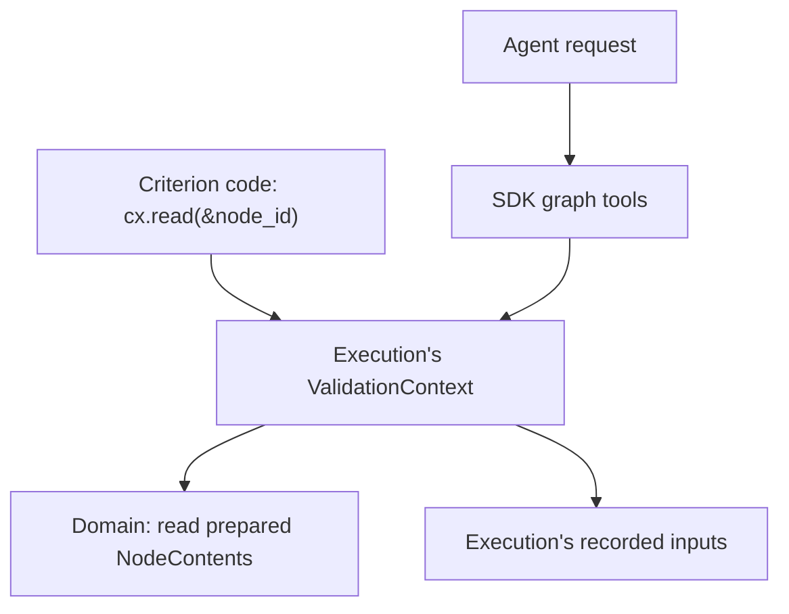

# Validation context

:::{definition} validation_context
:phrase: validation context

A *validation context* gives a {term}`requirements.sdk.graph.criteria.criterion`
the tools to decide whether it is satisfied and records which inputs it uses
during a single execution. An agent called by the criterion shares that context.
:::

:::{req} ValidationContext
:test: crates/trust-but-verify/tests/public_api.rs#fn[public_exports_match_the_appendix]

The SDK exposes the {term}`requirements.sdk.graph.validation-context.validation_context`
through `ValidationContext`. Criterion code can read graph nodes and source items, follow edges,
and call `ask` to dispatch an agent with a prompt. The agent can search project
files and use the same tracked reads as criterion code.

`Validator::verify` creates a context for one execution. Each tracked read adds
the input’s identity and a fingerprint of its contents to the dependency list.
The validator returns these dependencies with the answer so it can detect changed
inputs and rerun the criterion. [Searching project sources](search.md) explains
how the agent chooses which search excerpts to record.

```rust,ignore
pub struct ValidationContext<'d, D: Domain> { /* private fields */ }
```
:::

:::{req} ValidationContext.new
:test: crates/trust-but-verify/tests/public_api.rs#fn[public_exports_match_the_appendix]

Construct a context for a source node with an empty dependency list. `Validator::verify` does this for each execution.

```rust,ignore
impl<'d, D: Domain> ValidationContext<'d, D> {
    pub fn new(graph: &'d D, node: D::NodeId) -> Self;
}
```
:::

## Find a node, then read its contents

Suppose a test calls a helper whose code the agent needs to examine. A search
finds the file containing the helper. The file's outline lists its functions
and gives each one an identifier. The agent can then read the helper's complete
contents using that identifier.

If the agent reads the helper, that read records a dependency and the agent
can close the search with `used: []`. If the excerpt itself answers the
question, the agent can select its tag when closing the search. Either path
records the source observation on which the answer relies. [Searching project sources](search.md) walks through both choices.

## Access the criterion's source and inputs

Before reading additional inputs, criterion code can identify its source
and select related nodes through its validation context.

:::{req} ValidationContext.node_id
:test: crates/trust-but-verify/tests/public_api.rs#fn[public_exports_match_the_appendix]

Borrow the identity of the source node being checked.

```rust,ignore
impl<'d, D: Domain> ValidationContext<'d, D> {
    pub fn node_id(&self) -> &D::NodeId;
}
```
:::

:::{req} ValidationContext.successors
:test: crates/trust-but-verify/tests/public_api.rs#fn[public_exports_match_the_appendix]

Select targets of a labeled edge from the current source node. Record the target set even when it is empty. Reading a selected target records its contents separately.

```rust,ignore
impl<'d, D: Domain> ValidationContext<'d, D> {
    pub fn successors(
        &self,
        label: &D::EdgeLabel,
    ) -> Result<Vec<D::NodeId>, D::Error>
    where
        D::EdgeLabel: PartialEq;
}
```
:::

:::{req} root_inputs
`node_id` identifies the criterion’s source node. `successors` returns the targets
of its matching edges in order, including duplicates. Labels match by equality. A change to the recorded target set makes prior
evidence stale, including adding an edge to an empty selection. Target contents
become dependencies through tracked reads or agent insertions. An edge selects a
related source; assessments of that target remain separate.
:::

## Ask an agent

The [Agent calls](agent-calls.md) subchapter shows how to provide a prompt,
select the inputs, and await the agent’s typed answer.

:::{req} ValidationContext.ask
:test: crates/trust-but-verify/tests/public_api.rs#fn[public_exports_match_the_appendix]

Start an agent request that will decode its submitted answer as `R`. Its graph tools share the dependency list used by direct reads under {cite}`requirements.sdk.graph.validation-context.shared_context`.

```rust,ignore
impl<'d, D: Domain> ValidationContext<'d, D> {
    pub fn ask<R>(&self) -> Ask<'_, 'd, D, R, ContextPhase>
    where
        R: DeserializeOwned + JsonSchema + Send;
}
```
:::

## Agent tools call the same context as ordinary code

The SDK's graph tools call the same inspection operations as criterion code.
The shared context prepares reads and records observations.

:::{req} shared_context
During one call to `Validator::verify`, direct reads by the criterion and
reads served by the SDK's agent tools record inputs in the same
`ValidationContext`. For example, if criterion code reads a test and the agent
then reads its helper, both node fingerprints accompany the returned answer.
A subsequent verification starts with an empty dependency list.
:::



Source discovery uses the project files and outline module
described in [Sources and inspection](../sources.md). The application maps
source addresses into its graph and resolves their contents. The SDK's
`read_source` tool uses that mapping, then performs the same tracked node read
as criterion code.

For each operation, `.fn` identifies the Rust method and `.mcp` gives the
agent tool's name, JSON arguments, result shape, and the description sent to
the model in Rig's `ToolDefinition`. `.behavior` describes what
the caller receives, and `.inputs` specifies which observations enter evidence.
In the signatures, `?` marks an optional
field, `T[]` is an array, and `NodePath` is `{"segments": string[]}`. A `next` field holds a continuation UUID issued by the current conversation.

## Reading the contents of a graph node

Use a node's identity to obtain its application-defined
[contents](../graph.md#read-node-contents).

Rust callers pass the application's `D::NodeId`. The agent sends a `NodePath`
because `Domain` lets each application choose its own ID type and requires only
the [forward conversion from ID to path](../graph.md#habeas-req-requirements.sdk.graph.node_path_method).
The harness starts each conversation with the IDs of the current node and the
nodes supplied as inputs. When the agent sends a path, the harness finds the
known ID whose `Domain::node_path` equals it. An unknown path gives a tool error.

:::{req} ValidationContext.read
:test: crates/trust-but-verify/tests/public_api.rs#fn[public_exports_match_the_appendix]

Read a graph node and record the fingerprint of the returned contents under {cite}`requirements.sdk.graph.validation-context.read_node.inputs`.

```rust,ignore
impl<'d, D: Domain> ValidationContext<'d, D> {
    pub fn read(&self, node: &D::NodeId) -> Result<D::NodeContent, D::Error>;
}
```
:::

:::{req} ValidationContext.read_snapshot
:test: crates/trust-but-verify/tests/public_api.rs#fn[public_exports_match_the_appendix]

Read a node once and return both its contents and their fingerprint. Record the same fingerprint in the dependency list.

```rust,ignore
impl<'d, D: Domain> ValidationContext<'d, D> {
    pub fn read_snapshot(
        &self,
        node: &D::NodeId,
    ) -> Result<Snapshot<D::NodeContent>, D::Error>;
}
```
:::

:::{req} read_node.fn
Criterion code uses {cite}`requirements.sdk.graph.validation-context.ValidationContext.read` for this operation.
:::

:::{req} read_node.mcp
Give `read_node` the path of a known node. The result contains the node’s text. If more
text remains, pass `next` to `get_next_page`.

```text
read_node({path: NodePath}) -> {text: string, next?: UUID}
```
:::

:::{req} read_node.mcp.description
> `Read a known graph node. Returns text and, when more remains, a next UUID. A
> delivered page records its enclosing node.`
:::

:::{req} read_node.behavior
The Rust caller receives the node's complete `D::NodeContent` or the domain's read error.

The tool reads a known node, such as the current node or a target from `outgoing_edges`.
Each page’s `text` contains the next portion of the node’s formatted contents. Formatting follows
{cite}`requirements.sdk.graph.agent-calls.judge.rendering`.
:::

:::{req} read_node.inputs
A successful `ValidationContext::read` records the node's identity and the
fingerprint of the returned contents, under
{cite}`requirements.sdk.graph.evidence.node_inputs`. A failed read records no
successful observation. The evidence becomes stale when a later read of that
node has a different fingerprint; a failure to resolve it is reported by
{cite}`requirements.sdk.graph.evidence.checking_records`.

For a Rust caller, the SDK records the fingerprint when `read` returns the
contents. For an agent, the harness puts a tool result in the next request to
the model and records the fingerprint once the provider responds successfully.
That successful exchange is *delivery*. For example, suppose the tool reads a
function that returns `3`, and someone changes it to return `4` before the
provider responds. The model saw the version that returns `3`, so the SDK
records the fingerprint it computed from that version. Reading the function
again at this point would record a fingerprint for code the model never saw.
:::

## Selecting a node's outgoing edges

Select relationships by their label. A criterion can use the returned node
identities to choose additional reads.

:::{req} ValidationContext.outgoing_edges
:test: crates/trust-but-verify/tests/public_api.rs#fn[public_exports_match_the_appendix]

Select targets from any supplied node by label, returning the target IDs and the recorded target-set fingerprint under {cite}`requirements.sdk.graph.validation-context.outgoing_edges.inputs`.

```rust,ignore
impl<'d, D: Domain> ValidationContext<'d, D> {
    pub fn outgoing_edges(
        &self,
        node: &D::NodeId,
        label: D::EdgeLabel,
    ) -> Result<Snapshot<Vec<D::NodeId>>, D::Error>
    where
        D::EdgeLabel: PartialEq;
}
```
:::

:::{req} outgoing_edges.fn
Criterion code uses {cite}`requirements.sdk.graph.validation-context.ValidationContext.outgoing_edges` for this operation.
:::

:::{req} outgoing_edges.mcp
Give `outgoing_edges` a known source path and a label of the application’s
edge-label type. Each path in `targets` can be used in a subsequent graph tool call.

```text
outgoing_edges({path: NodePath, label: EdgeLabel}) -> {targets: NodePath[]}
```
:::

:::{req} outgoing_edges.mcp.description
> `Inspect a known node's outgoing targets for the requested label, making those
> targets available to read_node.`
:::

:::{req} outgoing_edges.behavior
The returned vector preserves order and duplicates. The fingerprint describes
the set of stable target paths under {cite}`requirements.sdk.graph.validation-context.snapshot`.

Follow edges with `label` from the known source at `path`. The application's
`D::EdgeLabel` supplies the JSON schema for `label`. The harness retains each
target's `D::NodeId` and returns its `NodePath` to the agent. The agent can pass
any path in `targets` directly to `read_node` or `outgoing_edges` in the same
conversation.
:::

:::{req} outgoing_edges.inputs
A successful edge selection records the source identity, the requested label,
and the fingerprint of the returned target identity set. Adding or removing an
identity from that set changes it, including adding the first identity to an
empty set. Reordering targets or repeating a target does not change it.
Changes to a target's contents do not affect this dependency: reading those
contents records a separate node dependency. These observations follow
{cite}`requirements.sdk.graph.evidence.inputs` and
{cite}`requirements.sdk.graph.evidence.checking_records`.

`ValidationContext::outgoing_edges` records the selection when returning it.
The SDK agent records the prepared selection when delivered. A failed selection
records no successful observation.
:::

:::{req} snapshot
:test: crates/trust-but-verify/tests/public_api.rs#fn[public_exports_match_the_appendix]

For a tracked label-specific edge query, the SDK constructs a
{term}`requirements.sdk.graph.content_snapshot` from the returned targets and
their target-set fingerprint, without another query.

The public `trust_but_verify::graph::edge_fingerprint(graph, targets)` helper
computes this `Fingerprint` from the domain and a slice of target node IDs.
It sorts and deduplicates the targets' `NodePath`s and hashes an unambiguous
encoding under a versioned scheme, including when the set is empty. Changing
order, duplicate edges, or another label's relationships leaves this fingerprint
unchanged. Reading target contents is a separate observation;
`NodeContents::fingerprint` describes those contents under
{cite}`requirements.sdk.graph.node_content.fingerprint`.

The returned vector preserves the graph's ordering and duplicates.

```rust,ignore
pub fn edge_fingerprint<D: Domain>(
    graph: &D,
    targets: &[D::NodeId],
) -> Fingerprint;
```
:::

## Reading a source item

A source item has a file path and an outline selector, such as a function
within a file. Discovery identifies files through
[source files](../sources.md#identify-source-files) in the project directory.

:::{req} ValidationContext.read_source
:test: crates/trust-but-verify/tests/public_api.rs#fn[public_exports_match_the_appendix]

Resolve an outline item to its graph node, read the contents, and record the observation under {cite}`requirements.sdk.graph.validation-context.read_source.inputs`.

```rust,ignore
impl<D: SourceNodes> ValidationContext<'_, D> {
    pub fn read_source(&self, item: &OutlineId) -> Result<D::NodeContent, D::Error>;
}
```
:::

:::{req} read_source.fn
Criterion code uses {cite}`requirements.sdk.graph.validation-context.ValidationContext.read_source` for this operation.
:::

:::{req} read_source.mcp
Give `read_source` a project-relative file path. Supply `selector` to read one
outline item. Each page identifies the item alongside its text.

```text
read_source({path: string, selector?: string})
  -> {node: OutlineId, text: string, next?: UUID}
```
:::

:::{req} read_source.mcp.description
> `Read a selected source node and record its exact observation.`
:::

:::{req} read_source.behavior
`SourceNodes` maps the `OutlineId` into the graph. `Domain::node_content`
returns that node’s `D::NodeContent`. Mapping and read failures return errors.

Read a project-relative file or an item within it. An omitted or empty selector
chooses the whole file. `node` contains the path and selector, and `text` is the
mapped node's `NodeContents::format` output. For long reads, [continue with `next`](#continuing-a-paged-result). Project access follows
{cite}`requirements.sdk.sources.local_provider`.
:::

:::{req} read_source.inputs
A successful source read records the mapped node's identity and the fingerprint
of the supplied contents under
{cite}`requirements.sdk.sources.provider_observations`. Direct tracked reads
record when returning the contents; agent reads record when delivering them.
Failures record no successful observation.

The dependency becomes stale when that node's fingerprint changes. The source
mapping cannot return an untracked successful read. Calling the standalone
outline parser directly records no graph dependency; a tracked node read must
enclose its use when its contents contribute to an assessment.
:::

## Listing source files

Use a [source scope](search.md#choosing-a-source-scope) to choose which files to list.

:::{req} list_sources.fn
```rust,ignore
impl Sources {
    // ...

    /// List file identities within this scope.
    pub async fn list(&self, scope: &SourceScope) -> Result<Vec<PathBuf>, SourceError>;

    // ...
}
```
:::

:::{req} list_sources.mcp
Call `list_sources` with an empty object to list the project, or supply
`prefix` to select a file or directory. Each page contains a `files` array of complete paths.

```text
list_sources({prefix?: string})
  -> {files: string[], next?: UUID}
```
:::

:::{req} list_sources.mcp.description
> `List available project files.`
:::

:::{req} list_sources.behavior
List project-relative file paths in the [selected scope](search.md#choosing-a-source-scope).
Omitting `prefix` lists all visible project files. If more paths remain, follow `next` as shown in
[Continuing a paged result](#continuing-a-paged-result).
:::

:::{req} list_sources.inputs
The SDK's `list_sources` result is discovery and
records neither the returned identity set nor the files' contents as
evidence inputs. Adding or removing a listed file therefore does not by
itself invalidate the evidence. Subsequent tracked reads record their own
dependencies.
:::

## Inspecting a source outline

An outline identifies the items within a source, so a caller can select one
for a content read.

:::{req} outline_source.fn
```rust,ignore
impl Sources {
    // ...

    /// Outline one file snapshot.
    pub async fn parse(
        &self,
        path: impl AsRef<Path>,
    ) -> Result<OutlineContent, SourceError>;

    // ...
}
```
:::

:::{req} outline_source.mcp
Give `outline_source` a project-relative file path. The outline pairs each
item’s selector with its kind. Every page names the file and carries complete outline items.

```text
outline_source({path: string})
  -> {path: string, items: {selector: string, kind: string}[], next?: UUID}
```
:::

:::{req} outline_source.mcp.description
> `Inspect selectable items in a project file.`
:::

:::{req} outline_source.behavior
`Sources::parse` reads a single file snapshot. `OutlineContent` retains its
identity and parsed contents under {cite}`requirements.sdk.sources.provider_results.parse_snapshot`.

Inspect the selectable items in a visible project file. Pass a returned selector
and the same `path` to `read_source` to read that item. Follow [`next`](#continuing-a-paged-result) to see more items.
:::

:::{req} outline_source.inputs
The SDK's `outline_source` result is discovery and records no evidence inputs. Changes to
that outline alone do not invalidate the evidence. A subsequent tracked read
of a selected item records that item's contents and fingerprint.
:::

## Continuing a paged result

Read each page as soon as it arrives. For example, suppose `list_sources` has
one more page of file names. This example shows one path from each page.

```text
list_sources({"prefix":"src"})
→ {"files":["src/a.rs"], "next":"71d27a0b-f65f-47e5-9aa2-750335b78897"}

get_next_page({"uuid":"71d27a0b-f65f-47e5-9aa2-750335b78897"})
→ {"files":["src/z.rs"]}
```

The second page has no `next`, so the listing is complete. The same call
continues a node read, source read, outline, or search. A UUID from a node read
returns more `text`. A UUID from an outline returns more `items` for that file.

:::{req} pages.mcp
Pass the `next` UUID exactly as returned by the previous page. The UUID
identifies the prepared result and determines the shape of the returned object.

```text
get_next_page({uuid: UUID}) -> object
```
:::

:::{req} pages.mcp.description
> `Pass the UUID from next to read the next page in the same format. When next
> is absent, this is the last page.`
:::

:::{req} pages.behavior
Each page has the same result fields as the originating tool. Text reads return
successive portions of text. Listings, outlines, and searches return successive
arrays of whole entries in their original order. Only a page with a successor
includes `next`.

Reusing a UUID returns the same page from the original snapshot, including the
same successor UUID if more remains. A malformed UUID, an unknown UUID, or a UUID
from another conversation returns a tool error under
{cite}`requirements.sdk.graph.agent-harness.tool_agent.isolation`.
:::

:::{req} pages.inputs
A delivered read page records the dependencies retained by that page under
{cite}`requirements.sdk.graph.evidence.node_inputs`. Each continuation of a
node or mapped source read retains the original node identity and content
fingerprint; reading a later page does not observe a newer version. A change
to that node's fingerprint can invalidate the evidence even if it happens
between pages. Agent tools record on delivery. Discovery pages record no evidence
inputs, just like their initial result. Preparing an undelivered page records
no read.
:::

## Collect the inputs used by the criterion

:::{req} ValidationContext.dependencies
:test: crates/trust-but-verify/tests/public_api.rs#fn[public_exports_match_the_appendix]

Return a snapshot of the observations collected so far. Later reads continue to contribute to this execution.

```rust,ignore
impl<'d, D: Domain> ValidationContext<'d, D> {
    pub fn dependencies(&self) -> Vec<Dependency<D::NodeId, D::EdgeLabel>>;
}
```
:::

:::{req} ValidationContext.finish
:test: crates/trust-but-verify/tests/public_api.rs#fn[public_exports_match_the_appendix]

Build a storage record from the supplied criterion version, serialized output, and the dependencies collected so far. The caller can pass the record to its storage backend.

```rust,ignore
impl<'d, D: Domain> ValidationContext<'d, D> {
    pub fn finish(
        &self,
        version: CriterionVersion,
        output: impl Serialize,
    ) -> Result<Record<D::NodeId, D::EdgeLabel>, serde_json::Error>;
}
```
:::

## Stay inside the tracked interface

:::{req} ValidationContext.graph
:test: crates/trust-but-verify/tests/public_api.rs#fn[public_exports_match_the_appendix]

Borrow the application domain. Calls made directly on the domain bypass the context’s dependency tracking.

```rust,ignore
impl<'d, D: Domain> ValidationContext<'d, D> {
    pub fn graph(&self) -> &'d D;
}
```
:::

:::{req} tracked_inspection
Criteria and their agents should use the SDK's context inspection
operations for information on which a judgment depends.
The context records successful node-content observations in the enclosing
validation's trace. The SDK makes no recording claim for arbitrary filesystem,
process, or network I/O outside that interface. Discovery-only results do not
count as full reads of the nodes they locate.
:::

Application code performs source parsing or network access inside its domain's
node-content implementation. A tracked inspection read then records the node
value returned by that implementation.
[Remember what a procedure actually reads](evidence.md#remember-what-a-procedure-actually-reads)
describes the resulting dependency trace.
