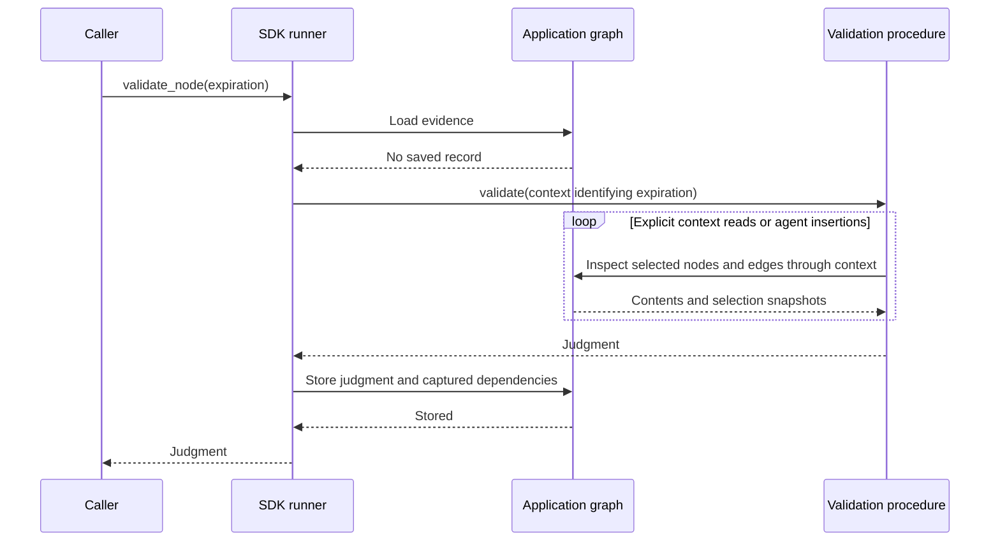
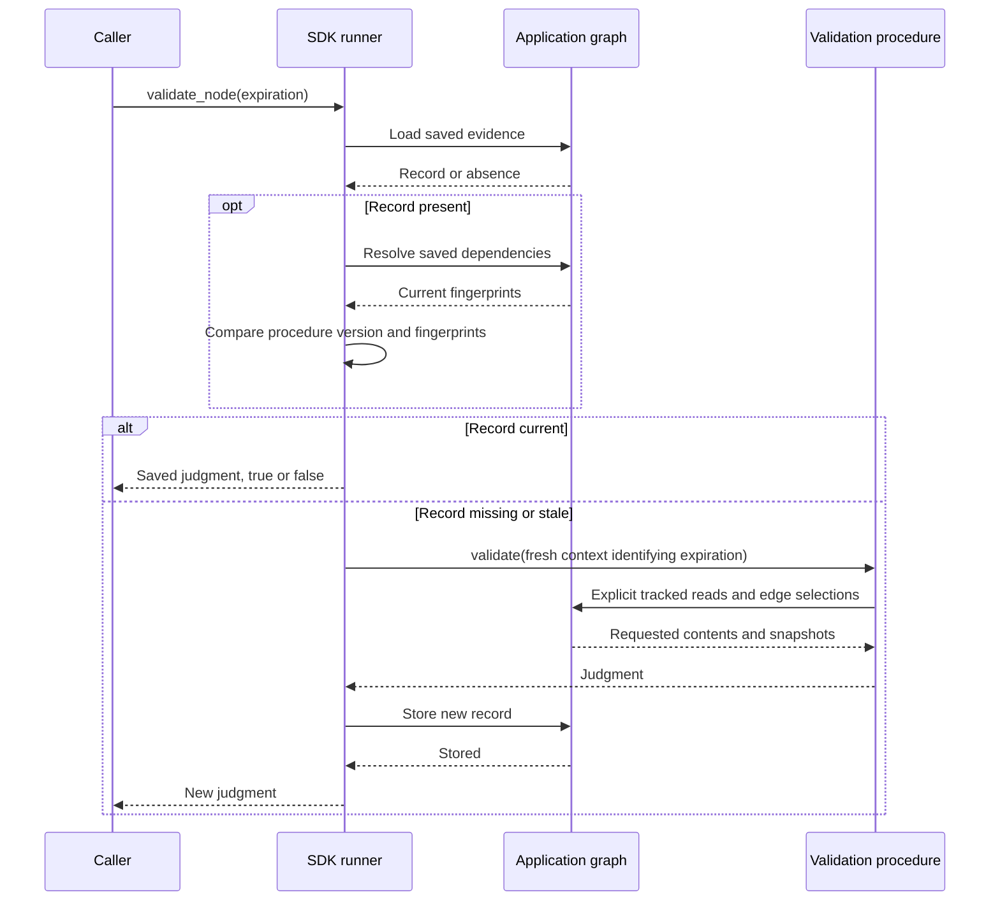

# Validation

Implement `Validation` to decide whether a node meets your application's
criterion. The SDK supplies a shared context for explicit input selection, captures
dependencies, and stores the judgment you return.

## Choose whether to check or validate

```rust,ignore
// Check saved evidence without invoking application validation.
let state = checker.check_node(&expiration).await?;

// Reuse current evidence, or validate and save a new record.
let judgment = validator.validate_node(&expiration).await?;
```

The SDK handles freshness, dependency tracking, and persistence. The application
callback decides validity. The sections below follow their interaction.

## Let the SDK create the validation context

Suppose no evidence has been saved for the expiration requirement. The SDK
creates a context identifying that node, invokes application code, then saves
the result and the observations the callback actually uses:



The callback receives only a shared `ValidationContext`. It can obtain the
subject's identity without reading its contents, inspect its outgoing edges, and
choose the contents needed for each computation or agent call.

:::{req} check_procedure
```rust,ignore
// Defined in habeas_sdk::graph.
pub enum ValidationError<E> {
    Graph(E),
    NoAgentConfigured,
    Agent(String),
}

pub trait Validation: Graph + Fingerprinting + Sized {
    /// Decide whether ctx.node_id() is valid.
    ///
    /// The runner supplies only this shared context. It reads no subject or
    /// target contents to prepare the callback; select inputs through ctx.
    /// No prepared NodeInputs bundle, extra application request, or
    /// EvidenceStorage capability is required.
    fn validate<'a, 'd>(
        &'a self,
        ctx: &'a ValidationContext<'d, Self>,
    ) -> impl Future<Output = Result<
        Judgment<Self::JudgmentMetadata>,
        ValidationError<Self::Error>,
    >> + Send + 'a
    where
        'd: 'a;
}
```

The context identifies the node requested by the caller. The callback remains
usable without `EvidenceStorage`; persistence belongs to the runner.
:::


The context provides identity and tracked selection independently of model use:

```rust,ignore
let subject = ctx.node_id();
let contents = ctx.inspection().read(subject)?;
let test_edges = ctx.successors(&HabeasEdgeLabel::Tests)?;
```

:::{req} root_inputs
```rust,ignore
// Methods on ValidationContext<'d, D>.

/// The node being validated. Obtaining its identity does not read its contents.
pub fn node_id(&self) -> &D::NodeId;

/// Select outgoing edges by label, preserving their order and duplicates.
/// Record this label's target-set fingerprint even when nothing matches.
/// Selecting edges does not read or validate their targets.
pub fn successors(
    &self,
    label: &D::EdgeLabel,
) -> Result<Vec<D::NodeId>, D::Error>
where
    D::EdgeLabel: PartialEq;
```

Labels match by equality. A change to the recorded target set makes prior
evidence stale, including adding an edge to an empty selection. Target contents
become dependencies only through explicit tracked reads or agent insertions.
An edge neither supplies nor requires a positive validation judgment for its target.
:::


## Return the application's judgment

The callback decides what validity means. For Habeas, that can include accepting
a gap with an adequate FIXME acknowledgment. The SDK receives a boolean,
explanation, and application metadata; it does not implement acknowledgment
policy or ask the callback to assemble an evidence record.

:::{req} judgment
```rust,ignore
/// The application's answer, defined in habeas_sdk::graph.
pub struct Judgment<M> {
    /// Whether the node satisfies the application-defined criterion.
    pub result: bool,
    /// Explanation of that result.
    pub rationale: String,
    /// Application-defined information; never an alternative result.
    pub metadata: M,
}

pub trait Graph: Send + Sync {
    // ...
    type JudgmentMetadata: Send + Sync;
}
```

The procedure returns `Judgment<D::JudgmentMetadata>`. The application defines
the criterion and metadata's meaning; the SDK preserves all three fields.
Failure to execute validation is an error, rather than a `false` judgment.
Habeas owns FIXME acknowledgment policy.
:::


## Investigate through the context

The callback can use ordinary code, inspect more nodes, ask an agent, or combine
those operations. The context is shared: concurrent operations contribute to
this validation's trace while keeping their request state independent.

```rust,ignore
let helper = ctx.inspection().read(&helper_id)?;

let answer: ExpirationAssessment = ctx.ask()
    .context((&review_policy, &project_conventions))
    .context(&question)
    .current_node_contents()
    .successors_content(HabeasEdgeLabel::Tests)
    .await?;
```

Here the application defines `ExpirationAssessment` as a deserializable,
schema-bearing response type. It also defines its instruction context values.
The example shows how the callback uses the SDK; the builder, context
composition, structured submission, and error contracts live in
[Agent calls](agent-calls.md).

The agent's tools use the same tracked inspection operations as ordinary code.
[Context tools](context-tools.md) accounts for node-content reads,
resource listings, outlines, ripgrep, ast-grep, relationship lookup, and paging.
Independent shell or filesystem reads do not automatically enter the evidence
record; use the tracked interface for information the judgment relies on.

A callback can run without a configured agent if it never awaits an ask builder.
Awaiting one without an agent reports `NoAgentConfigured`.

:::{req} deterministic_procedures
`Validation::validate` works without a configured model provider. A callback
that never invokes the agent interface does not fail because no agent is configured.
:::


## Check or reuse the evidence tomorrow

The application identifies its review rules with a procedure version such as
`test-adequacy-v1`. Changing the review prompt or deterministic checking logic
can require a new version even when all node contents are unchanged. This is
independent of model selection and of the context-prefix cache fingerprint.

The checker and validator obtain that version from a shared configured resolver,
not by running the validation callback:

:::{req} procedure_identity
Checker and validator configuration accepts an application-supplied resolver:

```rust,ignore
// Trait bounds on the configured resolver; not a separate domain trait.
Fn(&D::NodeId) -> Result<String, D::Error> + Send + Sync
```

Both `check_node` and `validate_node` use the same resolver. Checking needs
neither a `Validation` implementation nor model configuration. The runner
compares the resolved identity with saved evidence and uses that identity for
the replacement record. A resolution failure returns an error before invoking
validation or storing a completed judgment.
:::

Suppose we ask the SDK to validate `requirements.auth.expiration`. It first
looks for saved evidence. To decide whether that evidence is current, it checks
the procedure version and resolves the recorded dependencies: the requirement
itself if it was read, observed outgoing-edge selections, test inputs, and any
implementation or helper reads made by the previous review. Resolving these inputs
supplies their current fingerprints, computed from the contents being observed.
The freshness check therefore performs reads before it can reuse a judgment.

If all fingerprints still match, the SDK returns the saved judgment. This
includes a negative judgment: unchanged inputs do not justify rerunning a review
merely because it failed. A legacy record's stored procedure version `*`
matches any configured version under
{cite}`requirements.sdk.graph.evidence.checking_records.procedure_match`.
A concrete procedure-version or dependency mismatch can establish staleness
early, without checking the remaining saved dependencies.

When evidence is missing or stale, the SDK creates a fresh context identifying
the requested node. The callback chooses its reads and agent input insertions
and returns a judgment. Snapshots already obtained during this invocation can
be reused when they still represent the state being validated and satisfy an
explicit callback read or insertion. The SDK records the new run's observations
and stores its evidence.
Freshness checking uses a separate observation scope from the new assessment.
Reads performed only to check old evidence do not become dependencies of the
new judgment. If a checked snapshot is explicitly reused as a callback input,
its identity and fingerprint are recorded in the new assessment's trace.



A configured validator combines graph access, evidence storage, and the
application's callback. Its `Error` covers graph, callback, and storage failures.

`validate_node` concerns this node's judgment. Reading the implementation as an
input does not recursively validate the implementation.

:::{req} validate_node
```rust,ignore
// Method on the configured validator; associated types come from its domain.

/// Reuse current evidence, including a negative judgment.
/// Otherwise run validation and save the completed record before returning.
fn validate_node<'a>(
    &'a self,
    node: &'a Self::NodeId,
) -> impl Future<Output = Result<Judgment<Self::JudgmentMetadata>, Self::Error>> + Send + 'a;
```

The operation first looks up the requested node's evidence for the configured
procedure. It checks the procedure identity and resolves recorded dependencies
to compare current and saved fingerprints under
{cite}`requirements.sdk.graph.evidence.checking_records`.
Current evidence returns its judgment without a callback invocation.
Missing or stale evidence starts a fresh context for that node, invokes the
callback, and constructs a record from its judgment and captured dependencies.
:::

:::{req} validate_node.errors
Storage and input-resolution failures return errors, rather than missing or
stale states. A callback error is never stored as a completed judgment.
:::

## Check evidence in CI without invoking validation

Suppose CI encounters stale evidence for the expiration requirement. It should
report that state, without starting an agent to repair it. The
`check_node` operation uses the same storage lookup and freshness comparison as
`validate_node`, but stops before invoking a callback or saving a replacement.

```rust,ignore
// This SDK operation never calls Validation::validate.
let state = checker.check_node(&expiration).await?;
// state: current judgment, missing evidence, or stale evidence
```

:::{req} check_node
`check_node` returns a current stored judgment, a missing-evidence state, or a
stale-evidence state. Storage and input-resolution failures return errors.
It gets the current procedure identity through
{cite}`requirements.sdk.graph.validation.procedure_identity`.

The SDK performs lookup and freshness comparison itself, using only
`Graph + Fingerprinting + EvidenceStorage`. Checking invokes no validation
callback or model and writes no evidence; it needs neither a `Validation`
implementation nor a configured agent.
:::

A current negative judgment is a successful freshness check but may fail
Habeas's CI policy. Running `validate_node` without an agent can also produce
a new judgment if the callback does not need one. Checking evidence and
producing evidence remain distinct SDK operations.
