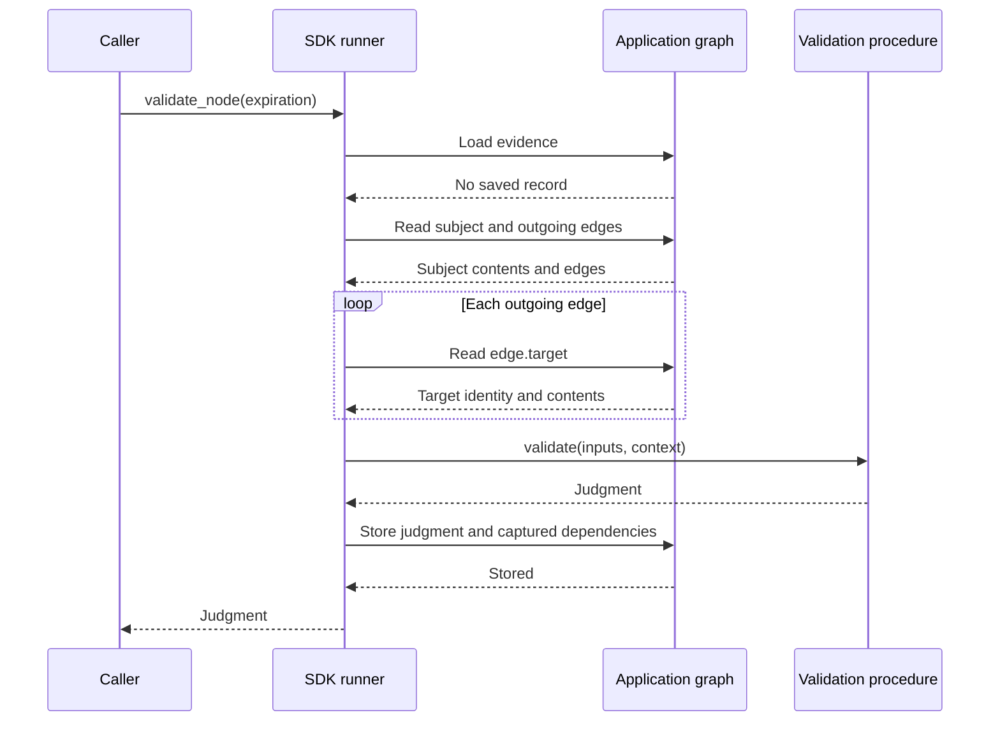
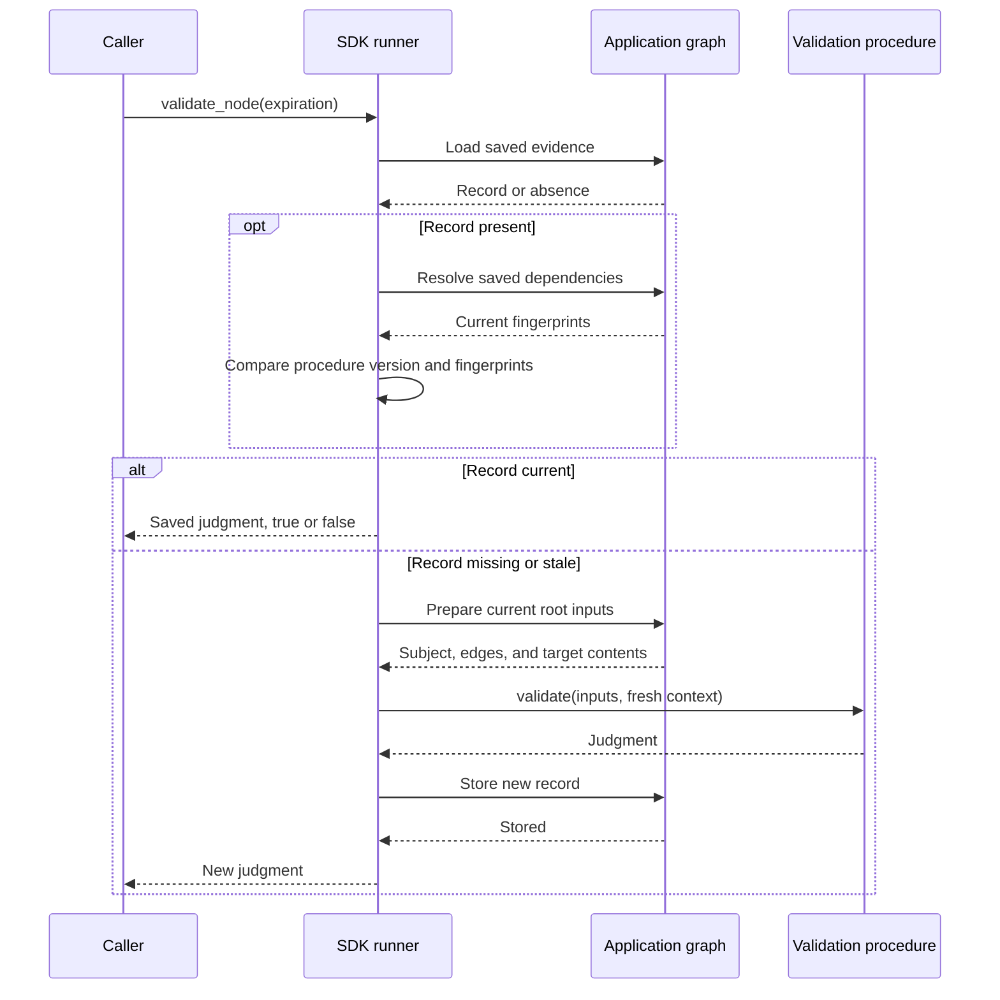

# Validation

Implement `Validation` to decide whether a node meets your application's
criterion. The SDK supplies prepared inputs and a shared context, captures
dependencies, and stores the judgment you return.

## Choose whether to check, validate, or traverse

```rust,ignore
// Check saved evidence without invoking application validation.
let state = checker.check_node(&expiration).await?;

// Reuse current evidence, or validate and save a new record.
let judgment = validator.validate_node(&expiration).await?;

// Apply that lifecycle to every reachable node.
let results = validator.validate_transitive(&expiration, options).await?;
```

The SDK handles freshness, dependency tracking, and persistence. The application
callback decides validity. The sections below follow their interaction; the
[traversal chapter](traversal.md) adds scheduling across connected nodes.

## Let the SDK prepare a validation

Suppose no evidence has been saved for the expiration requirement. The SDK
loads its contents and outgoing inputs, invokes application code, then saves
the result and its dependencies:



The callback receives a `NodeInputs` bundle and a shared `ValidationContext`.
The source identity is in the bundle; each root contains an edge and its
target's contents. The SDK has already recorded these initial observations.

:::{req} check_procedure
`habeas_sdk::graph` MUST expose the following prepared inputs and validation
capability:

```rust,ignore
pub struct RootInput<D: Graph> {
    pub edge: Edge<D::NodeId, D::EdgeLabel>,
    pub contents: D::NodeContent,
}

pub struct NodeInputs<D: Graph> {
    pub source_id: D::NodeId,
    pub source_contents: D::NodeContent,
    pub roots: Vec<RootInput<D>>,
}

pub enum ValidationError<E> {
    Graph(E),
    NoAgentConfigured,
    Agent(String),
}

pub trait Validation: Graph + Fingerprinting + Sized {
    fn validate<'a, 'd>(
        &'a self,
        inputs: &'a NodeInputs<Self>,
        ctx: &'a ValidationContext<'d, Self>,
    ) -> impl Future<Output = Result<
        Judgment<Self::JudgmentMetadata>,
        ValidationError<Self::Error>,
    >> + Send + 'a
    where
        'd: 'a;
}
```

The runner MUST pass the subject identity as `inputs.source_id` and its
contents as `inputs.source_contents`. It MUST include one root entry per
outgoing edge, preserving the edge and supplying the contents of
`root.edge.target` as `root.contents`. Multiple edges
to one target MUST retain separate root entries. These inputs MUST be recorded
as required by {cite}`requirements.sdk.graph.validation.root_inputs`. The callback MUST NOT
require an additional application-defined request or evidence-storage capability.
The procedure MUST remain usable without an `EvidenceStorage` bound.
:::


Going back to our expiration example, the bundle looks like this
(`HabeasEdgeLabel` is the application's label enum):

```rust,ignore
NodeInputs {
    source_id: expiration,
    source_contents: requirement_text,
    roots: vec![
        RootInput {
            edge: Edge {
                label: HabeasEdgeLabel::Implements,
                target: check_token_id,
            },
            contents: implementation_text,
        },
        RootInput {
            edge: Edge {
                label: HabeasEdgeLabel::Tests,
                target: expired_token_is_rejected_id,
            },
            contents: test_text,
        },
    ],
}
```

:::{req} root_inputs
When invoking a node's validation callback, the SDK MUST supply the subject
identity and contents, its outgoing edges, and the contents identified by their
targets. It MUST record the subject read, outgoing-edge selection, and target
reads as dependencies of that validation. A change to the outgoing selection,
including adding an edge to an empty selection, MUST make the prior evidence
stale. Edges supply content inputs; they MUST NOT implicitly supply or require
positive validation judgments for their targets.
:::


## Return the application's judgment

The callback decides what validity means. For Habeas, that can include accepting
a gap with an adequate FIXME acknowledgment. The SDK receives a boolean,
explanation, and application metadata; it does not implement acknowledgment
policy or ask the callback to assemble an evidence record.

:::{req} judgment
`habeas_sdk::graph` MUST expose the following judgment structure, and `Graph`
MUST supply its metadata type:

```rust,ignore
pub struct Judgment<M> {
    pub result: bool,
    pub rationale: String,
    pub metadata: M,
}

pub trait Graph: Send + Sync {
    // ...
    type JudgmentMetadata: Send + Sync;
}
```

A node validation procedure MUST return `Judgment<D::JudgmentMetadata>`.
Its `result` MUST state whether the node satisfies the application's validation
criterion. The application MUST define that criterion and the meaning of the
metadata. Its `rationale` MUST explain the returned result. The SDK MUST
preserve all three fields without reinterpreting metadata as
an alternative result. A failure to execute validation MUST remain an error,
not a `false` judgment. FIXME acknowledgment policy MUST belong to Habeas,
not the SDK's judgment structure.
:::


## Investigate through the context

The callback can use ordinary code, inspect more nodes, ask an agent, or combine
those operations. The context is shared: concurrent operations contribute to
this validation's trace while keeping their request state independent.

```rust,ignore
let helper = ctx.inspection().read(&helper_id)?;

let answer: ExpirationAssessment = ctx.ask()
    .context((&review_policy, &project_conventions))
    .prompt("Does this implementation reject expired tokens?", &agent_inputs)
    .await?;
```

Here the application defines `ExpirationAssessment` as a deserializable,
schema-bearing response type. It also defines its instruction context values.
The example shows how the callback uses the SDK; the builder, context
composition, structured submission, and error contracts live in
[Agent calls](agent-calls.md).

The agent's tools use the same tracked inspection operations as ordinary code.
[Context tools](context-tools.md) accounts for node-content reads,
resource listings, outlines, ripgrep, ast-grep, relationship lookup, and paging.
Independent shell or filesystem reads do not automatically enter the evidence
record; use the tracked interface for information the judgment relies on.

A callback can run without a configured agent if it never sends a prompt.
Sending one without an agent reports `NoAgentConfigured`.

:::{req} deterministic_procedures
The SDK MUST allow `Validation::validate` callbacks to run without a configured
model provider. A callback that does not invoke the agent interface MUST NOT
fail merely because no agent is configured.
:::


## Check or reuse the evidence tomorrow


Suppose we ask the SDK to validate `requirements.auth.expiration`. It first
looks for saved evidence. To decide whether that evidence is current, it checks
the procedure version and resolves the recorded dependencies: the requirement
itself, its outgoing-edge selection, its implementation and test inputs, and any
additional node reads made by the previous review. Resolving these inputs
supplies their current fingerprints, computed from the contents being observed.
The freshness check therefore performs reads before it can reuse a judgment.

If all fingerprints still match, the SDK returns the saved judgment. This
includes a negative judgment: unchanged inputs do not justify rerunning a review
merely because it failed. A procedure-version or dependency mismatch can establish
staleness early, without checking the remaining saved dependencies.

When evidence is missing or stale, the SDK prepares the callback's initial
inputs: the requirement contents, current outgoing edges, and target contents.
Snapshots already obtained during this invocation can be reused when they still
represent the state being validated; any remaining root inputs must be read.
The callback examines those inputs, possibly invokes an agent, and returns a
judgment. The SDK records the new run's observations and stores its evidence.
Freshness checking uses a separate observation scope from the new assessment.
Reads performed only to check old evidence do not become dependencies of the
new judgment. If a checked snapshot is reused as a callback input, its identity
and fingerprint are recorded in the new assessment's trace.



A configured SDK validator provides this lifecycle. The validator uses the graph for node access and evidence storage,
together with the application's validation callbacks. In the method signature below, `NodeId` is its graph's node identity
type, `JudgmentMetadata` is its metadata type, and `Error` covers graph,
callback, and storage failures. These are associated types of the configured
validator interface; the result uses the SDK's `Judgment` structure.

```rust,ignore
let judgment = validator.validate_node(&expiration).await?;
```

`validate_node` concerns this node's judgment. Reading the implementation as an
input does not recursively validate the implementation. The [traversal chapter](traversal.md) adds that traversal explicitly.

:::{req} validate_node
The configured SDK validator MUST expose the following method:

```rust,ignore
fn validate_node<'a>(
    &'a self,
    node: &'a Self::NodeId,
) -> impl Future<Output = Result<Judgment<Self::JudgmentMetadata>, Self::Error>> + Send + 'a;
```

The operation MUST first look up evidence for the requested node and its
configured validation procedure. To establish that evidence is current, it MUST
check the procedure identity and resolve the recorded dependencies to compare
their current fingerprints with the saved fingerprints. If the evidence
is current under {cite}`requirements.sdk.graph.evidence.checking_records`, it MUST
return the stored judgment without invoking the validation callback, including
when that judgment is negative. If evidence is absent or stale, it MUST prepare
the node's contents and outgoing root inputs, invoke the application callback,
construct evidence from the returned judgment and captured dependencies, and
store that evidence before reporting successful completion.
:::

:::{req} validate_node.errors
Storage or input resolution errors MUST be reported as errors rather than
treated as absent or stale evidence. A callback error MUST NOT be stored as a
completed judgment.
:::

## Check evidence in CI without invoking validation

Suppose CI encounters stale evidence for the expiration requirement. It should
report that state, without starting an agent to repair it. The
`check_node` operation uses the same storage lookup and freshness comparison as
`validate_node`, but stops before invoking a callback or saving a replacement.

```rust,ignore
// This SDK operation never calls Validation::validate.
let state = checker.check_node(&expiration).await?;
// state: current judgment, missing evidence, or stale evidence
```

:::{req} check_node
The SDK MUST provide a `check_node` operation that returns a current stored
judgment, a missing-evidence state, or a stale-evidence state. Storage and
input-resolution failures MUST be returned as errors. This operation MUST NOT
invoke validation callbacks, invoke a model, or write evidence, and MUST be
available with only `Graph + Fingerprinting + EvidenceStorage`, without a
`Validation` implementation or configured agent. The SDK MUST perform the
evidence lookup and freshness comparison itself.
:::

A current negative judgment is a successful freshness check but may fail
Habeas's CI policy. Running `validate_node` without an agent can also produce
a new judgment if the callback does not need one. Checking evidence and
producing evidence remain distinct SDK operations.

[Graph traversal](traversal.md) extends this lifecycle to connected nodes,
including cycles and concurrent validations.
