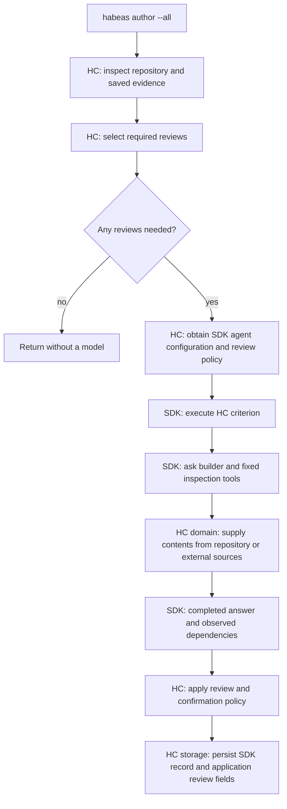
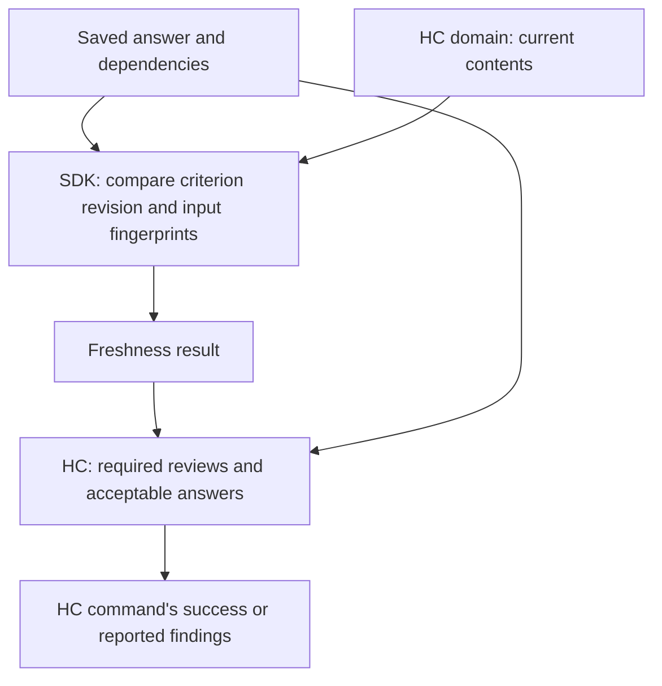
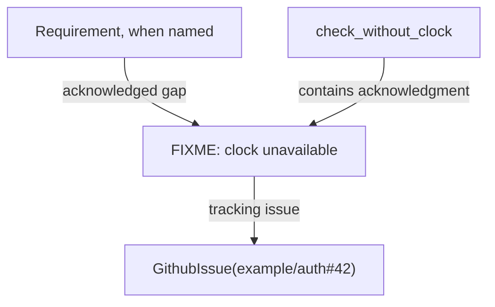

# Putting it together in Habeas Codicem

Habeas Codicem (HC) defines the requirements graph and the policy used by
`habeas author`, `habeas status`, and repository validation. Habeas SDK runs
HC's criteria, provides their inspection tools and configured agents, and
records the inputs used to compute each answer.

## Supply data and validation policy

HC's domain defines its `NodeId`, labeled relationships, `NodeContent`, and
evidence storage. A simplified application model has these shapes; the
particular variants and fields are illustrative:

```rust,ignore
enum HcNodeId {
    Requirement(RequirementId),
    Fixme(FixmeId),
    Source(OutlineId),
    GithubIssue(IssueId),
}

enum HcNodeContent {
    Requirement(RequirementText),
    Fixme(FixmeText),
    Source(SelectedSource),
    GithubIssue(GithubIssueContents),
}

enum HcEdge {
    Impl,
    Test,
    AcknowledgesGap,
    TrackingIssue,
}
```

The domain interprets each identity. Reading a source node uses HC's resource
access and `habeas-sdk-outline` to select from a file snapshot. Reading a
GitHub issue uses HC's GitHub client and cache. Reading a requirement obtains
its declaration. The SDK obtains each value through HC's `Graph`
implementation.

Each returned value implements `NodeContents`. HC's content enum delegates
fingerprinting and formatting to its contained value:

```rust,ignore
impl NodeContents for HcNodeContent {
    fn fingerprint(&self) -> Fingerprint {
        match self {
            Self::Requirement(contents) => contents.fingerprint(),
            Self::Fixme(contents) => contents.fingerprint(),
            Self::Source(contents) => contents.fingerprint(),
            Self::GithubIssue(contents) => contents.fingerprint(),
        }
    }

    fn format(&self) -> String {
        match self {
            Self::Requirement(contents) => contents.format(),
            Self::Fixme(contents) => contents.format(),
            Self::Source(contents) => contents.format(),
            Self::GithubIssue(contents) => contents.format(),
        }
    }
}
```

The SDK supplies these operations for `SelectedSource` under
{cite}`requirements.sdk.outlines.node_contents`. HC supplies them for its issue
data and other application-defined values.

HC's criterion types specify the questions. Its `Context` implementations
supply the review instructions and conventions. HC loads SDK agent
configuration through its own [configuration policy](../configuration.md),
then constructs a validator:

```rust,ignore
let validator = Validator::new(hc_domain).with_agent(agent_config);
let result = validator.verify(review_criterion).await?;

// HC interprets result.output() according to its validation policy.
```

The SDK supplies the agent, fixed tools, paging,
and structured submission. HC performs confirmation, assesses rationales, and
combines answers inside its criteria and command policy. Those computations can
make further `ask` requests with additional `Context` and tracked inputs.

## Follow `habeas author --all`

HC discovers declarations, references, sites, and saved evidence. It selects
reviews needing work and leaves current records alone unless forced.
It resolves agent configuration and credentials only when there is work to author.



For behavioral adequacy, the HC criterion inserts the requirement and its test
nodes. Implementation source is available through the SDK's tools when a
specific question requires it. For structural assessment, HC selects the
implementation roots as mandatory inputs. Reference metadata and acknowledgments
can have their own node contents.

Inside an ask request, the SDK records inputs actually delivered to the agent.
It records a prepared page when its contents are delivered. Deterministic criterion
code reads through `ValidationContext::inspection()` and records the contents
returned to it. Both paths contribute to the enclosing criterion's trace.

## Interpret the completed answer

:::{req} assessment_policy
HC selects the criteria required for each review and interprets their completed
answers according to its validation policy. It applies the required-review and
determination rules under {cite}`requirements.ci.outcomes` and
{cite}`requirements.ci.determination` to decide whether an SDK execution
returning `Ok(value)` constitutes a passing application review.

The SDK's `Criterion::Ok` is an application-defined completed answer under
{cite}`requirements.sdk.graph.validation.output_policy`. An execution error
is distinct from a completed negative assessment.
:::

Freshness is another question. An answer can be current and negative, or
previously favorable and now stale. A missing required review is also an HC
validation finding, independently of whether other records are current.



HC owns the evidence schema and detailed diagnostics. Its storage recognizes
legacy formats and delegates SDK record comparison while retaining
application checks for subject identity, reference roles, coverage, and
acknowledgment consistency.

## Upgrade existing evidence in place

Habeas Codicem's storage adapter recognizes its existing formats temporarily and
converts them to a versioned representation of SDK records at the same evidence
locations.

:::{req} evidence_format
Habeas Codicem uses a versioned JSON representation of the SDK record: procedure
identity, dependencies, and judgment, together with the application-owned
information needed for requirement, example, citation, and site reviews.

| Information retained | Purpose |
| --- | --- |
| Recorded subject identity and text, determination, and rationale | Identify the review and its answer. |
| Reference-set digests | Detect changes to the references supporting it. |
| Citation roles and commentary | Preserve the citation's reviewed meaning. |
| Site queries and applicability | Preserve the scope and outcome of a site review. |
| Recorded input information | Check the inputs applicable to that review kind. |

Equivalent information receives the same application validation in both legacy
and versioned records. Versioned fields can live in application-owned output and SDK
dependencies. Outline inputs retain no
source text in the versioned representation.
:::

:::{req} evidence_format.loading
The versioned representation under
{cite}`requirements.sdk.habeas.evidence_format` is distinguishable from the
unversioned legacy formats under {cite}`requirements.ci.schema`,
{cite}`requirements.references.citation_review`, and
{cite}`requirements.references.site_review`. Habeas Codicem temporarily accepts those
legacy formats for loading alongside the supported versioned format.
:::

:::{req} evidence_format.errors
Malformed records and unsupported format versions return errors. They do not
count as absent evidence and are not retried as a different representation.
:::

:::{req} evidence_conversion
Habeas Codicem supports in-place conversion of legacy evidence to the versioned
representation under {cite}`requirements.sdk.habeas.evidence_format`, preserving
the historical values of its judgments, rationales, recorded inputs, and all
review-specific fields.
:::

:::{req} evidence_conversion.provenance
Conversion preserves history rather than performing a new review. It invokes
no model and needs no model configuration. It reconstructs no missing historical
dependencies from current sources and assigns no current procedure identity
to records lacking one. Missing historical metadata is explicitly identified
as legacy information.
:::

:::{req} evidence_conversion.writes
Conversion writes only through a write-capable migration or authoring path.
Loading for `load_evidence`, CI, status inspection, or book rendering leaves
evidence files unchanged. Authoring with `--stdout` performs no in-place
conversion and creates or changes no evidence files or directories under
{cite}`requirements.authoring.persistence`.
:::

:::{req} evidence_conversion.atomic
A write-capable conversion atomically replaces the selected file at its existing
location. Readers observe either the original complete record or the converted
complete record. Failure before replacement leaves the original file unchanged.
:::

:::{req} evidence_conversion.idempotent
Converting an already-upgraded record leaves the file unchanged.
:::

:::{req} evidence_conversion.legacy_freshness
When loading a supported legacy evidence record that did not capture its
procedure version, Habeas Codicem represents that missing version as `*`.
In-place conversion preserves this wildcard rather than assigning the current
version. The wildcard matches any
requested review revision under
{cite}`requirements.sdk.graph.evidence.checking_records.procedure_match`.
The record is current when its recorded inputs and all existing application
freshness checks still match. Version matching leaves the subject, reference-set,
input, determination, citation, and site checks intact.

For new assessments, Habeas Codicem's validation value supplies a concrete review revision
other than `*`, and the assessment records it.
:::

## Nodes can refer to external state

A GitHub issue is application data just as a source file is. HC defines its
identity and the contents returned by reading it. The SDK's ordinary node-read
tool can present those contents and record their fingerprint.

:::{req} github_nodes
HC represents a GitHub issue by a stable owner, repository, and issue-number
identity. Reading the node supplies the issue's title, opening post, and
open/closed status as one snapshot. HC computes its fingerprint and formatted
text from that supplied snapshot through `Graph`.

For illustration:

```rust,ignore
struct GithubIssueContents {
    title: String,
    opening_post: String,
    status: IssueStatus,
}

enum IssueStatus {
    Open,
    Closed,
}
```
:::

:::{req} github_nodes.inputs
A tracked read of an HC GitHub issue node records its identity and a fingerprint
of the supplied title, opening post, and status under
{cite}`requirements.sdk.graph.evidence.node_inputs`.
Changing any of those supplied fields changes the fingerprint under the same
fingerprinting rules. The fingerprint excludes cache fetch time and TTL;
refetching otherwise unchanged issue contents does not change it.

The fingerprint describes the issue contents supplied under HC's
[redaction policy](../authoring.md#habeas-req-requirements.authoring.redaction),
including the text presented to an agent.
:::

### Link a FIXME to its tracking issue

```rust,ignore
// :::{fixme}
// :github: example/auth#42
// Reject expired tokens when the clock is unavailable.
// :::
fn check_without_clock() { /* ... */ }
```

:::{req} fixme_graph
HC represents a FIXME acknowledgment as a graph node and exposes its tracking
issue relationships as labeled edges to GitHub issue nodes. A named FIXME also
connects the acknowledgment to the requirement whose gap it acknowledges;
an unnamed FIXME connects directly to its tracking issues.
Each issue named by the acknowledgment is available through its tracking edges.
:::



The relationship makes an issue available to a criterion. Selecting the edges
records their target identity set; reading an issue records its contents.

### Check status and relevance separately

:::{req} github_nodes.open
HC's validation policy requires each issue linked by a FIXME to remain open.
A deterministic criterion reads the issue through the SDK's tracked inspection
interface and assesses its supplied status. `Closed` produces a completed
failing assessment; `Open` satisfies this status check. The check does not
require a configured agent.
:::

:::{req} github_nodes.related
HC's FIXME review uses an agent criterion to assess whether each linked issue's
title and opening post describe the FIXME's acknowledged gap. It selects the
FIXME's tracking-issue edges through the SDK's tracked interface and supplies
the FIXME and selected issue contents through tracked reads or ask insertions.

A completed assessment that an issue is unrelated fails that issue's relevance
check.
:::

The two questions have different criterion identities. The following execution
sketch omits those identity and revision methods:

```rust,ignore
let issue = cx.inspection().read(&issue_id)?;
let open = match issue {
    HcNodeContent::GithubIssue(issue) => matches!(issue.status, IssueStatus::Open),
    _ => return Err(unexpected_node_contents()),
};
```

An illustrative relevance request on a FIXME node is:

```rust,ignore
let related: RelevanceAssessment = cx.ask()
    .context(&fixme_review_policy)
    .context("Check whether the linked issues describe this FIXME's gap.")
    .contents_of_current_node()
    .contents_of_successors(HcEdge::TrackingIssue)
    .await?;
```

Once HC observes a refreshed issue snapshot with a changed fingerprint, evidence
recording the earlier snapshot becomes stale. Reevaluating the open-issue
criterion for a closed issue produces a failing assessment. Changes to the
supplied title or opening post invalidate both whole-issue assessments even
when the status remains open. Until refresh, reads can continue observing the
cached snapshot. Both criteria read the whole-issue snapshot.

### Cache issue snapshots in HC

:::{req} github_nodes.cache
HC's issue-content implementation can cache a fetched issue snapshot with a
fetch time and an application-selected TTL. When caching is enabled, reads
within the TTL reuse that snapshot. After expiry, a network-enabled read obtains
a refreshed snapshot before returning contents, or reports a refresh failure.
The returned contents, formatter, and fingerprint remain based on the same
snapshot.
:::

A TTL of about one day is a possible HC policy. Under that policy, a remotely
closed or edited issue may appear unchanged until the cached snapshot expires
or HC explicitly refreshes it. Cache expiry alone is not a content change;
a refreshed snapshot changes evidence only when its fingerprint differs.

<a id="an-edge-carries-an-obligation"></a>
