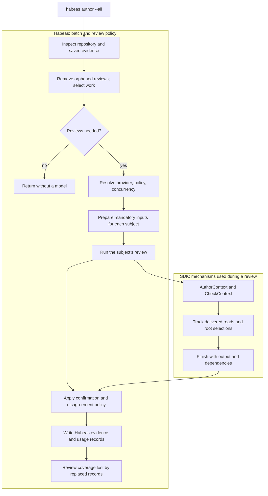
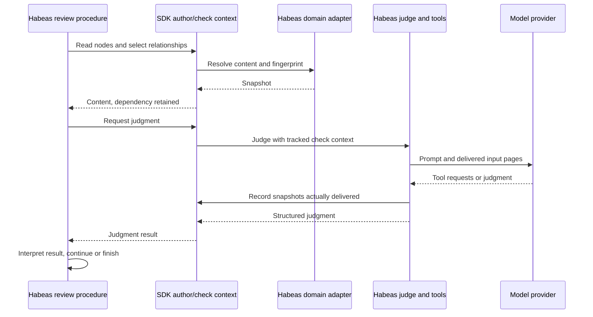
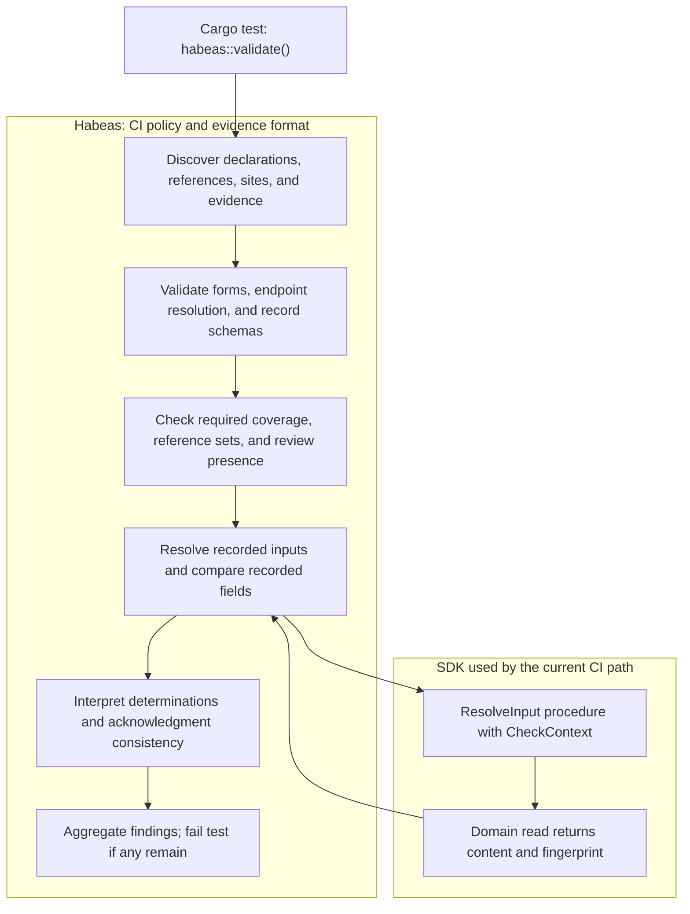
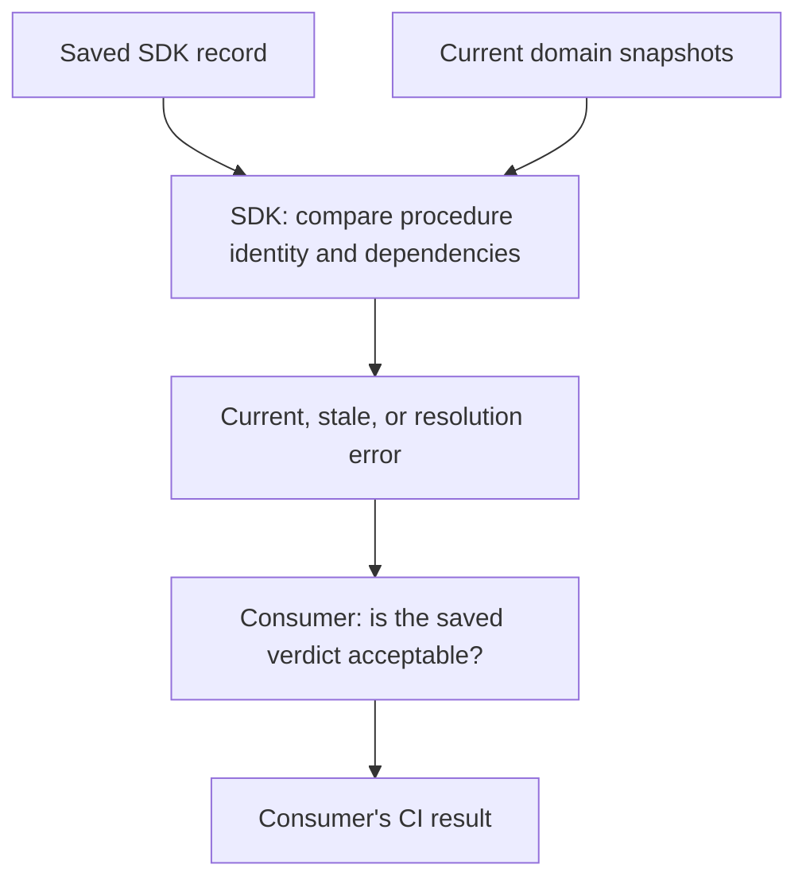

# Putting it together in Habeas

Suppose the body of `check_token` changes after its requirement review was saved.
Running CI reports that the old evidence is stale. Running `habeas author --all`
selects that requirement for another review, gathers its initial inputs, and
invokes the configured agent. The SDK provides the mechanisms described in
[Graph](graph.md) and [Sources](sources.md); Habeas decides which reviews to run
and what their results mean.

## Follow `habeas author --all`

The batch command begins with repository inspection, not model inference.
Habeas discovers the current declarations, references, sites, and evidence;
selects the reviews needing work; and preserves current records unless forced.
It also handles orphaned reviews. When there is nothing to author, it returns
without resolving model configuration or credentials.

The batch scheduler is Habeas code (`src/authoring/batch.rs`). It knows what a
requirement, citation, or site review is, which stale records need replacement,
and what to do with disagreement. None of that follows merely from having a
graph, so extracting the graph does not transfer these decisions to the SDK.

Inside an individual review, the division is more precise:

This is the API boundary the extraction is establishing. In the current port,
Habeas prepares inputs using short-lived check contexts, and `AssessmentJudge`
wraps its existing conversation loop. The adapter imports the exact delivered
inputs and requirement reference-set fingerprint into the authoring context.
It does not re-read inputs after the model has seen them to invent a new digest.
The conversation loop, tool presentation, paging, retries, and provider clients
remain Habeas code (`src/authoring/mod.rs` and its submodules).

That delivery distinction matters to the SDK contract: a prepared page that the
model never receives is not an observed input. A model tool can therefore use
Habeas's delivery adapter to record observations, while a deterministic procedure
can read directly through `CheckContext`.

## Follow the CI test

The project's test calls `habeas::validate()`. It inspects the repository and
reports validation failures; it does not enter the authoring path to fill in
missing or stale evidence.

The diagram groups checks by responsibility; the inspector interleaves these
checks as it visits records and references.

Today, `src/evidence.rs`, `src/citations.rs`, and `src/sites.rs` validate Habeas's
JSON schemas, reference sets, coverage, and judgments. Input resolution goes
through `ResolveInput` and the SDK check context in `src/sdk.rs`. Detailed
comparison and diagnostic wording remain in Habeas.

The SDK also provides `Record` and `record_is_current` for generic dependency
checking. The current CI path does **not** deserialize Habeas evidence into
those records and hand all validation to that method. The intended reusable
operation is narrower than a complete Habeas CI result:

A current negative judgment is still negative. A missing review is still
missing even if every existing record is current. Checking freshness is SDK
machinery; deciding which reviews are required and which judgments satisfy the
project is Habeas policy.
