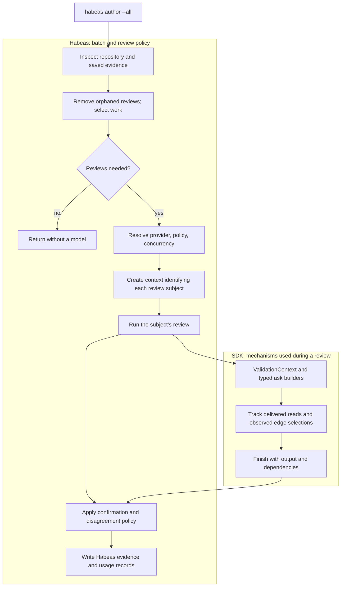
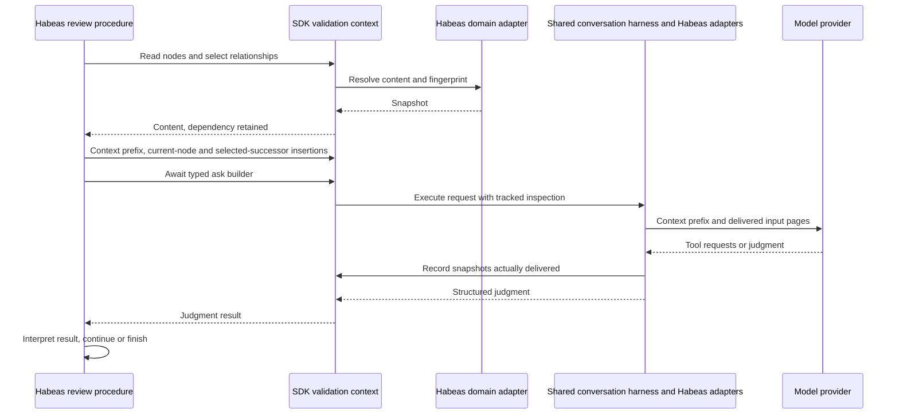
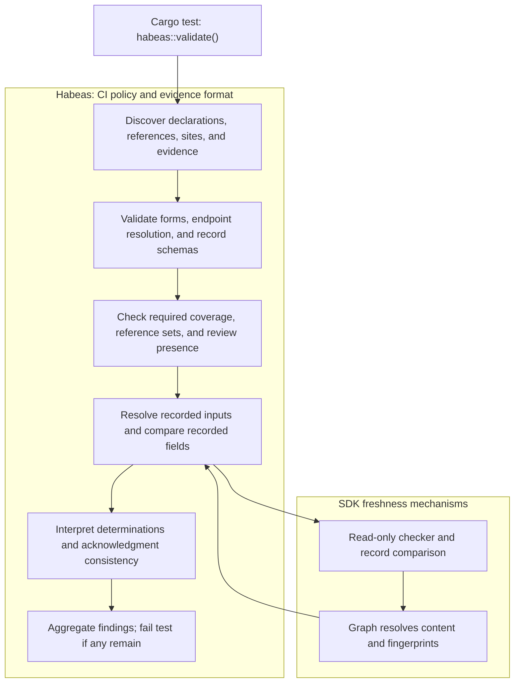
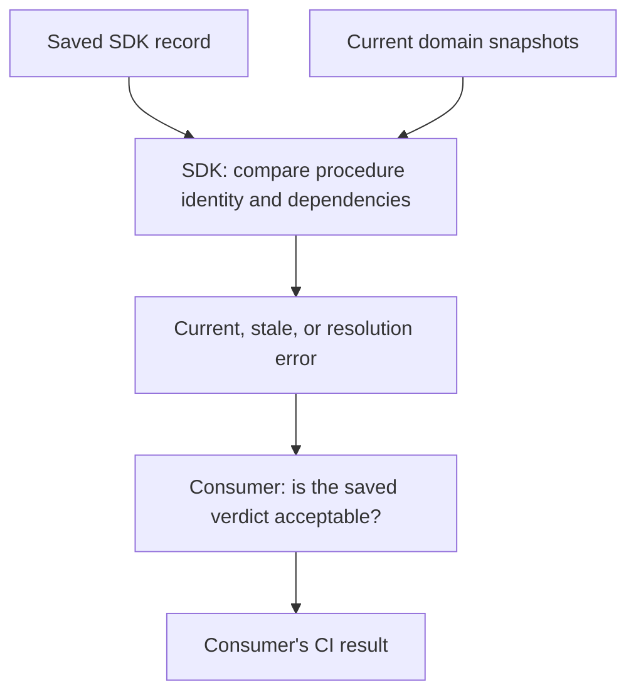
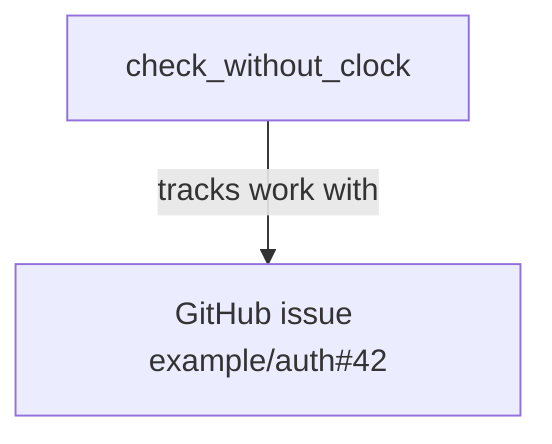

# Putting it together in Habeas

Suppose a test or an explicitly read helper changes after its requirement review was saved.
Running CI reports that the old evidence is stale. Running `habeas author --all`
selects that requirement for another review, gathers its initial inputs, and
invokes the configured agent. The SDK provides the mechanisms described in
[Graph](graph.md) and [Sources](sources.md); Habeas decides which reviews to run
and what their results mean.

## Follow `habeas author --all`

The batch command begins with repository inspection, not model inference.
Habeas discovers the current declarations, references, sites, and evidence;
selects the reviews needing work; and preserves current records unless forced.
It also handles orphaned reviews. When there is nothing to author, it returns
without resolving model configuration or credentials.



The batch scheduler is Habeas code (`src/authoring/batch.rs`). It knows what a
requirement, citation, or site review is, which stale records need replacement,
and what to do with disagreement. None of that follows merely from having a
graph, so extracting the graph does not transfer these decisions to the SDK.

Inside an individual review, the division is more precise:



This is the API boundary the SDK consumer port is establishing. Habeas's
`Validation::validate` callback receives only the context. For a requirement
review, it builds a reusable context prefix from its review instructions and
question, inserts the subject and its mandatory content inputs, then awaits
the builder. Implementation references do not automatically supply source.
Comment-only acknowledgments and reference metadata remain protected by the
reference-set snapshot without reading their containing implementation.

The SDK makes Habeas's conversation harness reusable: tool dispatch, paging,
retries, structured submission, and search accounting support different typed
results. Habeas's adapters retain its prompts, review policy, rationale
correction, `submit_judgment` and `submit_verification` names, and the
`finish_search` gate. The provider clients can remain transport adapters.
Searches still record only the enclosing nodes of explicitly selected excerpts;
tracking search result sets and adding a hook to change that policy are deferred.

The current runtime still uses the earlier `AuthorContext`/`CheckContext` API
and an `AssessmentJudge` wrapper in `src/authoring/mod.rs`. Replacing that
wrapper is part of implementing this destination API; the new SDK record must
retain the actual dependency trace instead of being discarded after extracting
its judgment.

That delivery distinction matters to the SDK contract: a prepared page that the
model never receives is not an observed input. A model tool can therefore use
the harness's delivery adapter to record observations, while a deterministic
procedure can read directly through `ValidationContext::inspection`.

## Follow the CI test

The project's test calls `habeas::validate()`. It inspects the repository and
reports validation failures; it does not enter the authoring path to fill in
missing or stale evidence.



The diagram groups checks by responsibility; the inspector interleaves these
checks as it visits records and references.

`src/evidence.rs`, `src/citations.rs`, and `src/sites.rs` own Habeas's
schemas, reference sets, coverage, and judgments. The consumer port delegates
record freshness to the SDK checker while retaining these application checks
and their detailed diagnostics. Habeas loads missing legacy procedure versions
as `*` under
{cite}`requirements.sdk.habeas.evidence_conversion.legacy_freshness`; the same
SDK comparison handles those records and records with concrete versions.
Checker and validator share the application's procedure-version resolver
independently of model configuration.

The SDK provides `Record` and model-free dependency comparison. The intended
reusable operation is narrower than a complete Habeas CI result:



A current negative judgment is still negative. A missing review is still
missing even if every existing record is current. Checking freshness is SDK
machinery; deciding which reviews are required and which judgments satisfy the
project is Habeas policy.

## Upgrade existing evidence in place

Habeas's storage adapter recognizes its existing formats temporarily and
converts them to a versioned representation of SDK records at the same evidence
locations. The generic filesystem helper's encoded directory layout does not
replace Habeas's filenames.

:::{req} evidence_format
Habeas MUST support a versioned JSON evidence representation that preserves the
SDK record's procedure identity, dependencies, and judgment, together with all
application-owned fields needed for requirement, example, citation, and site
validation. These fields MUST retain recorded subject identity and text, determination,
rationale, reference-set digests, citation roles and commentary, site queries
and applicability, and recorded input information as applicable to the review
kind.

The same application validation rules MUST apply to equivalent information in
the legacy and versioned representations. Versioned fields MAY reside in
judgment metadata and SDK dependencies rather than the legacy top-level layout.
The versioned representation MUST NOT store source text for outline inputs.
:::

:::{req} evidence_format.loading
The versioned representation under
{cite}`requirements.sdk.habeas.evidence_format` MUST be distinguishable from the
unversioned legacy formats under {cite}`requirements.ci.schema`,
{cite}`requirements.references.citation_review`, and
{cite}`requirements.references.site_review`. Habeas MUST temporarily accept
those legacy formats for loading as well as the supported versioned format.
:::

:::{req} evidence_format.errors
Malformed records and unsupported format versions MUST be reported as errors,
rather than treated as absent evidence or retried as a different representation.
:::

:::{req} evidence_conversion
Habeas MUST support in-place conversion of legacy evidence to the versioned
representation under {cite}`requirements.sdk.habeas.evidence_format`, preserving
the historical values of its judgments, rationales, recorded inputs, and all
review-specific fields.
:::

:::{req} evidence_conversion.provenance
Conversion MUST NOT invoke a model, require model configuration, reconstruct
missing historical dependencies from current sources, or assign the current
procedure identity to a record that did not capture one. Missing historical
metadata MUST be identified explicitly as legacy information.
:::

:::{req} evidence_conversion.writes
Conversion MUST occur only through a write-capable migration or authoring path.
Loading evidence for `check_node`, CI, status inspection, or book rendering MUST
NOT replace or convert evidence files. Authoring with `--stdout` MUST NOT perform
in-place conversion or create or change evidence files or directories under
{cite}`requirements.authoring.persistence`.
:::

:::{req} evidence_conversion.atomic
A write-capable conversion MUST replace the selected evidence file atomically
at its existing location. Readers MUST observe either the original complete
record or the converted complete record. If conversion fails before replacement,
it MUST leave the original file unchanged.
:::

:::{req} evidence_conversion.idempotent
Repeating conversion of an already-upgraded record MUST leave the file unchanged.
:::

Dropping support for the old reader can follow after migration. The legacy
procedure version `*` remains distinguishable from a concrete version;
format conversion alone does not establish which review rules produced it.

:::{req} evidence_conversion.legacy_freshness
When loading a supported legacy evidence record that did not capture its
procedure version, Habeas MUST represent that missing version as the stored
procedure identity `*`. In-place conversion MUST preserve that wildcard rather
than assign the current procedure version. The wildcard MUST match any
configured review version under
{cite}`requirements.sdk.graph.evidence.checking_records.procedure_match`.
The record MUST be considered current when its recorded inputs and all
existing application freshness checks still match. This version match MUST NOT
bypass subject, reference-set, input, determination, citation, or site checks.

Habeas's configured procedure-version resolver MUST supply a concrete identity
other than `*` for new assessments, and those assessments MUST record that
identity.
:::

## Nodes can refer to external state

The nodes in the first example came from repository files. A node can also
identify something outside the repository, such as a GitHub issue. Its identity
might be `example/auth#42`; its contents are the issue data fetched from GitHub,
including its description and current state.

For example, an issue-only FIXME connects a source item to its tracking issue:

```rust,ignore
// :::{fixme}
// :github: example/auth#42
// Reject expired tokens when the clock is unavailable.
// :::
fn check_without_clock() { /* ... */ }
```



The source item is one node; the issue is another. Resolving the source node
reads code, while resolving the issue node fetches external data. Both supply
contents that a validation procedure can examine. Neither the node identity nor
the graph abstraction requires those contents to live in a source file.

The application defines the check that uses this relationship. If the check
requires the tracking issue to remain open, it can inspect the fetched state
deterministically. It does not need to ask an agent to determine whether the
state field says `open`.

External inputs also explain why evidence cannot be tied only to a repository
revision. The issue can close without any code changing. A judgment that relies
on the issue being open must account for that state when checking whether its
inputs are still current.

A named FIXME can contribute both relationships: from a requirement to the
source that acknowledges its gap, and from that source to a tracking issue.
The unnamed form above contributes only the issue relationship. The requirement
relationship selects code for review; the issue relationship brings external
state into the graph.

<a id="an-edge-carries-an-obligation"></a>
