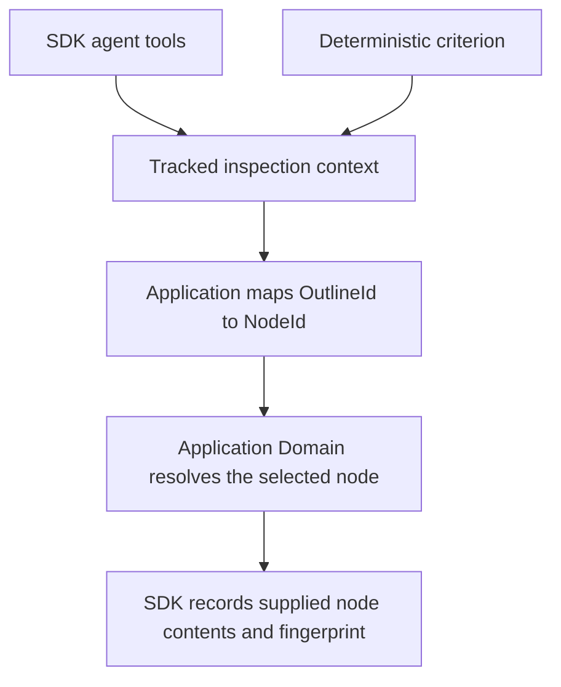

# Sources and inspection

Habeas Codicem owns its graph's node identities and their contents. For a node
such as `Source(src/auth.rs, fn[check_token])`, HC loads an
[`OutlineContent`](outlines.md#load-outline-contents) and returns it as its
application-defined contents. HC supplies those contents through `Domain`;
the SDK's tracked inspection records the read.

Source discovery is useful before a node is known. The SDK supplies the tools
for listing resources, outlining them, and searching text or syntax. The
application supplies resource access and maps discovered source items into its
graph. These are data interfaces used by the fixed SDK tools.

## Identify source resources

:::{definition} resource
:phrase: source resource

A *source resource* is a unit of source identified by
[`ResourceId`](../../rustdocs/trust_but_verify/resource/struct.ResourceId.html) and made
available through a source provider. Its scheme and location identify it
independently of any item within it; its bytes can change without changing
that address. A resource can be a checkout file, a Git revision's file, an
editor buffer, or generated text.
:::

:::{req} source_addresses
`ResourceId` identifies a resource within an application-defined namespace.
The application resolves that address when reading its contents.

```rust,ignore
// Defined in trust_but_verify::resource.
#[derive(Clone, Debug, PartialEq, Eq, serde::Serialize, serde::Deserialize)]
pub struct ResourceId {
    /// Namespace interpreted by the application, such as "repo".
    pub scheme: String,
    /// Address within that namespace, such as "src/auth.rs".
    pub location: String,
}
```

An item within a source file uses the path and selector in `OutlineId` under
{cite}`requirements.sdk.outlines.address_identity`.
:::

```rust,ignore
let resource = ResourceId {
    scheme: "repo".into(),
    location: "src/auth.rs".into(),
};
let function = OutlineId {
    path: "src/auth.rs".into(),
    selector: "fn[check_token]".into(),
};
```

HC exposes repository files through the `repo` namespace and uses
repository-relative paths for their outline identities. The
[outline chapter](outlines.md#identify-a-file-and-item) introduces item
selectors and source contents.

## The application supplies a source provider

:::{definition} source_provider
:phrase: source provider

A *source provider* is the application's resource-access interface for listing
source resources and obtaining their bytes. The SDK's
[`SourceProvider`](../../rustdocs/trust_but_verify/sources/trait.SourceProvider.html)
also supplies reusable parsing and search defaults. A provider can specialize
how those operations execute while preserving their results and scope.
:::

For HC, a provider exposes the repository files available for inspection. It
can reuse the SDK's filesystem provider with HC's root and access rules.
Selected public declarations are:

```rust,ignore
pub trait SourceProvider: Send + Sync {
    type Error: From<SourceError> + Send;

    /// Enumerate resource identities within this scope.
    fn list(
        &self,
        scope: &SourceScope,
    ) -> impl Future<Output = Result<Vec<ResourceId>, Self::Error>> + Send;

    /// Obtain one resource snapshot; an empty resource is a successful read.
    fn read(
        &self,
        resource: &ResourceId,
    ) -> impl Future<Output = Result<SourceFile, Self::Error>> + Send;
}
```

:::{req} provider
The SDK exposes a source-provider interface for enumerating resource identities
within a requested scope and reading resource bytes. Resources need no local
filesystem path.
:::

:::{req} provider.errors
Listing and reading failures are errors, distinct from successful empty
listings and successful reads of empty resources.
:::

:::{req} local_provider
The SDK supplies a local-filesystem provider for listing and reading resources
within an application-selected scope.
:::

## Providers can specialize parsing and search

Source access and source interpretation remain separate even when a provider
uses a cached parse or an existing search index. The SDK's defaults combine
provider access with the outline module.

The following assembly sketch uses the default languages:

```rust,ignore
let sources = SourceAnalysis::new(LocalSources::new(repository_root));
```

:::{req} provider_defaults
Source providers can override parsing, text search, and structural search.
The SDK supplies defaults for all three. Listing and reading, together with
`OutlineContent::from_source`, support parsing and text search. Structural search
additionally uses the selected language's syntax capability under
{cite}`requirements.sdk.outlines.language_provider.structural_search`.
:::

:::{req} provider_defaults.composition
The defaults compose through the provider's operations:

| Default operation | Uses |
| --- | --- |
| Parsing | Provider reading and the outline library's selected language |
| Text search | Provider listing and reading |
| Structural search | Provider listing and parsing, including any parsing override |
:::

:::{req} provider_results
An override preserves the requested scope and semantics, including the selected
language for parsing and structural search.
:::

:::{req} provider_results.parse_snapshot
A parse result retains its resource identity and the root `OutlineContent`
prepared from that resource's source snapshot. A cached parse keeps the
resource, outline, and bytes together under
{cite}`requirements.sdk.outlines.snapshot`.

```rust,ignore
pub struct ParsedSource {
    pub resource: ResourceId,
    pub contents: OutlineContent,
}
```
:::

:::{req} provider_results.search_completeness
Search results distinguish complete results from truncated or incomplete
ones. An operation failure is an error, rather than a complete empty result.
:::

## Connect source items to graph nodes

The application maps discovered source addresses to graph node identities. For HC,
`src/auth.rs` with selector `fn[check_token]` becomes `HcNodeId::Source(address)`.

:::{req} source_nodes
An application supporting SDK source inspection supplies access to its source
provider, a mapping from a resource and selector to `OutlineId`, and a mapping
from `OutlineId` to its graph's `NodeId`. The outline path preserves the
resource's identity across namespaces. The mapped node represents the requested
path and selector; an unsupported or invalid address returns an error. The
SDK's source read uses those mappings and the application's `Domain` interface.

The application owns the mapping and the interpretation of that node's contents.
:::

This trait sketch names these capabilities; its declaration is illustrative:

```rust,ignore
pub trait SourceNodes: Domain {
    type Sources: SourceProvider;

    fn sources(&self) -> &SourceAnalysis<Self::Sources>;
    fn outline_id(
        &self,
        resource: &ResourceId,
        selector: &str,
    ) -> Result<OutlineId, Self::Error>;
    fn source_node(&self, item: &OutlineId) -> Result<Self::NodeId, Self::Error>;
}
```

HC maps resources in its `repo` namespace to repository-relative outline paths.
An application exposing other namespaces can assign distinct logical paths or
report an unsupported mapping.

For a source node, HC's `Domain::node_content` resolves its `OutlineId` and
returns an `OutlineContent`. HC can obtain the snapshot through its source
provider and use `OutlineContent::from_source` followed by `select`, or load a
file's selected item directly with `OutlineContent::from_id`. The returned value
supplies its fingerprint and agent text through `NodeContents` under
{cite}`requirements.sdk.outlines.node_contents`, so the dependency and model
text describe the same read.

:::{req} provider_observations
The tracked source-read operation resolves the selected `OutlineId` through
the application's source-node mapping and reads that node through `Domain`.
Successful reads delivered to the caller record that node's identity and the
fingerprint of its supplied contents, whether obtained from a cache, provider
default, or override.

The graph's recording and freshness contracts apply under
{cite}`requirements.sdk.graph.evidence.node_inputs` and
{cite}`requirements.sdk.graph.evidence.checking_records`.
:::

## Inspection runs through the tracked context

Deterministic criterion code and SDK agent tools use the same inspection
operations. A direct tracked read records its returned input. An agent read
records the prepared input when it is delivered, including any continuation
pages; preparing an undelivered result does not record a read.



Calling the outline module or a source provider directly does not
record evidence. HC uses those libraries inside `node_content`; the enclosing
SDK read records the resulting node observation.

Listing, outlining, and searching help choose nodes to read. The fixed SDK
policy does not record those discovery result sets as evidence inputs.
A subsequent tracked read records the selected node.
[Context tools](graph/context-tools.md) gives each operation's signatures,
returned data, and input-recording semantics.

## Follow a source item into its contents

[Source outlines](outlines.md) introduces `OutlineId`, `OutlineContent`, and
`OutlineLang`, including automatic language selection and explicit language
constructors. Its [language chapters](outlines.md#language-specific-rules)
define the item kinds, selectors, and fingerprints for each supported language.
