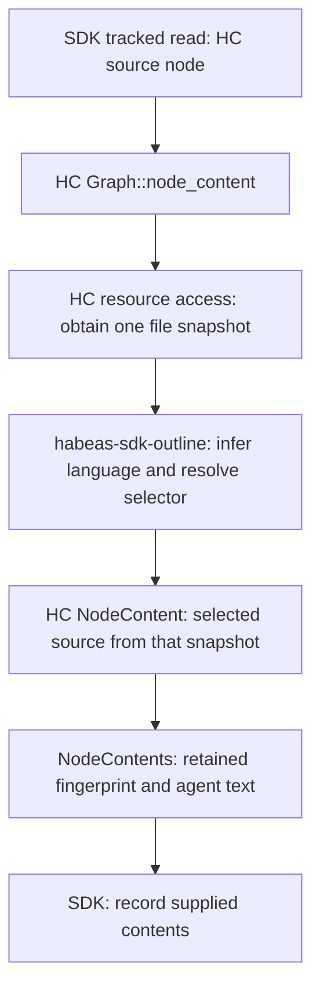
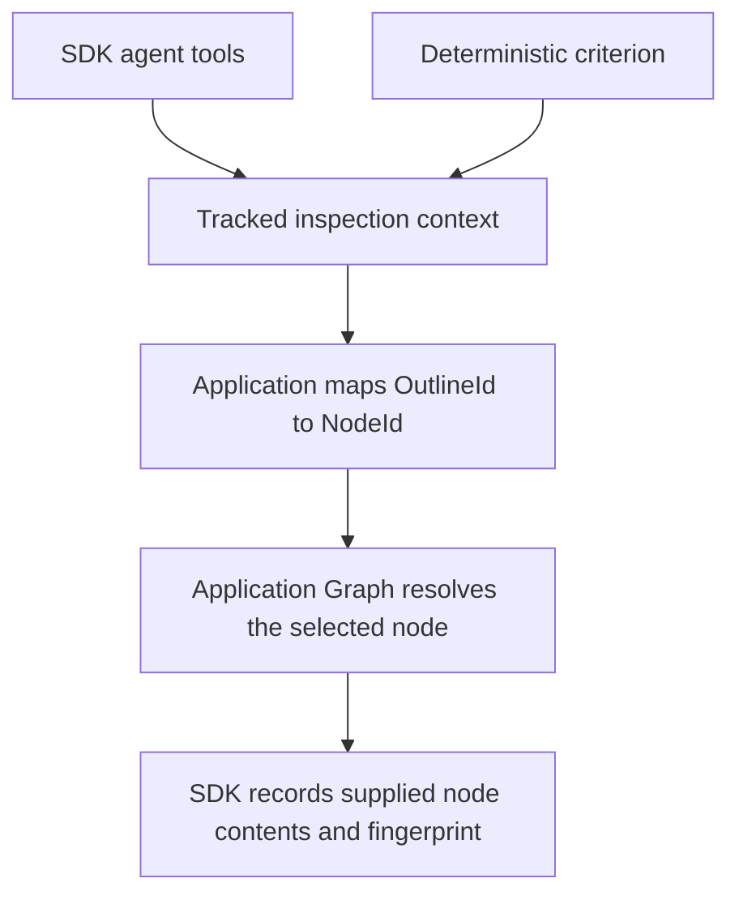

# Sources and inspection

Habeas Codicem owns its graph's node identities and their contents. For a node
such as `Source(src/auth.rs, fn[check_token])`, HC obtains the file snapshot,
asks the [outline library](outlines.md) to resolve the selector, and returns
its application-defined contents. HC supplies those contents through `Graph`;
the SDK's tracked inspection records the read.

Source discovery is useful before a node is known. The SDK supplies the tools
for listing resources, outlining them, and searching text or syntax. The
application supplies resource access and maps discovered source items into its
graph. These are data interfaces used by the fixed SDK tools.

## Separate resource access from language interpretation

:::{definition} resource
:phrase: source resource

A *source resource* is a unit of source identified by
[`ResourceId`](../../rustdocs/habeas_sdk/resource/struct.ResourceId.html) and made
available through a source provider. Its scheme and location identify it
independently of any item within it; its bytes can change without changing
that address. A resource can be a checkout file, a Git revision's file, an
editor buffer, or generated text.
:::

:::{definition} outline
:phrase: source outline

A *source outline* is a structured view of one source snapshot. Its items have
selectors, spans within that snapshot, and structural hashes.
`habeas-sdk-outline` constructs this view using a language implementation or
the plain-text fallback.
:::

HC chooses its repository root, which resources it makes available, and how
to obtain their bytes. A filesystem provider is a convenient implementation;
other applications can provide source from an editor or database.
The outline library interprets supplied source text independently of its origin.



## Identify something before reading it

:::{definition} selector
:phrase: item selector

An *item selector* is an address for an item within a
{term}`requirements.sdk.sources.outline`, such as `fn[check_token]`.
The empty selector addresses the resource root. The resource address and
selector together form an
[`OutlineId`](../../rustdocs/habeas_sdk/resource/struct.OutlineId.html).
Selectors identify items independently of their line numbers; item spans refer
to the snapshot used to build the outline.
:::

```rust,ignore
let function = OutlineId {
    resource: ResourceId {
        scheme: "repo".into(),
        location: "src/auth.rs".into(),
    },
    selector: "fn[check_token]".into(),
};
```

HC interprets `repo` as its repository namespace. Constructing this address
fetches no source and creates no dependency. The address is suitable for a
saved node identity; the resolved document holds the parser and source snapshot.

:::{req} source_addresses
The public resource and source-item addresses are defined in
`habeas_sdk_outline` and re-exported by `habeas_sdk::resource`:

```rust,ignore
#[derive(Clone, Debug, PartialEq, Eq, serde::Serialize, serde::Deserialize)]
pub struct ResourceId {
    /// Namespace interpreted by the application, such as "repo".
    pub scheme: String,
    /// Address within that namespace, such as "src/auth.rs".
    pub location: String,
}

#[derive(Clone, Debug, PartialEq, Eq, serde::Serialize, serde::Deserialize)]
pub struct OutlineId {
    pub resource: ResourceId,
    /// Item within the resource, such as "fn[check_token]".
    pub selector: String,
}
```

The application defines resource resolution, including fetching. The address's
identity is independent of parsed source and runtime language handles under
{cite}`requirements.sdk.outlines.address_identity`.
:::

## The application supplies a source provider

:::{definition} source_provider
:phrase: source provider

A *source provider* is the application's resource-access interface for listing
source resources and obtaining their bytes. The SDK's
[`SourceProvider`](../../rustdocs/habeas_sdk/sources/trait.SourceProvider.html)
also supplies reusable parsing and search defaults. A provider can specialize
how those operations execute while preserving their results and scope.
:::

For HC, a provider exposes the repository files available for inspection. It
can reuse the SDK's filesystem provider with HC's root and access rules.
Selected public declarations are:

```rust,ignore
pub trait SourceProvider: Send + Sync {
    type Error: From<SourceError> + Send;

    /// Enumerate resource identities within this scope.
    fn list(
        &self,
        scope: &SourceScope,
    ) -> impl Future<Output = Result<Vec<ResourceId>, Self::Error>> + Send;

    /// Obtain one resource snapshot; an empty resource is a successful read.
    fn read(
        &self,
        resource: &ResourceId,
    ) -> impl Future<Output = Result<SourceFile, Self::Error>> + Send;
}
```

:::{req} provider
The SDK exposes a source-provider interface for enumerating resource identities
within a requested scope and reading resource bytes. Resources need no local
filesystem path.
:::

:::{req} provider.errors
Listing and reading failures are errors, distinct from successful empty
listings and successful reads of empty resources.
:::

:::{req} local_provider
The SDK supplies a local-filesystem provider for listing and reading resources
within an application-selected scope.
:::

## Register the languages that interpret those resources

:::{definition} language_definition
:phrase: language definition

A *language definition* is an implementation of the outline library's
[`Language`](#habeas-req-requirements.sdk.sources.language_provider) trait: it
names a language, identifies filename extensions, and
interprets supplied source into an outline.
:::

[Source outlines](outlines.md#use-the-default-languages) describes automatic
selection and optional registration of additional languages.

:::{req} language_provider
`habeas-sdk-outline` exposes a language interface implemented by each supplied
language implementation and usable by additional application-defined languages:

```rust,ignore
pub trait Language: Send + Sync {
    /// Stable name for this language implementation.
    fn name(&self) -> &str;

    /// Filename extensions recognized by this implementation, without dots.
    fn extensions(&self) -> &[&str];

    /// Interpret supplied text into outline items and structural hashes.
    fn outline(&self, source: &str) -> Result<Outline, OutlineError>;

    // ... fingerprint_scheme introduced below ...
}
```
:::

:::{req} language_provider.fingerprint_scheme
Each language implementation supplies the scheme identifying its structural-hash
rules and their version. A change to those rules uses a different scheme; an
update preserving the calculation can retain the scheme.

```rust,ignore
pub trait Language: Send + Sync {
    /// Identify the structural-hash rules and their version.
    fn fingerprint_scheme(&self) -> &str;

    // ... other language methods ...
}
```
:::

:::{req} language_provider.structural_search
A language implementation can additionally provide the syntax capability
used by the SDK's structural-search default. Outline-only implementations
remain valid language implementations. Requesting structural search for
a language without that capability returns an unsupported-language error,
rather than a successful empty result.
:::

The trait above shows its outline-facing members.

## Providers can specialize parsing and search

Source access and source interpretation remain separate even when a provider
uses a cached parse or an existing search index. The SDK's defaults combine
provider access with the independent outline library.

The following assembly sketch uses the default languages:

```rust,ignore
let sources = SourceAnalysis::new(LocalSources::new(repository_root));
```

:::{req} provider_defaults
Source providers can override parsing, text search, and structural search.
The SDK supplies defaults for all three. Listing and reading, together with
the default outline parser, support parsing and text search. Structural search
additionally uses the selected language's syntax capability under
{cite}`requirements.sdk.sources.language_provider.structural_search`.
:::

:::{req} provider_defaults.composition
The defaults compose through the provider's operations:

| Default operation | Uses |
| --- | --- |
| Parsing | Provider reading and the outline library's selected language |
| Text search | Provider listing and reading |
| Structural search | Provider listing and parsing, including any parsing override |
:::

:::{req} provider_results
An override preserves the requested scope and semantics, including the selected
language for parsing and structural search.
:::

:::{req} provider_results.parse_snapshot
A parse result retains the source snapshot it describes. A cached parse stays
paired with those same bytes.
:::

:::{req} provider_results.search_completeness
Search results distinguish complete results from truncated or incomplete
ones. An operation failure is an error, rather than a complete empty result.
:::

## Connect source items to graph nodes

The application maps discovered source addresses to graph node identities. For HC,
`src/auth.rs` with selector `fn[check_token]` becomes `HcNodeId::Source(address)`.

:::{req} source_nodes
An application supporting SDK source inspection supplies access to its source
provider and a mapping from `OutlineId` to its graph's `NodeId`. The mapped node
represents the requested resource and selector; an unsupported or invalid
address returns an error. The SDK's source read uses that mapping and the
application's `Graph` interface.

The application owns the mapping and the interpretation of that node's contents.
:::

This trait sketch names the two capabilities; its declaration is illustrative:

```rust,ignore
pub trait SourceNodes: Graph {
    type Sources: SourceProvider;

    fn sources(&self) -> &SourceAnalysis<Self::Sources>;
    fn source_node(&self, item: &OutlineId) -> Result<Self::NodeId, Self::Error>;
}
```

For a source node, HC's `Graph::node_content` obtains a snapshot and invokes
the outline library. The returned selection supplies its fingerprint and agent
text through `NodeContents` under
{cite}`requirements.sdk.outlines.node_contents`, so the dependency and model
text describe the same read.

:::{req} provider_observations
The tracked source-read operation resolves the selected `OutlineId` through
the application's source-node mapping and reads that node through `Graph`.
Successful reads delivered to the caller record that node's identity and the
fingerprint of its supplied contents, whether obtained from a cache, provider
default, or override.

The graph's recording and freshness contracts apply under
{cite}`requirements.sdk.graph.evidence.node_inputs` and
{cite}`requirements.sdk.graph.evidence.checking_records`.
:::

## Inspection runs through the tracked context

Deterministic criterion code and SDK agent tools use the same inspection
operations. A direct tracked read records its returned input. An agent read
records the prepared input when it is delivered, including any continuation
pages; preparing an undelivered result does not record a read.



Calling the independent outline library or a source provider directly does not
record evidence. HC uses those libraries inside `node_content`; the enclosing
SDK read records the resulting node observation.

Listing, outlining, and searching help choose nodes to read. The fixed SDK
policy does not record those discovery result sets as evidence inputs.
A subsequent tracked read records the selected node.
[Context tools](graph/context-tools.md) gives each operation's signatures,
returned data, and input-recording semantics.

## Each language defines its outline

An empty selector identifies the source root. Nested items use slash-separated
segments; reserved characters in names are percent-encoded. Anonymous items use
identity-hash prefixes and duplicate named siblings use occurrence suffixes.
The outline library applies these shared rules and the selected language's
naming, attachment, and comment rules.

The language chapters explain those rules with source examples:

- [Rust](sources/rust.md)
- [Python](sources/python.md)
- [TypeScript and TSX](sources/typescript.md)
- [Markdown](sources/markdown.md)
- [CSS](sources/css.md)
- [TOML](sources/toml.md)
- [YAML](sources/yaml.md)
- [Plain-text fallback](sources/plain-text.md)

[References and Rust items](../references.md) specifies the detailed selector
and structural-hash rules.
