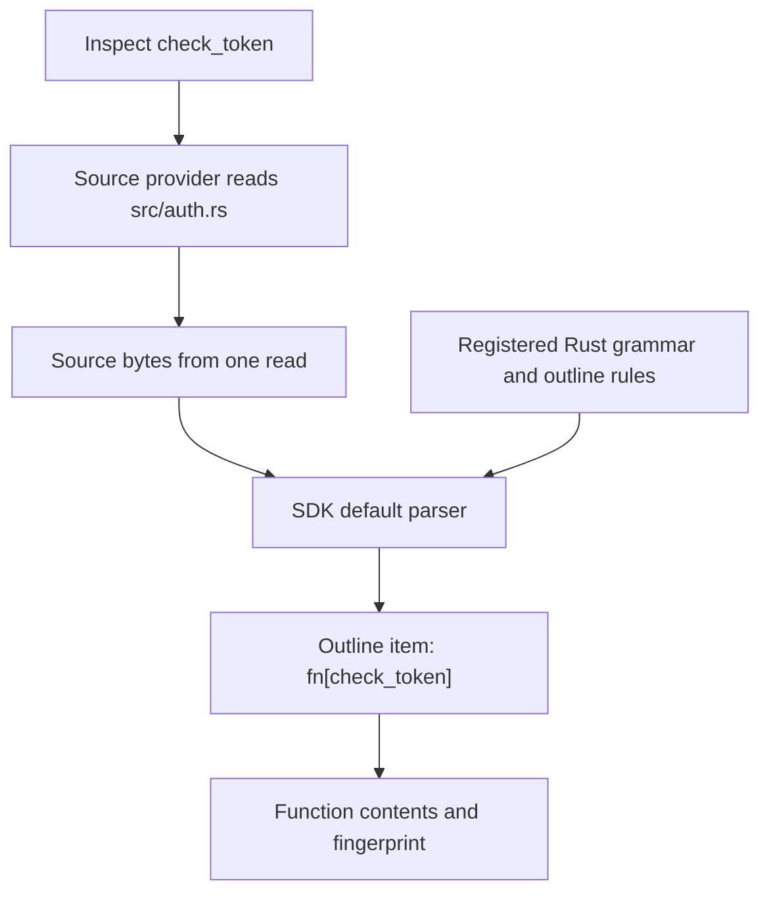
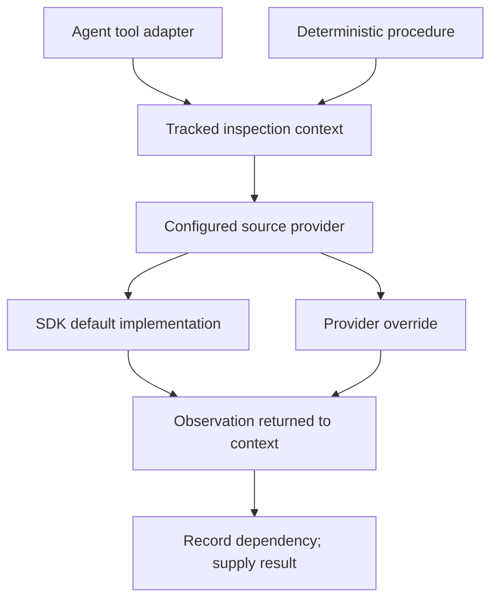

# Sources and inspection

Suppose the agent reviewing our expiration requirement wants to inspect
`check_token` in `src/auth.rs`:

```rust
fn check_token(expires_at: u64, now: u64) -> bool {
    now < expires_at
}
```

The application can read that file, but the review needs the function rather
than an arbitrary range of lines. It may also need to find other calls to
`check_token`. The SDK's source machinery gives these operations a common home:
reading resources, identifying items within them, and searching their contents.

## Separate where content comes from from how it is interpreted

For this example, a local source provider supplies the bytes of `src/auth.rs`.
A registered Rust language definition supplies a tree-sitter grammar and rules
for identifying functions. The SDK's default parser combines them to produce
an outline containing `fn[check_token]`.



These responsibilities generalize beyond a checkout. A provider could read a
Git revision, an editor buffer, generated content, or a database. The same
language definition can interpret Rust from any of those locations. Conversely,
one local provider can serve Rust, Python, and Markdown resources.

The graph has no mandatory source-node variant. Habeas can put
`Source(OutlineId)` in its node identity enum and delegate reads of that variant
to source inspection. Other graph nodes, such as GitHub issues, can be resolved
without passing through a parser at all.

## Identify something before reading it

A declaration and a source item each need an identity. An identity tells us
*which thing* to read; it does not tell us which version we will get. A function
can keep its identity while its body changes.

For source code, the SDK separates the resource from the item within it:

```rust,ignore
let function = OutlineId {
    resource: ResourceId {
        scheme: "repo".into(),
        location: "src/auth.rs".into(),
    },
    selector: "fn[check_token]".into(),
};
```

Here `repo` is a namespace interpreted by Habeas. The location identifies a
resource in that namespace; the selector identifies a function within it.
Another application could resolve `https` resources or use `generated` for the
output of a generator. Constructing an address does not fetch anything.

A graph node does not have to be source code. A requirement might be identified
by its name, and an imported review might be identified by a database key. The
application chooses its node identity type. None of these identities requires a
filename or source span. When we parse text, the resulting outline spans refer
to that particular text snapshot, wherever the text came from.

:::{req} source_addresses
`habeas_sdk::resource` MUST define the following public address types:

```rust,ignore
#[derive(Clone, Debug, PartialEq, Eq)]
pub struct ResourceId {
    pub scheme: String,
    pub location: String,
}

#[derive(Clone, Debug, PartialEq, Eq)]
pub struct OutlineId {
    pub resource: ResourceId,
    pub selector: String,
}
```

The SDK MUST leave resource resolution to the consumer. These structures do not
prescribe URI parsing or resource fetching.
:::

## The application supplies a source provider

For a checkout, listing resources might return `src/auth.rs` and
`tests/auth.rs`; reading either resource returns its bytes. A database-backed
provider could expose the same logical resources without creating local files.
The application chooses the provider and the set of resources it exposes.

The `SourceProvider` interface starts with those two operations:

```rust,ignore
pub trait SourceProvider {
    type Error;

    async fn list(
        &self,
        scope: &SourceScope,
    ) -> Result<Vec<ResourceId>, Self::Error>;

    async fn read(
        &self,
        id: &ResourceId,
    ) -> Result<SourceFile, Self::Error>;

    // Parsing and search methods follow below.
}

pub struct SourceFile {
    pub bytes: Arc<[u8]>,
    pub language: Option<LanguageId>,
}
```

A resource's optional language identifier selects a registered definition
explicitly. This is useful for generated content with no file extension. When
there is no explicit identifier, the registry can select a language using the
resource name. The source provider does not need to implement a grammar.

:::{req} provider
The SDK MUST expose a source-provider interface through which an application
can enumerate resource identities within a requested scope and read a resource's
bytes. The interface MUST support resources that have no local filesystem path.
:::

:::{req} provider.errors
The source-provider interface MUST distinguish listing and reading failures
from successful empty listings and successful reads of empty resources.
:::

The SDK also supplies a local-filesystem implementation. It uses the same
interface as an application-supplied provider, so choosing local storage does
not change the graph model or the inspection operations available to a review.

:::{req} local_provider
The SDK MUST supply a source provider for listing and reading local filesystem
resources within an application-selected scope.
:::

## Register the languages that interpret those resources

For `check_token`, the Rust grammar recognizes a `function_item`; the Rust
outline definition maps it to the kind `fn` and takes its name from the
function's name field. A Python definition maps `function_definition` to `def`.
The shared outline engine uses these mappings to name items and organize them
by their syntactic containment.

An application supplies a collection of these language definitions. The default
collection is convenient for Habeas; a different application can replace it or
register additional languages. In illustrative assembly code:

```rust,ignore
let sources = SourceAnalysis::new(
    LocalSources::new(repository_root),
    LanguageRegistry::new()
        .register(Rust)
        .register(Python),
);
```

`habeas-language` defines the existing provider trait and profile vocabulary.
Each `habeas-language-*` crate supplies a language implementation, and
`habeas-languages` assembles the default collection. A language provider defines
parsing and outline interpretation; a source provider supplies resources and
inspection operations. Neither defines what makes a requirement valid.

:::{req} language_provider
`habeas-language` MUST expose the following provider interface, where `Profile`
describes outline interpretation and `Language` is `tree_sitter::Language`:

```rust,ignore
pub trait LanguageProvider: Sync {
    fn profile(&'static self) -> &'static Profile;
    fn grammar(&self) -> fn() -> Language;
}
```
:::


## Providers can specialize parsing and search

Suppose a database provider already has an index of every call to `check_token`.
Reading every resource to repeat that search would discard the benefit of the
index. Parsing and search therefore belong on the source-provider interface,
with reusable SDK implementations as defaults.

Continuing the illustrative trait above:

```rust,ignore
async fn parse(
    &self,
    id: &ResourceId,
    languages: &LanguageRegistry,
) -> Result<ParsedSource, Self::Error> {
    defaults::parse(self, id, languages).await
}

async fn search_text(
    &self,
    query: &TextQuery,
) -> Result<TextMatches, Self::Error> {
    defaults::search_text(self, query).await
}

async fn search_structure(
    &self,
    query: &StructuralQuery,
    languages: &LanguageRegistry,
) -> Result<StructuralMatches, Self::Error> {
    defaults::search_structure(self, query, languages).await
}
```

The default text search enumerates resources and reads their contents. The
default parser reads a resource and applies its selected language definition.
The default structural search enumerates resources and calls the provider's
parsing operation. A provider that overrides parsing can therefore reuse the
shared structural-search implementation.

:::{req} provider_defaults
The source-provider interface MUST expose overridable parsing, text-search,
and structural-search operations. The SDK MUST supply default implementations
so a provider can support these operations by implementing resource listing
and reading and using a supplied language registry.
:::

:::{req} provider_defaults.composition
Default parsing MUST read through the provider and use the selected language
definition. Default text search MUST use provider listing and reading.
Default structural search MUST use provider listing and parsing, including
a provider's override of parsing.
:::

An override changes how an operation is executed. A database index still needs
to answer the requested search over the requested scope; approximate index
matches can be candidates that the provider verifies. A cached parse must stay
paired with the source bytes it describes. Reading the file again to attach
newer bytes would produce an inconsistent result.

:::{req} provider_results
Provider overrides MUST preserve the requested operation's scope and semantics,
including the selected language definition for parsing and structural search.
:::

:::{req} provider_results.parse_snapshot
A parse result MUST retain the source snapshot it describes. Cached parsing
MUST NOT be paired with bytes from a different source snapshot.
:::

:::{req} provider_results.search_completeness
Search results MUST distinguish complete results from truncated or incomplete
results. An operation failure MUST NOT be reported as a complete empty result.
:::

## Inspection runs through the tracked context

The requirement-review agent asks a tool to read `check_token`. That tool calls
the inspection context, which dispatches to the configured source provider.
Deterministic validation code calls the same context directly. Both routes
observe the same source operations, regardless of whether the provider uses
SDK defaults or optimized implementations.



The graph's [input-recording contracts](graph.md#remember-what-a-procedure-actually-reads)
cover node reads and outgoing-edge selections. Source inspection additionally
tracks search observations under the following contract. Providers execute
operations; the inspection context records their observations. An override cannot bypass
recording merely because it answered from a cache or database.

:::{req} provider_observations
The SDK's tracked inspection context MUST record successful source reads and
search queries, including empty search results, as dependencies of the
assessment. Recording MUST apply whether the provider uses SDK defaults or
overrides. Recorded fingerprints MUST describe the observations returned to
the caller, including whether a search result is complete.
:::

A search observation and a full source read are different inputs. For example,
a procedure may establish that no calls to a forbidden function exist from a
complete empty search result. It must retain that query dependency even though it read
no matching nodes. Adding a matching call changes the result and makes the
saved judgment stale. In contrast, locating a function does not establish that
its full contents were examined.

## Each language defines its outline

For the example at the start, `fn[check_token]` selects the function independently
of its line number. An empty selector selects the resource root. Nested items
use slash-separated segments; reserved characters in names are percent-encoded.
Anonymous items use identity-hash prefixes and duplicate named siblings use
occurrence suffixes.

Node contents are the text supplied to a procedure. A structural fingerprint
captures which changes to that text matter for freshness. Shared structural
hashing ignores ordinary whitespace; language definitions specify comment
handling and the syntax attached to an item. The graph only compares the
resulting fingerprint, without interpreting these language rules.

Each page starts with a source example and its resulting selector, then explains
the language's outline definition:

- [Rust](sources/rust.md)
- [Python](sources/python.md)
- [TypeScript and TSX](sources/typescript.md)
- [Markdown](sources/markdown.md)
- [CSS](sources/css.md)
- [TOML](sources/toml.md)
- [YAML](sources/yaml.md)
- [Plain-text fallback](sources/plain-text.md)

Existing detailed selector and structural-hash requirements remain in
[References and Rust items](../references.md). The
[allocation plan](requirements-map.md) identifies how to separate their shared
rules, language definitions, and Habeas policy. The next chapter
[puts the SDK pieces together in Habeas](habeas.md).
